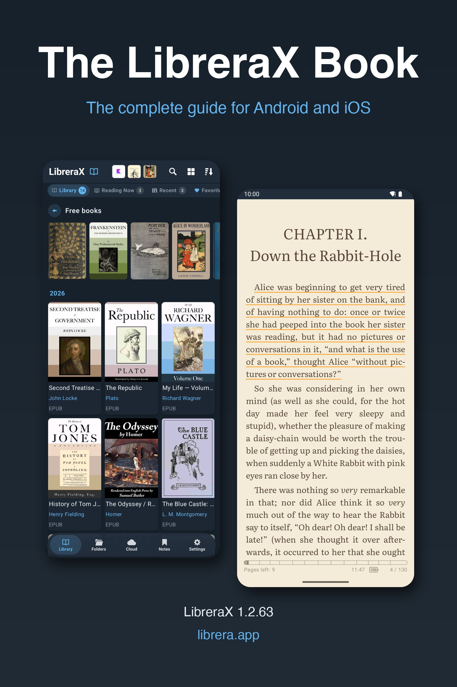

# The LibreraX Book

<p class="lede">The complete guide to LibreraX 1.2.64 for Android and iOS: every screen, option, sort order, field and setting, with screenshots. Read it here, or download it.</p>

<div class="book-downloads">
  <a class="btn btn--primary btn--lg" href="LibreraX-Book.pdf" download>Download PDF · 15 MB</a>
  <a class="btn btn--secondary btn--lg" href="LibreraX-Book.epub" download>Download EPUB · 8 MB</a>
</div>



**The complete guide to LibreraX: every screen, feature, option, sort order, field and setting**

**LibreraX ([iOS](https://apps.apple.com/us/app/librerax/id6815773197), [Android](https://play.google.com/store/apps/details?id=com.librerax))**

**Version:** LibreraX 1.2.63 for Android and iOS  
**Author:** Ivan Ivanenko  
**Web:** [librera.app](https://librera.app)

*Edition of 6 November 2026.*

## About this book

This book describes what LibreraX ([iOS](https://apps.apple.com/us/app/librerax/id6815773197), [Android](https://play.google.com/store/apps/details?id=com.librerax)) does, as the code does it today. Every label in quotes is the exact English text the app shows, every default is the value the app uses when nothing has been chosen, and every limit is the one the app applies. Where the two platforms differ, the text says so, and each part ends with an Android vs iOS table.

**How to read it**

- **Introduction**: what LibreraX is, a map of its features, and how it compares with other readers.
- **Parts 1-6**: one area of the app each: the library, the reading screen, formats/PDF/notes, reading aloud and other devices, OPDS/cloud/editions, and the full Settings reference.
- **Appendix**: a glossary of the terms used in the book.

**Conventions**

| Mark | Meaning |
|---|---|
| "Quoted text" | The exact English label shown in the app |
| **Default** | The value used when the reader has not chosen anything |
| §1.5, 3.B.4 | A section of this book (part number, then section) |
| Android / iOS | Applies to that platform only |
| FREE, PRO 3H, PRO, PRO+ | The app's editions (see §5.C.1) |
| LibreraX | This app: [iOS](https://apps.apple.com/us/app/librerax/id6815773197) (App Store), [Android](https://play.google.com/store/apps/details?id=com.librerax) (Google Play) |
| Librera | The classic app LibreraX follows: [Librera Reader](https://play.google.com/store/apps/details?id=com.foobnix.pdf.reader) (free) and [Librera PRO](https://play.google.com/store/apps/details?id=com.foobnix.pro.pdf.reader) (paid, also the DjVu renderer for LibreraX on Android) |

## What LibreraX is

<div class="shots">
<figure style="width:100%">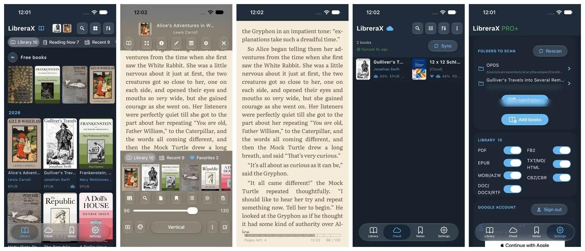<figcaption>LibreraX on iPhone: library, reader, reading page, Cloud and Settings</figcaption></figure>
<figure style="width:28.8%"><figcaption>A video playing inside an EPUB 3 book</figcaption></figure>
</div>

LibreraX ([iOS](https://apps.apple.com/us/app/librerax/id6815773197), [Android](https://play.google.com/store/apps/details?id=com.librerax)) is an e-book reader for **Android** (phones, tablets, Chromebooks, e-ink readers) and **iOS/iPadOS** (iPhone, iPad, and Macs running the iPad app). Both platforms are built from one Kotlin Multiplatform code base, with the user interface in Compose Multiplatform. It follows the classic **[Librera Reader](https://play.google.com/store/apps/details?id=com.foobnix.pdf.reader)** and can bring a Librera profile across.

Design principles visible throughout the code:

1. **One reader for all reflowable text.** EPUB, MOBI/AZW3, FB2, TXT, Markdown, HTML, DOC, DOCX and RTF are all laid out by one shared copy of **foliate-js** inside the platform's own WebView. Themes, fonts, CSS, tap zones, notes, search and read-aloud therefore work the same in every format and on both platforms.
   The same reader plays video and audio built into EPUB 3 books and shows math formulas (MathML) and vector graphics (SVG) (§2.1.1).
2. **Native engines for pages.** PDF uses **PDFium** on Android and **PDFKit** on iOS. Comics (CBZ, CBR) use the same page reader. DjVu opens on Android through an installed [Librera PRO](https://play.google.com/store/apps/details?id=com.foobnix.pro.pdf.reader).
3. **Your files, your folders.** The library is built by scanning only the folders the reader chooses in the system's own secure folder picker (Android's Storage Access Framework, the Files picker on iOS), or single files added by hand. LibreraX needs no permission to read all files. Nothing is imported into a closed store. Metadata edits are written back into the book file.
4. **Your data travels with you.** With a Google (or Apple) account, reading positions, bookmarks, notes, favourites, tags and read marks are synced through LibreraX's cloud. Book files can be kept in the reader's own Google Drive folder `LibreraX/Books`.
5. **Everything configurable.** Tabs, shelves, book actions, tap zones, themes, fonts, status bar, dictionaries and selection tiles can be reordered, renamed, hidden or redefined.

### LibreraX in numbers

| What | Count |
|---|---|
| File extensions recognised | 21 (pdf, epub, mobi, azw, azw3, kf8, prc, fb2, fb2.zip, cbz, cbr, txt, md, html, xhtml, doc, docx, rtf, zip, djvu, djv) |
| Library shelves | 8 (Library, Reading Now, Recent, Favorites, Unread, Read, My tags, Excluded), plus one per tag |
| Display modes | 4 (List, Two columns, Grid, Covers) |
| Grouping modes | 9 (Author, Author last name, Genre, Series, Keywords, Language, My tags, Publisher, Publication Date) |
| Sort options | 13 |
| Search field prefixes | 9 (`@series`, `@genre`, `@author`, `@last_name`, `@tags`, `@keywrods`, `@languages`, `@year`, `@publisher`) |
| Book actions | 12, reorderable and hideable |
| Tap zones | 9 (3 × 3 grid with movable lines), 26 assignable actions |
| Built-in reading themes | 6 (Day, Book, Grey, Dark, Dusk, Black), unlimited own themes |
| Bundled font families | 9 + "Default", plus a folder of the reader's own fonts |
| Hyphenation pattern languages | 76 |
| Built-in web dictionaries | 24 |
| Highlight colours | 7 |
| Built-in OPDS catalogs | 9 |
| Interface languages | 41 in the menu + "System" |

## Feature map

A one-page view of everything in this book, grouped by area. Each line points to the section with the details.

### Library and organisation (Part 1)
- Home tabs: Library, Folders, Cloud, OPDS, Notes, Settings. Reorderable and hideable (§1.1).
- Shelves: Library, Reading Now, Recent, Favorites, Unread, Read, My tags (one shelf per tag), Excluded. Renamable, reorderable, swipeable (§1.3).
- Views: List, Two columns, Grid, Covers. Cover size, cover radius, series pennant, format-coloured placeholders (§1.4).
- Groups: by author, author last name, genre, series, keywords, language, tag, publisher, publication year (§1.5).
- 13 sort options with section headers and a fast scrollbar with a section bubble (§1.6, §1.4.4).
- Search across title, author, series, genre and file name, with `@field` prefixes (§1.7).
- Selection with 12 book actions (§1.8), File info (§1.9), tags/favourites/read marks (§1.10).
- Folder scanning, excluded folders (`.nomedia`), permission re-grant, file browser (§1.11-§1.13).
- Duplicate hiding by author+title or file name; format filter (§1.14).
- App themes (System, Dark, White, Custom with OLED and E-ink styles), accent colours, sizes (§1.15).
- Metadata editor that writes into EPUB, FB2 and PDF, with cover from the book, a file or a link (§1.16).
- Backup/restore of the whole library and settings; import from Librera (§1.17, §1.18).

### Reading (Part 2)
- Top and bottom panels, book strip, seek bar, mode label (§2.3, §2.4).
- 3 × 3 tap zones with 26 actions, gestures, keyboard, mouse wheel, volume keys (§2.5-§2.7).
- Paged or vertical scroll, one or two columns, page animation, text direction (§2.8).
- Full screen, keep-screen-on timer, brightness strip (§2.9, §2.10).
- Status bar: chapter ticks, pages left, clock, battery, page number, or a movable percent label (§2.11).
- Contents, Go to page over rendered previews, Find in book (§2.12-§2.14).
- Reading themes with an editor, WCAG contrast, aged-paper texture, illustrations blended into the page (§2.15, §2.16).
- Typography: 10 font choices, own fonts, size, line spacing, per-side padding, alignment, bold text, hyphenation in 76 languages, user CSS (§2.17-§2.19).
- Inline footnotes, link back-stack (§2.20).
- Selection popup: 7 colours, highlight/underline/strike/note/bookmark, copy, translate, 24 web dictionaries, dictionary apps (§2.21, §2.22).
- Find and replace and highlight rules (§2.23), auto scroll (§2.24), speed reading RSVP (§2.25), accent reading (§2.26).

### Formats, PDF, comics and notes (Part 3)
- Format engine matrix, metadata read and written per format (§3.A).
- PDF/DjVu/comic page reader: zoom, fit, crop margins (auto/manual), half/one/two pages, night recolouring, page reflow, Reflow to EPUB (§3.B).
- Drawing and annotations on pages, saving them into the PDF, editing a PDF's own annotations (§3.B.12-§3.B.15).
- Notes and bookmarks: kinds, colours, the reader's Bookmarks dialog, the Notes tab, storage and sync (§3.C).

### Reading aloud and other devices (Part 4)
- TTS dialog: engine, voice, speed, pitch, sleep timer, pauses, replacement-rule files (§4.3).
- Engine behaviour: what is read, highlighting, automatic page turn, previous/next rules (§4.4).
- Android media session, notification, headset; iOS Now Playing (§4.5, §4.6).
- Home-screen widgets on Android and iOS (§4.7, §4.8). Wear OS and Apple Watch (§4.9). Android Auto and CarPlay (§4.10).
- Automation apps, opening books from other apps, Librera integration, e-ink devices (§4.11-§4.15).

### Catalogs, cloud and editions (Part 5)
- OPDS: built-in catalogs, adding with discovery, login, proxy, browsing, search, downloads, "Free books" strip (§5.A).
- Cloud: Google/Apple sign-in, what is synced, conflict rules, Google Drive books, Wi-Fi only, account deletion (§5.B).
- Editions: FREE, PRO 3H, PRO, PRO+; ads, consent, reward-video trial, subscriptions, licences (§5.C).

### Settings (Part 6)
- Every Settings card in screen order with its choices and defaults, the interface languages and backup.

## Table of contents

  - [About this book](#about-this-book)
  - [What LibreraX is](#what-librerax-is)
    - [LibreraX in numbers](#librerax-in-numbers)
  - [Feature map](#feature-map)
    - [Library and organisation (Part 1)](#library-and-organisation-part-1)
    - [Reading (Part 2)](#reading-part-2)
    - [Formats, PDF, comics and notes (Part 3)](#formats-pdf-comics-and-notes-part-3)
    - [Reading aloud and other devices (Part 4)](#reading-aloud-and-other-devices-part-4)
    - [Catalogs, cloud and editions (Part 5)](#catalogs-cloud-and-editions-part-5)
    - [Settings (Part 6)](#settings-part-6)
  - [Comparison with other book readers](#comparison-with-other-book-readers)
- **[Part 1 — The library](#part-1--the-library)**
  - [1.1 Home screen and navigation bar](#11-home-screen-and-navigation-bar)
    - [1.1.1 Tabs](#111-tabs)
    - [1.1.2 Bar styles](#112-bar-styles)
    - [1.1.3 Back button behaviour](#113-back-button-behaviour)
    - [1.1.4 Full screen](#114-full-screen)
  - [1.2 Library tab — layout overview](#12-library-tab--layout-overview)
    - [1.2.1 Reading Now strip (in the top bar)](#121-reading-now-strip-in-the-top-bar)
    - [1.2.2 Read-aloud header](#122-read-aloud-header)
    - [1.2.3 Title icon = groups toggle](#123-title-icon--groups-toggle)
  - [1.3 Shelves (Library tabs)](#13-shelves-library-tabs)
    - [1.3.1 Shelf list](#131-shelf-list)
    - [1.3.2 Long-press on a chip](#132-long-press-on-a-chip)
    - [1.3.3 Lead buttons on the strip](#133-lead-buttons-on-the-strip)
    - [1.3.4 Library tabs settings (Settings → "Library tabs")](#134-library-tabs-settings-settings--library-tabs)
    - [1.3.5 Search interaction with chips](#135-search-interaction-with-chips)
    - [1.3.6 "Free books" strip (Discover)](#136-free-books-strip-discover)
  - [1.4 Display (view) modes](#14-display-view-modes)
    - [1.4.1 What each card shows](#141-what-each-card-shows)
    - [1.4.2 Page count shown](#142-page-count-shown)
    - [1.4.3 Section headers](#143-section-headers)
    - [1.4.4 Fast scrollbar](#144-fast-scrollbar)
    - [1.4.5 Cover placeholders](#145-cover-placeholders)
  - [1.5 Groups mode (browse by metadata)](#15-groups-mode-browse-by-metadata)
    - [1.5.1 Author name parsing](#151-author-name-parsing)
  - [1.6 Sorting](#16-sorting)
    - [1.6.1 Library sort options (menu order)](#161-library-sort-options-menu-order)
  - [1.7 Search](#17-search)
  - [1.8 Selection and book actions](#18-selection-and-book-actions)
    - [1.8.1 Book actions (default order)](#181-book-actions-default-order)
    - [1.8.2 Delete dialog](#182-delete-dialog)
    - [1.8.3 Opening a book whose file is gone](#183-opening-a-book-whose-file-is-gone)
  - [1.9 File info](#19-file-info)
    - [1.9.1 Window](#191-window)
    - [1.9.2 Header](#192-header)
    - [1.9.3 Fields (shown only when not empty, in this order)](#193-fields-shown-only-when-not-empty-in-this-order)
  - [1.10 Tags, favourites, read marks](#110-tags-favourites-read-marks)
    - [1.10.1 Tags editor ("My tags")](#1101-tags-editor-my-tags)
    - [1.10.2 Favourites](#1102-favourites)
    - [1.10.3 Read marks](#1103-read-marks)
    - [1.10.4 Marks shared between copies](#1104-marks-shared-between-copies)
  - [1.11 Adding books and library folders](#111-adding-books-and-library-folders)
    - [1.11.1 Where the buttons are](#1111-where-the-buttons-are)
    - [1.11.2 "Add folders"](#1112-add-folders)
    - [1.11.3 "Add books"](#1113-add-books)
    - [1.11.4 Folder permission lost (Android)](#1114-folder-permission-lost-android)
  - [1.12 Folders tab (file browser)](#112-folders-tab-file-browser)
    - [1.12.1 Top bar](#1121-top-bar)
    - [1.12.2 Selection in the Folders tab](#1122-selection-in-the-folders-tab)
  - [1.13 Scanning](#113-scanning)
    - [1.13.1 When a scan runs](#1131-when-a-scan-runs)
    - [1.13.2 Which files count](#1132-which-files-count)
    - [1.13.3 What you see during and after a scan](#1133-what-you-see-during-and-after-a-scan)
    - [1.13.4 Metadata sources](#1134-metadata-sources)
    - [1.13.5 Excluded folders](#1135-excluded-folders)
  - [1.14 Duplicates and formats](#114-duplicates-and-formats)
    - [1.14.1 "Hide duplicates" (Settings → Other settings)](#1141-hide-duplicates-settings--other-settings)
    - [1.14.2 Formats filter](#1142-formats-filter)
    - [1.14.3 "Hide Cloud books in Library"](#1143-hide-cloud-books-in-library)
  - [1.15 Appearance: themes, sizes, covers](#115-appearance-themes-sizes-covers)
    - [1.15.1 "Theme"](#1151-theme)
    - [1.15.2 Custom theme](#1152-custom-theme)
    - [1.15.3 Sizes](#1153-sizes)
    - [1.15.4 Other appearance switches (Settings → "Other settings")](#1154-other-appearance-switches-settings--other-settings)
    - [1.15.5 Covers](#1155-covers)
  - [1.16 Metadata editor ("Edit metadata")](#116-metadata-editor-edit-metadata)
  - [1.17 Backup and restore](#117-backup-and-restore)
  - [1.18 Import from Librera (Android only)](#118-import-from-librera-android-only)
  - [1.19 Settings that belong to the library (summary)](#119-settings-that-belong-to-the-library-summary)
  - [1.20 Android vs iOS differences](#120-android-vs-ios-differences)
  - [1.21 Notable details and edge cases](#121-notable-details-and-edge-cases)
- **[Part 2 — Reading](#part-2--reading)**
  - [2.1 Which books open in the reflowable reader](#21-which-books-open-in-the-reflowable-reader)
    - [2.1.1 Video, audio, formulas and vector graphics](#211-video-audio-formulas-and-vector-graphics)
  - [2.2 Screen layout at a glance](#22-screen-layout-at-a-glance)
  - [2.3 Top panel](#23-top-panel)
  - [2.4 Bottom panel (footer)](#24-bottom-panel-footer)
  - [2.5 Tap zones](#25-tap-zones)
    - [Default layout](#default-layout)
    - [All assignable actions](#all-assignable-actions)
    - [Rules](#rules)
    - [The "Tap zones" editor](#the-tap-zones-editor)
  - [2.6 Gestures in the page](#26-gestures-in-the-page)
  - [2.7 Keyboard, mouse wheel and volume keys](#27-keyboard-mouse-wheel-and-volume-keys)
    - [Keyboard (tablets with a keyboard, Mac running the iPad app)](#keyboard-tablets-with-a-keyboard-mac-running-the-ipad-app)
    - [Mouse wheel / trackpad](#mouse-wheel--trackpad)
    - [Volume keys (Android only)](#volume-keys-android-only)
  - [2.8 Paged vs scroll, columns, page-turn animation, RTL](#28-paged-vs-scroll-columns-page-turn-animation-rtl)
    - [Paged and Vertical (scroll) modes](#paged-and-vertical-scroll-modes)
    - [Two pages (columns)](#two-pages-columns)
    - [Page-turn animation](#page-turn-animation)
    - [Reading direction ("Orientation")](#reading-direction-orientation)
  - [2.9 Full screen, keep screen on](#29-full-screen-keep-screen-on)
  - [2.10 Brightness](#210-brightness)
  - [2.11 Status bar and progress display](#211-status-bar-and-progress-display)
    - [Full bar](#full-bar)
    - [Percent mode](#percent-mode)
    - [2.11.1 Configuring the status bar, step by step](#2111-configuring-the-status-bar-step-by-step)
    - [What "pages" mean in reflowable books](#what-pages-mean-in-reflowable-books)
  - [2.12 Table of contents ("Contents")](#212-table-of-contents-contents)
  - [2.13 Go to page and the page previews grid](#213-go-to-page-and-the-page-previews-grid)
  - [2.14 Search in book ("Find")](#214-search-in-book-find)
  - [2.15 Reading themes](#215-reading-themes)
    - [Built-in themes](#built-in-themes)
    - [Choosing a theme](#choosing-a-theme)
    - [Themes section (Settings -> "Themes")](#themes-section-settings---themes)
    - [Theme editor ("New theme" / "Edit theme")](#theme-editor-new-theme--edit-theme)
    - [How themes look in the book](#how-themes-look-in-the-book)
  - [2.16 Paper texture and illustrations](#216-paper-texture-and-illustrations)
    - [2.16.1 "Paper"](#2161-paper)
    - [2.16.2 "Replace white in images with page color" (multiply illustrations)](#2162-replace-white-in-images-with-page-color-multiply-illustrations)
  - [2.17 Typography](#217-typography)
    - [Font family](#font-family)
    - [2.17.1 Fallback fonts](#2171-fallback-fonts)
    - [Size, spacing, margins](#size-spacing-margins)
    - [Alignment](#alignment)
    - [Bold text](#bold-text)
    - [Hyphenation](#hyphenation)
  - [2.18 User fonts](#218-user-fonts)
  - [2.19 User CSS](#219-user-css)
  - [2.20 Footnotes and links](#220-footnotes-and-links)
  - [2.21 Text selection and the selection popup](#221-text-selection-and-the-selection-popup)
    - [Built-in web dictionaries (open in the browser)](#built-in-web-dictionaries-open-in-the-browser)
    - [Installed apps (Android only)](#installed-apps-android-only)
  - [2.22 Highlights, underline, strikethrough, notes, bookmarks](#222-highlights-underline-strikethrough-notes-bookmarks)
    - ["Bookmarks" dialog](#bookmarks-dialog)
  - [2.23 Find and replace rules ("Replace")](#223-find-and-replace-rules-replace)
  - [2.24 Auto scroll](#224-auto-scroll)
  - [2.25 Speed reading (RSVP)](#225-speed-reading-rsvp)
  - [2.26 Accent reading (accent view)](#226-accent-reading-accent-view)
  - [2.27 Relayout pages (PDF only, for reference)](#227-relayout-pages-pdf-only-for-reference)
  - [2.28 The reader Settings dialog, complete layout](#228-the-reader-settings-dialog-complete-layout)
    - [2.28.1 Window size: double-tap the title](#2281-window-size-double-tap-the-title)
  - [2.29 Global vs per-book](#229-global-vs-per-book)
  - [2.30 Platform differences (Android vs iOS)](#230-platform-differences-android-vs-ios)
  - [2.31 Power-user notes](#231-power-user-notes)
- **[Part 3 — Formats, PDF and comics, notes and bookmarks](#part-3--formats-pdf-and-comics-notes-and-bookmarks)**
  - [3.A Formats](#3a-formats)
    - [3.A.1 Master list of extensions](#3a1-master-list-of-extensions)
    - [3.A.2 Formats at a glance](#3a2-formats-at-a-glance)
    - [3.A.3 Which reader opens which file](#3a3-which-reader-opens-which-file)
    - [3.A.4 Format details and limits](#3a4-format-details-and-limits)
    - [3.A.5 Platform differences (formats)](#3a5-platform-differences-formats)
    - [3.A.6 Metadata writing ("Edit metadata")](#3a6-metadata-writing-edit-metadata)
    - [3.A.7 Comic metadata (ComicInfo.xml + file name)](#3a7-comic-metadata-comicinfoxml--file-name)
    - [3.A.8 Office file-name metadata](#3a8-office-file-name-metadata)
    - [3.A.9 Calibre metadata.opf](#3a9-calibre-metadataopf)
    - [3.A.10 Library "Formats" switches](#3a10-library-formats-switches)
  - [3.B PDF and page-image reader (PDF, DjVu, CBZ, CBR)](#3b-pdf-and-page-image-reader-pdf-djvu-cbz-cbr)
    - [3.B.1 Capability matrix by format](#3b1-capability-matrix-by-format)
    - [3.B.2 Reading modes and the mode button](#3b2-reading-modes-and-the-mode-button)
    - [3.B.3 Page layout menu (bottom panel layout icon)](#3b3-page-layout-menu-bottom-panel-layout-icon)
    - [3.B.4 Zoom and fitting](#3b4-zoom-and-fitting)
    - [3.B.5 Crop margins](#3b5-crop-margins)
    - [3.B.6 Gap between pages](#3b6-gap-between-pages)
    - [3.B.7 Colours: themes, night recolouring, Paper, Bold text](#3b7-colours-themes-night-recolouring-paper-bold-text)
    - [3.B.8 Page previews ("Go to page")](#3b8-page-previews-go-to-page)
    - [3.B.9 Text selection (PDF, DjVu)](#3b9-text-selection-pdf-djvu)
    - [3.B.10 Reflow pages (in-reader text reflow)](#3b10-reflow-pages-in-reader-text-reflow)
    - [3.B.11 Reflow to EPUB (PDF only)](#3b11-reflow-to-epub-pdf-only)
    - [3.B.12 Annotations on PDF / DjVu / comics — overview](#3b12-annotations-on-pdf--djvu--comics--overview)
    - [3.B.13 Draw mode and the Draw bar](#3b13-draw-mode-and-the-draw-bar)
    - [3.B.14 Saving annotations into the PDF file](#3b14-saving-annotations-into-the-pdf-file)
    - [3.B.15 Editing annotations already inside a PDF ("PDF editing")](#3b15-editing-annotations-already-inside-a-pdf-pdf-editing)
    - [3.B.16 Comic reading options](#3b16-comic-reading-options)
    - [3.B.17 Other page-reader details](#3b17-other-page-reader-details)
  - [3.C Notes and bookmarks](#3c-notes-and-bookmarks)
    - [3.C.1 What kinds of marks exist](#3c1-what-kinds-of-marks-exist)
    - [3.C.2 Colours](#3c2-colours)
    - [3.C.3 How marks are drawn](#3c3-how-marks-are-drawn)
    - [3.C.4 Selection toolbar (both readers)](#3c4-selection-toolbar-both-readers)
    - [3.C.5 Bookmarks dialog inside the reader](#3c5-bookmarks-dialog-inside-the-reader)
    - [3.C.6 Bookmarks (Notes) screen — main app tab](#3c6-bookmarks-notes-screen--main-app-tab)
    - [3.C.7 Sync](#3c7-sync)
- **[Part 4 — Reading aloud, widgets, watches, cars and integrations](#part-4--reading-aloud-widgets-watches-cars-and-integrations)**
  - [4.1 Overview](#41-overview)
  - [4.2 Where Read Aloud lives in the app](#42-where-read-aloud-lives-in-the-app)
    - [4.2.1 Background reading (leaving the book while it is being read)](#421-background-reading-leaving-the-book-while-it-is-being-read)
  - [4.3 The "TTS" dialog](#43-the-tts-dialog)
    - [4.3.1 Overflow menu](#431-overflow-menu)
    - [4.3.2 First card: voice](#432-first-card-voice)
    - [4.3.3 Voice picker](#433-voice-picker)
    - [4.3.4 Second card: reading behaviour](#434-second-card-reading-behaviour)
    - [4.3.5 Sleep timer behaviour](#435-sleep-timer-behaviour)
    - [4.3.6 Replacement rules ("Replace" editor)](#436-replacement-rules-replace-editor)
    - [4.3.7 "Pause after" dialog](#437-pause-after-dialog)
    - [4.3.8 On-page TTS buttons](#438-on-page-tts-buttons)
  - [4.4 How reading works (engine behaviour)](#44-how-reading-works-engine-behaviour)
    - [4.4.1 What is read](#441-what-is-read)
    - [4.4.2 Highlighting and following the voice](#442-highlighting-and-following-the-voice)
    - [4.4.3 Automatic page/chapter turn](#443-automatic-pagechapter-turn)
    - [4.4.4 Previous / next semantics (important difference between controls)](#444-previous--next-semantics-important-difference-between-controls)
    - [4.4.5 Resume](#445-resume)
  - [4.5 Android media session, notification and headset](#45-android-media-session-notification-and-headset)
    - [4.5.1 Notification](#451-notification)
    - [4.5.2 Media session (lock screen, quick settings media player, Bluetooth, car)](#452-media-session-lock-screen-quick-settings-media-player-bluetooth-car)
    - [4.5.3 Headset and media keys](#453-headset-and-media-keys)
    - [4.5.4 Audio focus](#454-audio-focus)
    - [4.5.5 "Last-read book"](#455-last-read-book)
  - [4.6 iOS Now Playing, lock screen and remote commands](#46-ios-now-playing-lock-screen-and-remote-commands)
  - [4.7 Android home-screen widgets](#47-android-home-screen-widgets)
    - [4.7.1 Shelf widget](#471-shelf-widget)
    - [4.7.2 Book widget](#472-book-widget)
    - [4.7.3 Read-aloud (TTS) widget](#473-read-aloud-tts-widget)
  - [4.8 iOS home-screen widgets](#48-ios-home-screen-widgets)
  - [4.9 Watch apps](#49-watch-apps)
    - [4.9.1 Wear OS (Android)](#491-wear-os-android)
    - [4.9.2 Apple Watch](#492-apple-watch)
  - [4.10 Cars](#410-cars)
    - [4.10.1 Android Auto (PRO edition only)](#4101-android-auto-pro-edition-only)
    - [4.10.2 CarPlay (iOS)](#4102-carplay-ios)
  - [4.11 Automation (Android)](#411-automation-android)
  - [4.12 Opening books from other apps, "Open with" and sending](#412-opening-books-from-other-apps-open-with-and-sending)
    - [4.12.1 Android: LibreraX as a book viewer](#4121-android-librerax-as-a-book-viewer)
    - [4.12.2 iOS: document types and URL scheme](#4122-ios-document-types-and-url-scheme)
    - [4.12.3 "Open with" and "Send file"](#4123-open-with-and-send-file)
  - [4.13 Integration with Librera (the classic app)](#413-integration-with-librera-the-classic-app)
    - [4.13.1 Librera's "LibreraX reading mode"](#4131-libreras-librerax-reading-mode)
    - [4.13.2 Librera's "Export to LibreraX"](#4132-libreras-export-to-librerax)
  - [4.14 E-ink devices](#414-e-ink-devices)
  - [4.15 App-wide animation speed](#415-app-wide-animation-speed)
  - [4.16 Settings reference (TTS and devices)](#416-settings-reference-tts-and-devices)
  - [4.17 Platform differences at a glance](#417-platform-differences-at-a-glance)
- **[Part 5 — OPDS catalogs, cloud sync and editions](#part-5--opds-catalogs-cloud-sync-and-editions)**
  - [5.A OPDS catalogs](#5a-opds-catalogs)
    - [5.A.1 Where OPDS lives in the app](#5a1-where-opds-lives-in-the-app)
    - [5.A.2 Built-in catalogs](#5a2-built-in-catalogs)
    - [5.A.3 Catalog list screen](#5a3-catalog-list-screen)
    - [5.A.4 Adding / editing a catalog](#5a4-adding--editing-a-catalog)
    - [5.A.5 Browsing a catalog](#5a5-browsing-a-catalog)
    - [5.A.6 Search](#5a6-search)
    - [5.A.7 Login / authentication](#5a7-login--authentication)
    - [5.A.8 Proxy server (OPDS only)](#5a8-proxy-server-opds-only)
    - [5.A.9 Page menu (inside a catalog)](#5a9-page-menu-inside-a-catalog)
    - [5.A.10 Book details sheet](#5a10-book-details-sheet)
    - [5.A.11 Downloads](#5a11-downloads)
    - [5.A.12 "Free books" strip (Discover / popular books)](#5a12-free-books-strip-discover--popular-books)
    - [5.A.13 OPDS preferences summary](#5a13-opds-preferences-summary)
  - [5.B Cloud and sync](#5b-cloud-and-sync)
    - [5.B.1 Overview](#5b1-overview)
    - [5.B.2 Where the account is managed](#5b2-where-the-account-is-managed)
    - [5.B.3 Sign-in methods and platform differences](#5b3-sign-in-methods-and-platform-differences)
    - [5.B.4 What is synced](#5b4-what-is-synced)
    - [5.B.5 How syncing works](#5b5-how-syncing-works)
    - [5.B.6 When syncing happens](#5b6-when-syncing-happens)
    - [5.B.7 Google Drive — LibreraX/Books](#5b7-google-drive--libreraxbooks)
    - [5.B.8 "What is synced" dialog](#5b8-what-is-synced-dialog)
    - [5.B.9 Cloud screen layout](#5b9-cloud-screen-layout)
    - [5.B.10 Use only Wi-Fi](#5b10-use-only-wi-fi)
    - [5.B.11 Account deletion](#5b11-account-deletion)
    - [5.B.12 Sign out](#5b12-sign-out)
    - [5.B.13 Cloud and sync preferences summary](#5b13-cloud-and-sync-preferences-summary)
  - [5.C Editions and monetisation](#5c-editions-and-monetisation)
    - [5.C.1 The four statuses](#5c1-the-four-statuses)
    - [5.C.2 What PRO unlocks (paid features)](#5c2-what-pro-unlocks-paid-features)
    - [5.C.3 Advertising (AdMob)](#5c3-advertising-admob)
    - [5.C.4 Consent (UMP) and tracking (ATT)](#5c4-consent-ump-and-tracking-att)
    - [5.C.5 Reward video trial](#5c5-reward-video-trial)
    - [5.C.6 Subscriptions](#5c6-subscriptions)
    - [5.C.7 Cross-platform subscription (through the account)](#5c7-cross-platform-subscription-through-the-account)
    - [5.C.8 Subscription message (offer card)](#5c8-subscription-message-offer-card)
    - [5.C.9 In-app update of LibreraX PRO (Android PRO app only)](#5c9-in-app-update-of-librerax-pro-android-pro-app-only)
    - [5.C.10 App review prompts](#5c10-app-review-prompts)
    - [5.C.11 Licenses screen and third-party list](#5c11-licenses-screen-and-third-party-list)
    - [5.C.12 Privacy-relevant facts](#5c12-privacy-relevant-facts)
- **[Part 6 — Settings reference](#part-6--settings-reference)**
  - [6.0 Order of the screen at a glance](#60-order-of-the-screen-at-a-glance)
  - [6.1 Top bar](#61-top-bar)
  - [6.2 "Folders to Scan"](#62-folders-to-scan)
  - [6.3 "Excluded folders"](#63-excluded-folders)
  - [6.4 "Library  N" and format switches](#64-library--n-and-format-switches)
  - [6.5 "Google account" (cloud sync)](#65-google-account-cloud-sync)
  - [6.6 "Theme"](#66-theme)
    - [Built-in palettes](#built-in-palettes)
    - ["Custom" sub-settings (shown only when "Custom" is selected)](#custom-sub-settings-shown-only-when-custom-is-selected)
  - [6.7 "Controls size"](#67-controls-size)
  - [6.8 "Cover size"](#68-cover-size)
  - [6.9 "Cover radius"](#69-cover-radius)
  - [6.10 "Font size" (app UI text)](#610-font-size-app-ui-text)
  - [6.11 "Navigation bar" (home tabs)](#611-navigation-bar-home-tabs)
  - [6.12 "Library tabs" (shelves)](#612-library-tabs-shelves)
  - [6.13 "Book actions"](#613-book-actions)
  - [6.14 "Other settings"](#614-other-settings)
  - [6.15 "Backup"](#615-backup)
  - [6.16 "Language"](#616-language)
    - [Languages offered in the menu (in this order)](#languages-offered-in-the-menu-in-this-order)
  - [6.17 "About"](#617-about)
- **[Appendix — Glossary](#appendix--glossary)**

## Comparison with other book readers

> The other apps' columns come from their public feature lists and common knowledge as of late 2026. They change often and some features need a paid tier, so treat this table as a guide and check before quoting it.
> Legend: ✅ yes · 🟡 partial, via a plugin, or paid only · ❌ no

#### Platforms and business model

| App | Android | iOS / iPadOS | Other | Licence | Price model |
|---|---|---|---|---|---|
| **LibreraX ([iOS](https://apps.apple.com/us/app/librerax/id6815773197), [Android](https://play.google.com/store/apps/details?id=com.librerax))** | ✅ | ✅ | Wear OS, Apple Watch | Closed source | FREE with ads · PRO 3H trial · PRO · PRO+ subscription |
| [Librera Reader](https://play.google.com/store/apps/details?id=com.foobnix.pdf.reader) (classic) | ✅ | ❌ | — | GPL | Free with ads / paid PRO |
| Moon+ Reader | ✅ | ❌ | — | Closed | Free with ads / one-time Pro |
| ReadEra | ✅ | ✅ | — | Closed | Free, no ads / Premium |
| KOReader | ✅ | ❌ | Kindle, Kobo, PocketBook, Linux, macOS | AGPL | Free |
| FBReader | ✅ | ✅ | Windows, macOS, Linux | Closed (new) | Free / Premium |
| PocketBook Reader | ✅ | ✅ | PocketBook e-readers | Closed | Free |
| Readest | ✅ | ✅ | Windows, macOS, Linux, web | AGPL | Free / paid cloud plans |
| Apple Books | ❌ | ✅ | macOS | Closed | Free (store) |
| Google Play Books | ✅ | ✅ | Web | Closed | Free (store) |
| Amazon Kindle | ✅ | ✅ | Web, Kindle devices | Closed | Free (store) |

#### Formats

| App | EPUB | MOBI / AZW3 | FB2 | PDF | DjVu | CBZ / CBR | DOC / DOCX / RTF | TXT / MD / HTML |
|---|---|---|---|---|---|---|---|---|
| **LibreraX** | ✅ | ✅ | ✅ (+FB2.ZIP) | ✅ PDFium / PDFKit | ✅ Android, with [Librera PRO](https://play.google.com/store/apps/details?id=com.foobnix.pro.pdf.reader) | ✅ / ✅ | ✅ | ✅ |
| [Librera Reader](https://play.google.com/store/apps/details?id=com.foobnix.pdf.reader) | ✅ | ✅ | ✅ | ✅ | ✅ | ✅ | ✅ | ✅ |
| Moon+ Reader | ✅ | ✅ | ✅ | ✅ | ❌ | ✅ | 🟡 | ✅ |
| ReadEra | ✅ | ✅ | ✅ | ✅ | ✅ | ✅ | ✅ | ✅ |
| KOReader | ✅ | ✅ | ✅ | ✅ | ✅ | ✅ / 🟡 | 🟡 | ✅ |
| FBReader | ✅ | ✅ | ✅ | 🟡 | 🟡 | 🟡 | 🟡 | ✅ |
| PocketBook Reader | ✅ | ✅ | ✅ | ✅ | ✅ | ✅ | ✅ | ✅ |
| Readest | ✅ | ✅ | ✅ | 🟡 | ❌ | ✅ / ❌ | ❌ | ✅ |
| Apple Books | ✅ | ❌ | ❌ | ✅ | ❌ | ❌ | ❌ | ❌ |
| Google Play Books | ✅ | ❌ | ❌ | ✅ | ❌ | ❌ | ❌ | ❌ |
| Amazon Kindle | 🟡 converted | ✅ | ❌ | ✅ | ❌ | ❌ | 🟡 converted | 🟡 |

#### Reading and library features

| Feature | LibreraX | Librera | Moon+ | ReadEra | KOReader | FBReader | PocketBook | Readest | Apple Books | Play Books | Kindle |
|---|---|---|---|---|---|---|---|---|---|---|---|
| Folder scan of the reader's own files | ✅ | ✅ | ✅ | ✅ | ✅ | ✅ | ✅ | 🟡 import | ❌ import | ❌ upload | ❌ send |
| Grouping by author, series, genre, tag… | ✅ 9 groupings | ✅ | 🟡 | ✅ | 🟡 | 🟡 | ✅ | 🟡 | 🟡 | ❌ | 🟡 |
| Sort options | ✅ 13 options | ✅ | ✅ | ✅ | ✅ | 🟡 | ✅ | 🟡 | 🟡 | 🟡 | 🟡 |
| OPDS catalogs | ✅ built-in + own, login, proxy | ✅ | ✅ | ❌ | ✅ | ✅ | 🟡 | ✅ | ❌ | ❌ | ❌ |
| Editable reading themes with contrast check | ✅ | 🟡 | ✅ | 🟡 | 🟡 | ✅ | 🟡 | ✅ | 🟡 | 🟡 | 🟡 |
| Fully configurable tap zones | ✅ | ✅ | ✅ | 🟡 | ✅ | ✅ | 🟡 | 🟡 | ❌ | ❌ | ❌ |
| User CSS | ✅ | ✅ | ✅ | ❌ | ✅ | ❌ | ❌ | ✅ | ❌ | ❌ | ❌ |
| Find-and-replace text rules | ✅ | ✅ | ❌ | ❌ | 🟡 | ❌ | ❌ | ❌ | ❌ | ❌ | ❌ |
| Hyphenation with chosen languages | ✅ | ✅ | ✅ | ✅ | ✅ | ✅ | ✅ | ✅ | ✅ | 🟡 | ✅ |
| PDF crop margins / page splitting | ✅ auto + manual, half page | ✅ | 🟡 | ✅ | ✅ | ❌ | ✅ | ❌ | ❌ | ❌ | ❌ |
| PDF text reflow | ✅ | ✅ | 🟡 | ✅ | ✅ | ❌ | ✅ | ❌ | ❌ | ❌ | ❌ |
| Highlights / underline / strike in colours | ✅ | ✅ | ✅ | ✅ | ✅ | ✅ | ✅ | ✅ | ✅ | ✅ | ✅ |
| Speed reading (RSVP) | ✅ | ❌ | ❌ | ❌ | ❌ | ❌ | ❌ | ❌ | ❌ | ❌ | ❌ |
| Text to speech with replacement rules and sleep timer | ✅ | ✅ | ✅ | 🟡 | 🟡 | 🟡 | ✅ | 🟡 | 🟡 system | ✅ | 🟡 |
| Lock-screen / headset media controls for TTS | ✅ | ✅ | ✅ | 🟡 | ❌ | 🟡 | ✅ | 🟡 | ❌ | ✅ | ❌ |
| Metadata editor that writes into the file | ✅ EPUB, FB2, PDF | 🟡 | ❌ | ❌ | 🟡 | ❌ | ❌ | 🟡 | ❌ | ❌ | ❌ |
| Cross-device sync of progress and notes | ✅ own cloud | ✅ Drive | ✅ Dropbox/WebDAV | ✅ Premium | ✅ kosync | ✅ | ✅ | ✅ | ✅ iCloud | ✅ | ✅ |
| Sync of reading progress | ✅ | ✅ | ✅ | ✅ | ✅ | ✅ | ✅ | ✅ | ✅ | ✅ | ✅ |
| Sync of bookmarks, highlights and notes | ✅ | ✅ | ✅ | 🟡 | 🟡 | ✅ | ✅ | ✅ | ✅ | ✅ | ✅ |
| Sync of favourites, tags and read marks | ✅ | ✅ | 🟡 | 🟡 | ❌ | 🟡 | 🟡 | 🟡 | 🟡 | ❌ | 🟡 |
| Sync between Android and iOS | ✅ | ❌ | ❌ | ✅ | ❌ | ✅ | ✅ | ✅ | ❌ | ✅ | ✅ |
| Highlights and notes on PDF pages | ✅ | ✅ | 🟡 | ✅ | ✅ | ❌ | ✅ | 🟡 | ✅ | 🟡 | 🟡 |
| Drawing on PDF pages (pen, lines, arrows, shapes) | ✅ | ✅ | ❌ | ❌ | ❌ | ❌ | 🟡 | ❌ | ❌ | ❌ | ❌ |
| Move, resize and recolour drawn shapes | ✅ | ❌ | ❌ | ❌ | ❌ | ❌ | ❌ | ❌ | ❌ | ❌ | ❌ |
| Save annotations into the PDF file | ✅ | ✅ | ❌ | ❌ | ❌ | ❌ | 🟡 | ❌ | ❌ | ❌ | ❌ |
| Comics CBZ / CBR | ✅ | ✅ | ✅ | ✅ | ✅ | 🟡 | ✅ | 🟡 | ❌ | ❌ | ❌ |
| Notes and drawing on comic pages | ✅ | 🟡 | ❌ | ❌ | ❌ | ❌ | ❌ | ❌ | ❌ | ❌ | ❌ |
| Reflow of PDF pages, with text selection | ✅ | ✅ | 🟡 | ✅ | ✅ | ❌ | ✅ | ❌ | ❌ | ❌ | ❌ |
| Book files kept in the reader's own Google Drive | ✅ | ✅ | 🟡 | 🟡 | ❌ | 🟡 | ❌ | 🟡 | ❌ | ❌ | ❌ |
| Home-screen widgets | ✅ Android + iOS | 🟡 | ✅ | ❌ | ❌ | ❌ | ❌ | ❌ | ✅ | ✅ | ✅ |
| Watch companion | ✅ Wear OS + Apple Watch | ❌ | ❌ | ❌ | ❌ | ❌ | ❌ | ❌ | ❌ | ❌ | ❌ |
| E-ink device detection | ✅ | ✅ | 🟡 | 🟡 | ✅ | 🟡 | ✅ | 🟡 | ❌ | ❌ | ❌ |
| Import from Librera | ✅ | — | ❌ | ❌ | ❌ | ❌ | ❌ | ❌ | ❌ | ❌ | ❌ |

#### Where LibreraX stands out

- **One code base on Android and iOS.** The same library, reader, themes and settings on phone and tablet on both systems. Classic Librera, Moon+ Reader and KOReader don't run on iOS.
- **One rendering engine for every reflowable format.** EPUB, MOBI, AZW3, FB2, TXT, Markdown, HTML, DOC, DOCX and RTF all go through the same foliate-js page, so themes, fonts, CSS, tap zones, notes and TTS behave the same in every format.
- **A library tool, not just a shelf.** Nine groupings, thirteen sort options, duplicate hiding, the reader's own tags as shelves, a metadata editor that writes back into EPUB, FB2 and PDF, and a fast scrollbar for libraries with thousands of books.
- **Reading aloud everywhere.** In the app, from the notification, lock screen, headset, home-screen widgets, Wear OS and Apple Watch (CarPlay is wired up in development builds), with replacement rules kept in files.
- **Speed reading (RSVP)** built into the reader. Mainstream readers rarely have it.
- **A clean move from Librera.** Positions, bookmarks, tags and favourites come across from an existing Librera profile.

#### Where others are ahead

- **DjVu**: ReadEra, KOReader, PocketBook and classic Librera open DjVu on their own. LibreraX needs [Librera PRO](https://play.google.com/store/apps/details?id=com.foobnix.pro.pdf.reader) installed on Android and doesn't open DjVu on iOS.
- **CHM, ODT, XPS, EPUB3 media overlays**: some competitors support these. LibreraX doesn't.
- **Desktop and web**: KOReader, FBReader, Readest and the store apps also run on computers.
- **Store ecosystems**: Apple Books, Play Books and Kindle come with a bookstore, audiobooks and publisher DRM. LibreraX reads DRM-free files only.
- **Open source**: KOReader, Readest and classic Librera are open source. LibreraX is closed source.

# Part 1 — The library

Everything around the book collection: the home screen and its tabs, shelves, views, groups, sorting, search, book actions, File info, tags, scanning, the Folders browser, duplicates, app appearance, the metadata editor, backup and the Librera import.

## 1.1 Home screen and navigation bar

<div class="shots">
<figure style="width:28.8%">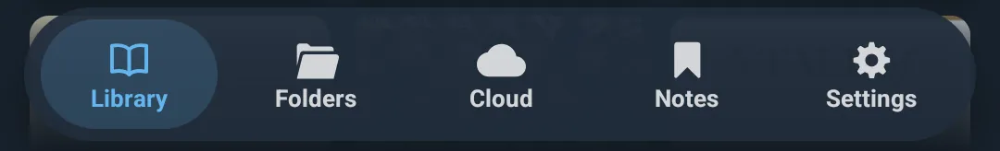<figcaption>The navigation bar</figcaption></figure>
</div>

### 1.1.1 Tabs

| Tab | Icon | Can be hidden | Hidden by default |
|---|---|---|---|
| "Library" | LibreraX mark | No (fixed) | No |
| "Folders" | open folder | Yes | **iOS: yes**, Android: no |
| "Cloud" | cloud | Yes | No |
| "OPDS" | globe | Yes | **Yes (both platforms)** |
| "Notes" | bookmark | Yes | No |
| "Settings" | cogwheel | No (fixed) | No |

- Default order is the order above. Order and visibility are changed in **Settings → "Navigation bar"** (a drag-to-reorder
  list with a drag handle on the left and a switch on the right; the Library and Settings switches are disabled).
  LibreraX remembers your choice. Tabs added in future versions appear at the end.
- Opening OPDS from the Library (long-press on the "OPDS" pill) automatically un-hides the OPDS tab.
- The **Cloud** tab shows a thin progress bar under its icon while a Drive upload or download is running.
- The app opens on the Library tab. Each tab keeps its own state (scroll position and so on) while you switch.

### 1.1.2 Bar styles
- **Floating pill bar** (default on Android, and on iOS when "System components" is off): a rounded panel floating
  above the bottom edge, with a gradient behind it; the selected tab is highlighted with an accent "patch".
- **Square band**: when **Cover radius = "0"** the bar becomes a flat full-width band with no rounded patch and no
  ripple (the whole app chrome turns square).
- **Native iOS tab bar** ("Liquid Glass"): only on **iOS 26 or newer**, and only while **Settings → Other settings →
  "System components"** is on (default **on**). Subtitle: "Native iOS navigation bar and buttons with Liquid Glass".
  The same switch turns top-bar buttons, the search field, switches and menus into native glass controls.

### 1.1.3 Back button behaviour
- On any tab other than Library: Back returns to Library.
- On Library: Back may first show the store review prompt, then leaves the app.
- Inside the Library: Back clears a selection first, then closes the groups bar, then closes the embedded OPDS view.
- Tapping the title (app name + icon) on Folders / Cloud / OPDS / Notes / Settings returns to Library.

### 1.1.4 Full screen
- **Settings → Other settings → "Full screen"** (switch, default **off**): hides the system status and navigation bars
  on the library, folders and settings screens. It is applied again every time you return to the app.

## 1.2 Library tab — layout overview

<div class="shots">
<figure style="width:28.8%">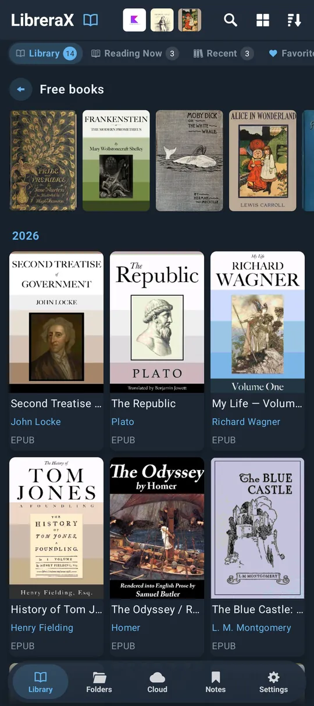<figcaption>The Library tab: top bar, shelves, &quot;Free books&quot; and the Grid view</figcaption></figure>
<figure style="width:28.8%"><figcaption>Tap the LibreraX icon next to the title: the library switches to groups</figcaption></figure>
</div>

From top to bottom:
1. **Top bar**: "LibreraX" title + icon (the icon is a button), the **Reading Now** cover strip, then three action
   buttons: **Search** (magnifier), **Display** picker, **Sort** picker.
2. **Search field** (when opened), placeholder "Find".
3. **Shelf strip**: optional lead buttons ("+" Add, "OPDS" pill) followed by shelf chips with counts; or, in groups
   mode, the group-mode chips.
4. A moving progress line while a scan (or an OPDS fetch) is running.
5. Banners: backup-restored notice, folders-need-access list, "Free books" strip (empty library).
6. The book list for the selected shelf; shelves are pages you can **swipe left/right**.

The top bar **collapses when you scroll down** and comes back when you scroll up (not on iPad, where it stays).
While books are selected the bar is always shown.

### 1.2.1 Reading Now strip (in the top bar)
- Shows covers of books on the **Reading Now** shelf (up to 12, as many as fit; the covers shrink so that at least two
  fit on a narrow phone). Tap a cover to open the book.
- Only shown when at least one book is being read and nothing is selected.

### 1.2.2 Read-aloud header
- While background read-aloud (TTS) is active, the title icon turns into **headphones** and a play/pause button
  appears. Tapping the headphones icon hides this header (instead of opening groups).

### 1.2.3 Title icon = groups toggle
- Tapping the LibreraX mark next to the title switches the strip into **groups mode** (see §1.5). In groups mode the
  icon shows the current group mode's icon; tapping it again (or Back) returns to the shelves.

## 1.3 Shelves (Library tabs)

<div class="shots">
<figure style="width:28.8%">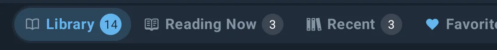<figcaption>The shelf strip: Library, Reading Now, Recent, Favorites</figcaption></figure>
<figure style="width:28.8%">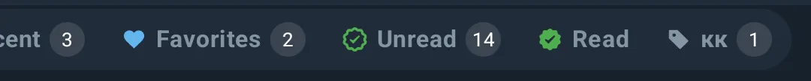<figcaption>Scrolled further: Unread, Read and a tag shelf</figcaption></figure>
</div>

### 1.3.1 Shelf list

| Default label | Strip icon (tint) | What it contains | Sort |
|---|---|---|---|
| "Library" | LibreraX mark | Books **in the library**: found by the scan in a library folder, or added by hand, and not excluded | your sort |
| "Reading Now" | open book with text | Opened at least once, **not marked read**, and opened again since it was last marked read/unread by hand | fixed: last opened, newest first |
| "Recent" | book library | Books on the recent list | fixed: "Last read", newest first |
| "Favorites" | heart (accent) | Books with a heart | your sort |
| "Unread" | empty check (green) | In the library, not marked read, and never started (never opened, or progress below 0.5 %) | your sort |
| "Read" | check (green) | Books marked read | your sort |
| "My tags" | tags | Expands into **one chip per tag** (each tag is its own shelf) | your sort |
| "Excluded" | circle-minus | Scanned books you excluded from the library. **The chip only appears when it has books** | your sort |

- Each chip shows a **count badge** (hidden when 0). Counts follow the current search text and the format filter.
- Default order: Library, Reading Now, Recent, Favorites, Unread, Read, My tags, Excluded. None hidden by default.
- The shelf shown at launch is the **first visible shelf** in your order.
- Swiping the list horizontally moves to the next/previous shelf; the chip strip scrolls to keep the selected chip in view.
- Shelves other than Library/Unread show books even when they are **not** in a library folder (for example a book
  opened from another app), as long as the book is not excluded and its file is not missing.
- Recent and Reading Now always ignore the Sort setting and show no section headers.

### 1.3.2 Long-press on a chip

| Chip | Long-press menu |
|---|---|
| "Library" | Add menu: storage sources (see §1.11.2) and "Add books" |
| "Recent" | "Clear recent" — removes every book from the recent list |
| "Favorites" | "Clear favorites" — removes every heart |
| a tag chip | "Delete tag" — removes that tag from **all** books |
| others | none |

Not available with the iOS native segmented control (System components), which only switches shelves.

### 1.3.3 Lead buttons on the strip
- **"+" (Add)**: circle button before the chips; opens the Add menu (storage sources + "Add books"). Turned on or off
  in Settings → "Library tabs" → **"Add books"** switch (default **on**).
- **"OPDS" pill**: tap = shows the "popular books" OPDS page **embedded inside the Library** (Back closes it); long-press =
  switches to the OPDS tab (and un-hides it). Turned on or off in Settings → "Library tabs" → **"OPDS"** switch
  (default **on**; turning it off also unpins the "Free books" strip).

### 1.3.4 Library tabs settings (Settings → "Library tabs")
- Two switches: "Add books" and "OPDS" (above).
- Reorderable list of shelves with a drag handle, an **edit (pencil)** button and a show/hide switch.
- **Rename**: every shelf except "My tags" can be renamed. The dialog title is the default name; a text field (the Done
  key saves); buttons "Save", "Reset" (only when a custom name exists), "Cancel". Saving the default name or an empty
  name removes the custom name.
- You cannot hide the last visible shelf.
- Order, hidden shelves and custom names are remembered.

### 1.3.5 Search interaction with chips
- While search text is entered, chips whose count is 0 disappear (except "Library" and the chip you are on).

### 1.3.6 "Free books" strip (Discover)
- On the Library shelf (no tag) a header row "Free books" (or the title of the pinned OPDS page) with a horizontal row
  of OPDS covers can appear above the books; it is also shown when the library is empty. Tap the title to open the
  embedded catalog; tap a cover to open its book sheet.
- On by default (default page: Project Gutenberg popular). It is controlled from the OPDS screen ("Show on library
  screen").

## 1.4 Display (view) modes

<div class="shots">
<figure style="width:28.8%">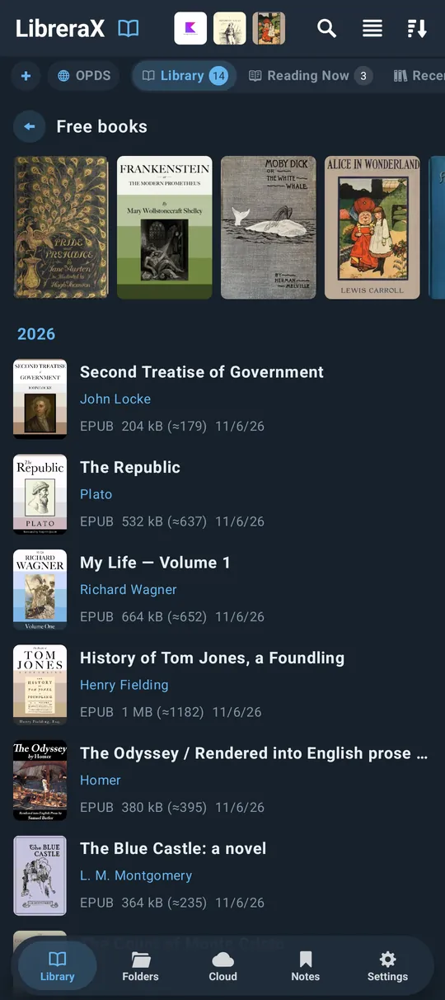<figcaption>List view</figcaption></figure>
<figure style="width:28.8%">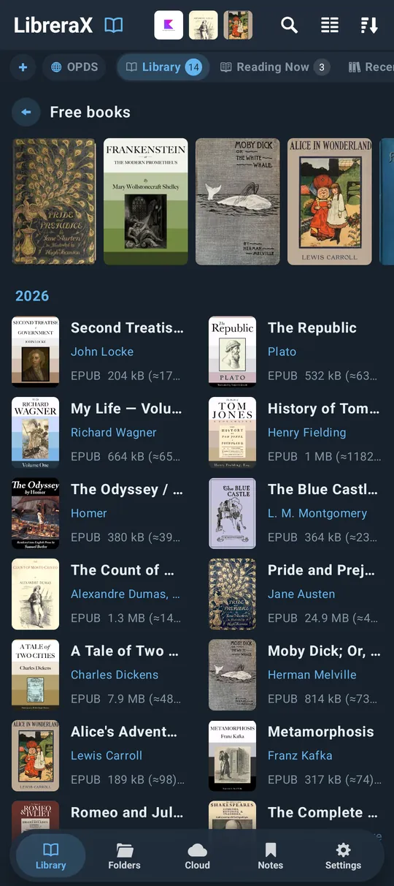<figcaption>Two columns view</figcaption></figure>
<figure style="width:28.8%">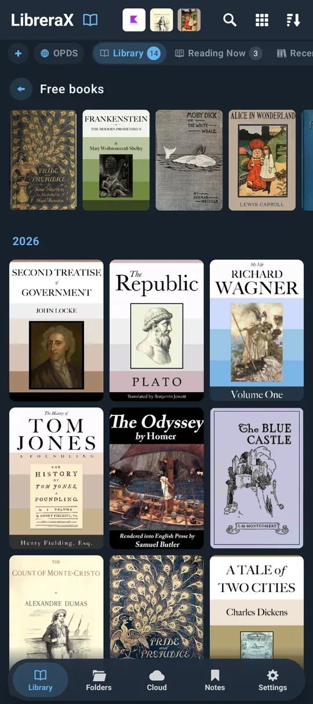<figcaption>Covers view</figcaption></figure>
</div>

The top bar **Display** button (icon = current mode) opens a menu with a check on the current mode.

| UI label | Layout |
|---|---|
| "List" | One row per book: cover thumbnail + text lines |
| "Two columns" | Condensed rows in 2 columns |
| "Grid" | Cards: cover on top, title/author/format below (**default**) |
| "Covers" | Covers only, with small corner marks |

- Library default: **Grid**. The Folders tab has its own setting (see §1.12).
- The number of columns for Grid/Covers depends on the **Cover size** setting (§1.15.3) and screen width; Two columns
  is always 2.
- In the free (ad-supported) edition an ad row appears every **32 books**.

### 1.4.1 What each card shows

| Element | List / Two columns | Grid | Covers |
|---|---|---|---|
| Cover (2:3), with series pennant | yes (height follows the row; scaled by Cover size; ×1.5 on tablets) | yes, full width | yes, full width |
| Title (bold) | 1 line | 1 line | — |
| Author line | yes | yes | — |
| File name line | if "Show file names" is on (shortened in the middle) | if on | — |
| Read check (green) | yes | yes | top-right corner |
| Cloud mark | yes | yes | top-right corner |
| Heart | yes (faded accent) | yes | top-right corner |
| Info text | "NN%  EXT  size (pages)  date" | extension only | — |

- **Author line** = `Author (Series, N)`; if no author: `Series, N`; if no series: the author. If the author is empty
  and there is no series, the **parent folder name in brackets** is shown instead, e.g. `[Downloads]`.
- **Info text** parts (separated by two spaces, each only when known): reading progress `%`, file extension in capitals,
  file size with page count in parentheses (`2.4 MB (312)`, or `(≈312)` when estimated), file modified date (in the
  chosen Date format).
- **Cloud mark**: filled cloud = the book is in the Cloud and on this device; outline cloud = "In the Cloud, not on this device".
- **Series pennant**: when the book has a number in a series, a small accent-coloured flag with the number is drawn
  at the top-left of the cover (all views, File info too).
- Selected books are tinted with the accent colour.
- Size units: B, kB, MB, GB, TB (decimal, one decimal place).

### 1.4.2 Page count shown
- PDF/DjVu/comics (fixed layout): pages from the file, or the reader's count.
- Reflowable books (EPUB, MOBI, FB2, TXT…): the reader's page count once the book has been opened; before that an
  estimate prefixed with "≈".

### 1.4.3 Section headers
When sorted by these orders (not on Recent / Reading Now), headers are inserted:

| Sort | Header |
|---|---|
| "Publication Date" | publication year |
| "File modified date" | year of the file date |
| "Book creation date" | year of the creation date |
| "Author last name" | first letter of the last name |
| "Author" | first letter of the author |
| "Publisher" | first letter of the publisher |

Missing dates are grouped under "No date"; names beginning with a non-letter go under "#".

### 1.4.4 Fast scrollbar
- A thin thumb at the right edge. Always visible on tablets; on phones it appears while scrolling and fades just under
  a second after scrolling stops.
- Drag the thumb to jump; it widens and turns accent while held.
- When the list has section headers, a **bubble** next to the thumb shows the current section (year / letter).
- Tapping a list that is still flinging only stops it (it does not open the book under your finger).

### 1.4.5 Cover placeholders
- Used when a book has no cover, or when **"Show book covers"** is off.
- A coloured gradient per format with a book-spine stripe: PDF red, EPUB green, MOBI/AZW orange, FB2 blue, DjVu purple,
  CBZ/CBR teal, TXT/MD grey-blue, HTML/XHTML indigo, DOC/DOCX/RTF brown, ZIP grey, other slate.
- Shows the title (serif bold, up to 5 lines), a short rule, the author (2 lines) and a format badge (e.g. "FB2", "DJVU").
  Very small covers show only the format label.

## 1.5 Groups mode (browse by metadata)

<div class="shots">
<figure style="width:28.8%">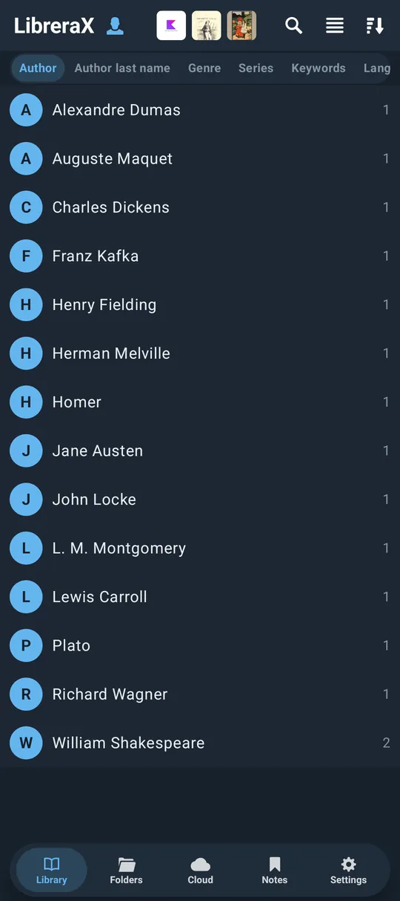<figcaption>Groups mode: books grouped by Author</figcaption></figure>
<figure style="width:28.8%">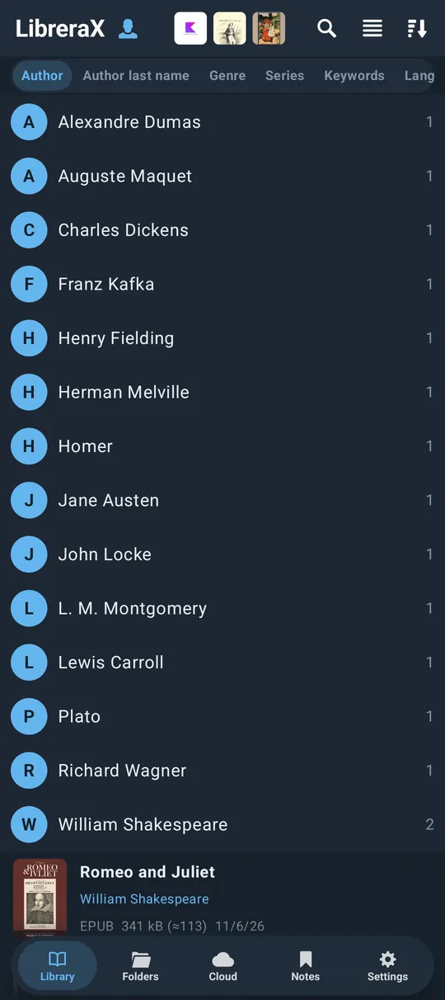<figcaption>A group unfolded</figcaption></figure>
<figure style="width:28.8%">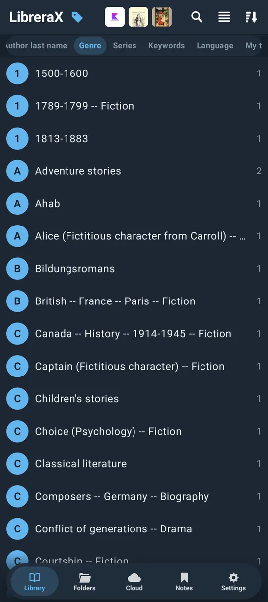<figcaption>Groups by Genre</figcaption></figure>
</div>

Open: tap the LibreraX icon in the top bar. The strip then shows group-mode chips; swipe left/right to change mode.

| Chip label | Groups by | Splitting |
|---|---|---|
| "Author" | full author names | multiple authors split (see §1.5.1) |
| "Author last name" | "First Last" per author, ordered by last name | split; circle letter = last-name initial |
| "Genre" | genre | comma-separated |
| "Series" | series name | — |
| "Keywords" | keywords/subjects | comma-separated |
| "Language" | language code | — |
| "My tags" | your tags | — |
| "Publisher" | publisher | — |
| "Publication Date" | publication **year** | — |

- The first time you open groups, **Author** is selected; afterwards the last mode is remembered.
- Each group row: an accent circle with its first letter, the group name, and the number of books. Groups are
  sorted alphabetically, ignoring case; names that differ only in case are merged ("tolkien" and "Tolkien").
- **Tap a group** to unfold it; its books appear below in the current Display mode, sorted by the current Sort.
  Several groups can be open at once. Tap again to fold.
- Long-press a book inside a group to start selection; taps then toggle selection.
- Group counts honour the format filter, "Hide duplicates" and "Hide Cloud books in Library".
- **Search in groups mode** filters group *names*; each mode chip then shows how many groups match (updated shortly
  after you stop typing).
- Jumping from File info: tapping an Author, Series, Genre, Keywords, Language, Publisher or Publication Date value
  opens the Library in the matching groups mode with that group unfolded and scrolled into view.

### 1.5.1 Author name parsing
- Several authors in one field are separated by `;`, `&`, or the words "and", "и", "і".
- `Last, First` is recognised (also `Last1, First1, Last2, First2`).
- The last name skips initials (e.g. "J." or "J.R.R."), suffixes (Jr, Sr, II, III, IV, PhD, MD), and keeps a
  capitalised particle with it ("Le", "La", "De", "Da", "Di", "Du", "Del", "Della", "Van", "Von", "Mac").

## 1.6 Sorting

<div class="shots">
<figure style="width:14.5%">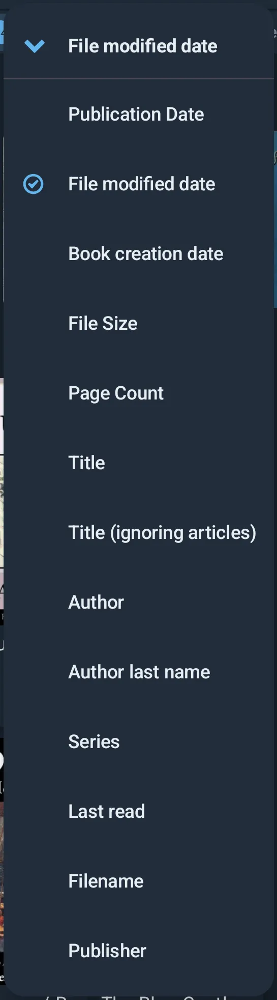<figcaption>The Sort menu</figcaption></figure>
<figure style="width:28.8%">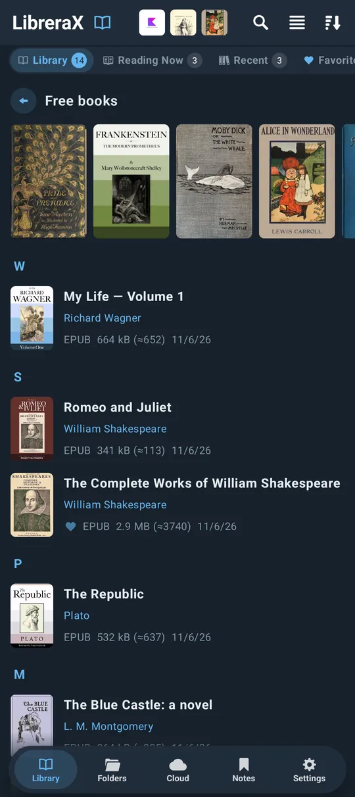<figcaption>Sorted by &quot;Author last name&quot; in List view, with letter headers</figcaption></figure>
</div>

The **Sort** button's icon shows the direction. Its menu: the first row is the current sort with an up/down chevron
(tap it to flip ascending/descending), a divider, then the options (the current one checked).
**Long-press the Sort button** to flip the direction directly (non-glass style).

### 1.6.1 Library sort options (menu order)

| UI label | Sorts by | Notes |
|---|---|---|
| "Publication Date" | publication year | year section headers |
| "File modified date" | the file's last-modified time | **default**, descending (newest first); year headers |
| "Book creation date" | creation date from the book (falls back to the publication date) | year headers |
| "File Size" | file size | |
| "Page Count" | page count | |
| "Title" | title, ignoring case | |
| "Title (ignoring articles)" | title with a leading article removed | articles per language: English (also when no language) "the/an/a"; French "les/le/la/l'/une/un/des"; German "der/die/das/eine/ein"; Spanish "los/las/el/la/una/un"; Italian "gli/il/lo/la/le/i/l'/uno/una/un"; Portuguese "os/as/o/a/uma/um"; Dutch "het/de/een/'t"; leading quotes/brackets/¿¡ are ignored too |
| "Author" | author, ignoring case | letter headers |
| "Author last name" | first author's last name, then author | a book with several authors is listed **once under each author**; books with the same last name are ordered by first name, then title; letter headers |
| "Series" | series name, then number in series ascending | |
| "Last read" | last read time | books never read always come last |
| "Filename" | file name, ignoring case | |
| "Publisher" | publisher, ignoring case | letter headers |

- Direction: default **descending**. The sort and its direction are remembered.
- Books that tie are ordered by **title ascending** (except in the Title sort); Series also uses the number in series,
  Author last name also uses the author.
- While searching with the "Author last name" sort, only the authors that match the search words are used to place a book.

## 1.7 Search

<div class="shots">
<figure style="width:28.8%">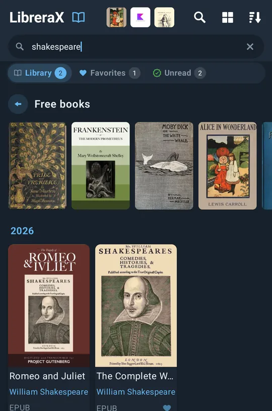<figcaption>Searching for &quot;shakespeare&quot;</figcaption></figure>
<figure style="width:28.8%">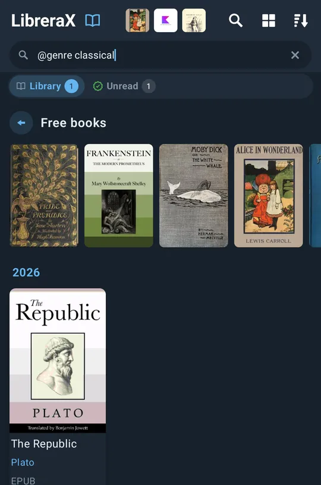<figcaption>A field search: &quot;@genre classical&quot;</figcaption></figure>
</div>

- Tap the magnifier to open the search field ("Find"); tap again to close and clear it. An × in the field clears the text.
- Search applies to the current shelf and updates the shelf counts.
- **Fields searched**: Title, Author, Series, Genre, File name.
- **Matching**: the text is split into words (punctuation `, ; : . " ' ( ) « »` is trimmed); **every word must match**.
  A word matches when a word in one of the five fields starts with it, or when it appears anywhere inside one of the
  fields (ignoring case).
- **Field-prefix syntax** (for power users, typed into the search box):

| Prefix | Field |
|---|---|
| `@series` | Series |
| `@genre` | Genre (comma list) |
| `@author` | Author (individual names) |
| `@last_name` | Author last name |
| `@tags` | your tags |
| `@keywrods` | Keywords (type it with exactly this spelling) |
| `@languages` | Language |
| `@year` | Publication year |
| `@publisher` | Publisher |

  `@author Tolkien` = contains; `@author "J. R. R. Tolkien"` (in quotes) = exact name. Quoted values for
  series/language/year/publisher match the whole field exactly (ignoring case). A tag search shows tagged books
  regardless of the format filter.

## 1.8 Selection and book actions

<div class="shots">
<figure style="width:28.8%">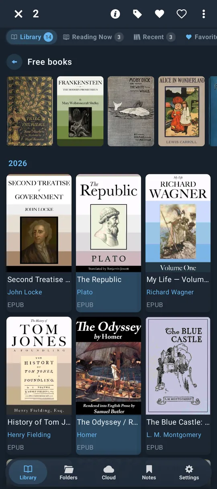<figcaption>Two books selected; the first actions sit in the top bar</figcaption></figure>
<figure style="width:14.5%">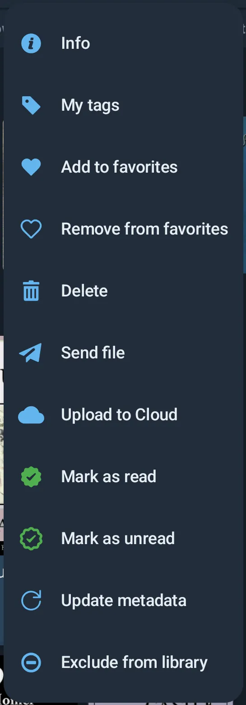<figcaption>All book actions in the ⋮ menu</figcaption></figure>
<figure style="width:25.0%"><figcaption>Info with two books selected: tap or swipe the covers at the top to switch books</figcaption></figure>
</div>

- **Tap** a book = open it. **Long-press** = select it and enter selection mode; taps then toggle selection.
- The top bar shows **×** (clear selection) and the number selected. The first **4** visible book actions become icons
  on the bar; a **⋮** menu holds all visible actions.

### 1.8.1 Book actions (default order)

| UI label | What it does |
|---|---|
| "Info" | Opens File info (§1.9) for the selected book(s) |
| "My tags" | Opens the tags editor (§1.10) |
| "Add to favorites" | Hearts the book(s) |
| "Remove from favorites" | Removes the heart |
| "Delete" | Deletes the file(s) from the device (with confirmation) |
| "Open with" | Hands the file to another app (only with **one** book selected) |
| "Send file" | Share sheet with the file(s) |
| "Upload to Cloud" | Uploads to Google Drive in the background (hidden when all are already in the Cloud) |
| "Mark as read" | Sets the read mark |
| "Mark as unread" | Clears the read mark |
| "Update metadata" | Re-reads the cover and book details from the file |
| "Exclude from library" / "Include in library" | Moves the book to/from the Excluded shelf. On the Excluded shelf the label is "Include in library" |

- By default the bar icons are Info, My tags, Add to favorites, Remove from favorites.
- **Settings → "Book actions"**: reorder (drag) and show/hide each action. Your order is remembered. Actions added in
  future versions appear right after the action that comes before them.
- The same action list (minus the selection-only ones) is the book menu inside the reader.
- **Exclude** takes every copy the card stands for: the same file elsewhere, and — with Hide duplicates — every copy with
  the same author+title (or file name).
- "Open with": Android = system app chooser; iOS = share sheet.

### 1.8.2 Delete dialog
- Title "Delete  N". Text "Delete from the device? The files cannot be brought back."
- Shows up to 6 covers with file names ("…" when more); a cloud icon marks books also in the Cloud.
- If any selected book is in the Cloud: checkbox **"Also delete from the Cloud (to Google Drive trash)"** (off by default).
- Buttons "Delete" (red) / "Cancel".
- Deleting removes the file and everything saved for it: progress, heart, read mark, tags, bookmarks and annotations.

### 1.8.3 Opening a book whose file is gone
- Unsupported extension: message "EXT: not supported".
- File moved/deleted or folder permission lost: a file picker opens near the old location. If you pick a file with the
  **same name**, the library **relinks** the book: progress, heart, recent, read mark, tags, bookmarks and annotations
  move to the new file and the old entry is removed. A file with a different name is just opened.
- Messages: "This book can no longer be opened: its file was moved or deleted, or its folder needs access again." /
  "This book was opened from another app, which no longer lets LibreraX read it. Open it from that app again, or add
  its folder to the library."

## 1.9 File info

<div class="shots">
<figure style="width:25.0%">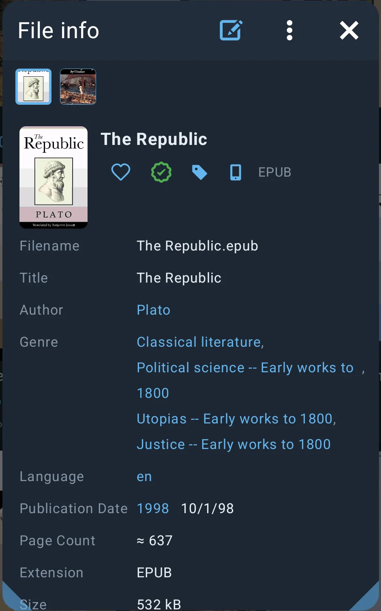<figcaption>File info</figcaption></figure>
</div>

Open: selection → "Info"; also from the reader and the Notes/Cloud screens.

### 1.9.1 Window
- Title "File info" (or "Edit metadata" while editing). The popup can be **dragged** by its title bar, **resized** from
  the two bottom corners, and **double-tapping the title** resets it to its default place or, if it is already
  there, fills the screen. Size and position are remembered per popup.
- Title-bar icons: **pencil** (Edit metadata — only EPUB, FB2, FB2.ZIP, PDF), **⋮** menu, **×** close.
- ⋮ menu: "Edit metadata" (when editable), "Update metadata", "Add widget to home screen" (Android, only when the
  launcher supports pinned widgets).
- With several books selected: a row of small covers at the top (the current one outlined); swipe or tap a cover to
  switch pages.

### 1.9.2 Header
- Cover (tap = full-size cover, tap again to go back) with series pennant.
- Title (bold, up to 4 lines).
- Heart toggle, read-check toggle (green), a tag icon (only when the book has no tags) to add tags, a widget icon
  (Android, when supported), and the file extension.
- Tags as accent chips; tap any to edit tags.

### 1.9.3 Fields (shown only when not empty, in this order)

| Label | Value | Tappable → group |
|---|---|---|
| "Filename" | file name | |
| "Title" | title (or file name) | |
| "Author" | author(s); each name separately tappable when several | Author |
| "Series" | series | Series |
| "# in Series" | number in series | |
| "Genre" | genre(s), each tappable | Genre |
| "Keywords" | keywords, each tappable | Keywords |
| "Language" | language | Language |
| "Publisher" | publisher | Publisher |
| "Publication Date" | year, plus the full date beside it when it differs | Publication Date |
| "Book creation date" | creation date (only when different from the publication date) | |
| "ISBN" | ISBN | |
| "Page Count" | pages ("≈ N" when estimated) | |
| "Extension" | e.g. EPUB | |
| "Size" | file size | |
| "File modified date" | date in the chosen date format | |
| "Progress" | reading progress % | |
| "Path" | full path, in readable form. Folded to 2 lines; a chevron expands it | |

- Below a divider: "Annotation" — the book description, with bold, italic, underline, headings, paragraphs and line breaks.

## 1.10 Tags, favourites, read marks

<div class="shots">
<figure style="width:24.7%">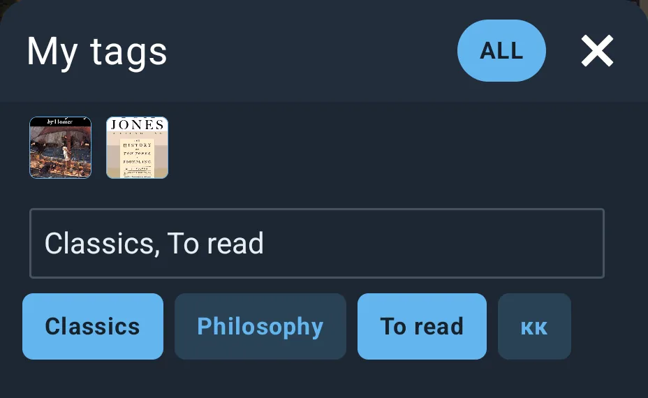<figcaption>The tags editor with sample tags: Classics, Philosophy, To read</figcaption></figure>
<figure style="width:28.8%"><figcaption>Each tag becomes a shelf in the strip, with its count</figcaption></figure>
<figure style="width:28.8%">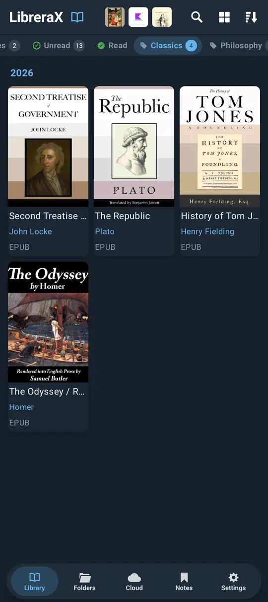<figcaption>The &quot;Classics&quot; tag shelf</figcaption></figure>
</div>

### 1.10.1 Tags editor ("My tags")
- Text field with placeholder "tag, another tag" — tags are comma-separated, trimmed, duplicates removed.
- "Apply" appears when the text has changed; the Done key and closing the popup also apply.
- All existing tags appear as chips below; tap a chip to add/remove it (applies immediately).
- **One book**: the field replaces the book's tags.
- **Several books**: the field **adds** tags to all of them (never removes). The title bar shows an "ALL" chip and a row
  of covers: tap a cover to edit just that book's own tags; tap "ALL" to go back.
- Tagging from the Folders tab also puts the book into the library.
- Delete a tag everywhere: long-press its chip on the shelf strip → "Delete tag".
- Setting tags also updates the book's "last read" time.

### 1.10.2 Favourites
- Toggle the heart from the action list, File info, or the reader. Adding a heart also updates the "last read" time.
  "Clear favorites" (long-press the chip) removes all hearts.

### 1.10.3 Read marks
- Set by "Mark as read"/"Mark as unread", the File info check, the Folders folder menu, and **automatically by the
  reader** when you reach 99 % or the last page (once per opening, only if the book is not already read).
- Marking a book read/unread by hand removes it from Reading Now until you open it again.

### 1.10.4 Marks shared between copies
- Heart, last-read time, progress/position and read mark — and tags — are copied to every other library book with the
  **same file name** when changed. The recent list, the library/excluded state and the Cloud link stay per file.
- Copies with identical content are always shown as **one** card.

## 1.11 Adding books and library folders

<div class="shots">
<figure style="width:15.4%">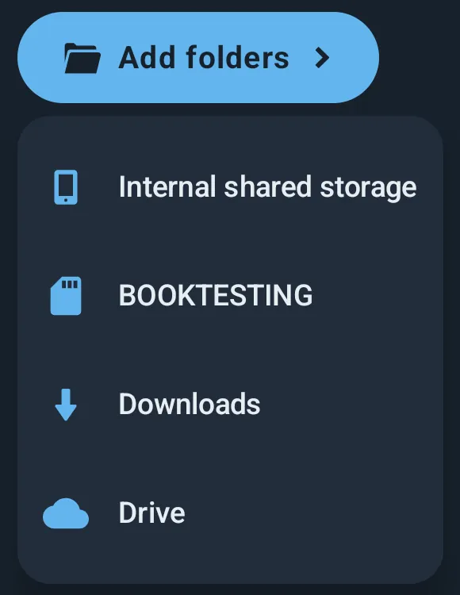<figcaption>&quot;Add folders&quot; on Android: storage sources</figcaption></figure>
<figure style="width:28.8%">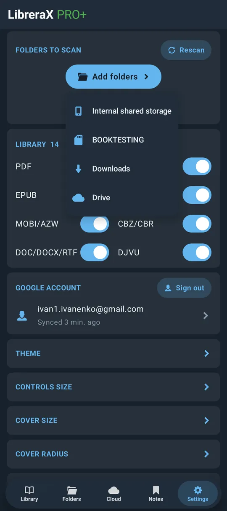<figcaption>Settings → &quot;Add folders&quot;: choose where the folder is</figcaption></figure>
<figure style="width:28.8%">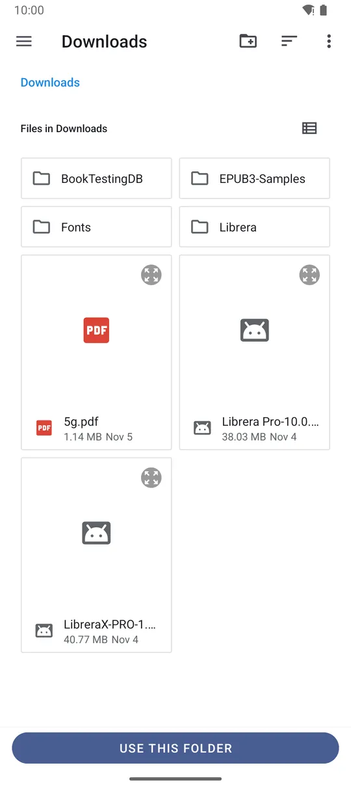<figcaption>The system folder picker opens in Downloads</figcaption></figure>
<figure style="width:28.8%">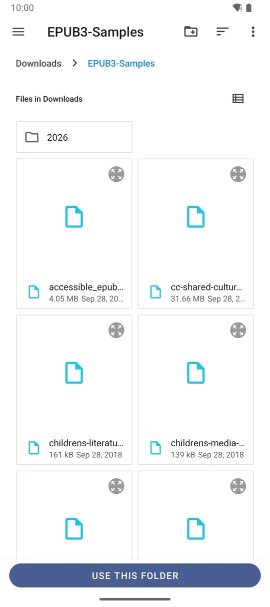<figcaption>Open the folder to add (here EPUB3-Samples) and tap &quot;USE THIS FOLDER&quot;</figcaption></figure>
<figure style="width:28.8%">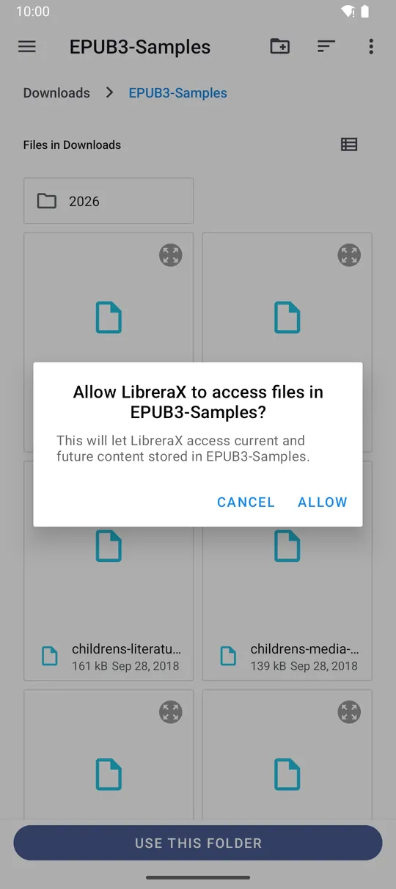<figcaption>Android asks to allow LibreraX to read the folder</figcaption></figure>
<figure style="width:27.2%">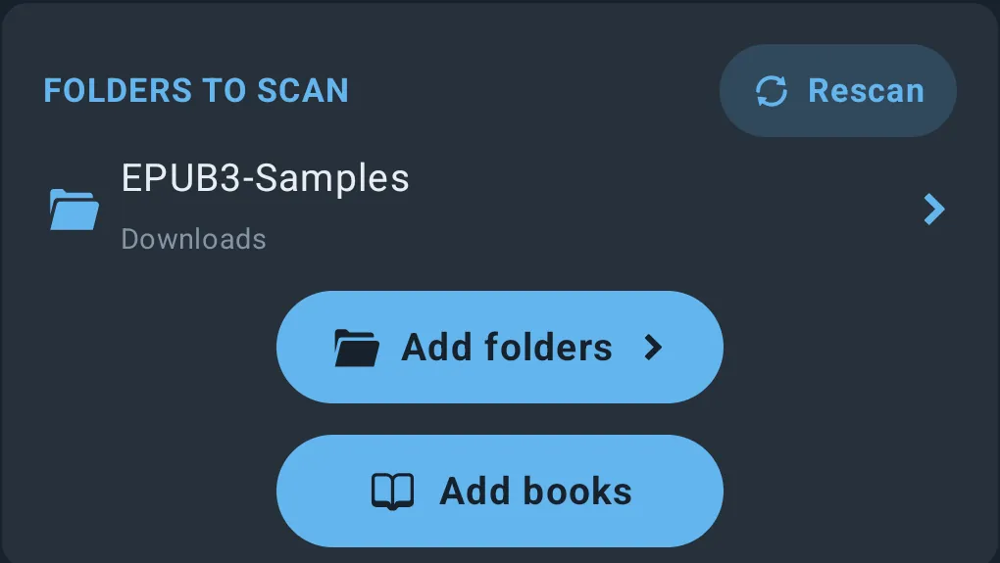<figcaption>The folder is listed under &quot;Folders to Scan&quot;; the library count grows as the scan finds books</figcaption></figure>
</div>

### 1.11.1 Where the buttons are
- Empty library (not signed in, nothing readable or nothing found yet): centred **"Add folders"** and **"Add books"** buttons.
- "+" lead button on the shelf strip, and long-press on the "Library" chip.
- Settings → "Folders to Scan" card: "Add folders" / "Add books".
- Folders tab root: "Add folders".

### 1.11.2 "Add folders"

> **Private by design.** LibreraX never asks for access to all your files. On Android it uses the system folder
> picker (the Storage Access Framework): you choose a folder, Android asks you to allow it, and LibreraX can read only
> that folder and what is inside it. On iOS the system picker works the same way. Only the folders you picked, and
> books you added one by one, appear in the library. Nothing else on the device is scanned, and you can remove a
> folder in Settings at any time, which also gives its permission back.

- **Android**: a menu of storage sources — each storage volume (internal storage = phone icon, SD card = card icon),
  **"Downloads"**, then cloud document providers (Google Drive per account, plus any provider you allowed before).
  The system folder picker opens at that place, with all storage shown. The app keeps permission to read the folder
  (and to write, if allowed). Then a scan starts.
- **iOS**: the system folder picker opens directly (no source menu). The app keeps access to the folder across restarts.
- The folder list is sorted alphabetically (ignoring case); a folder added twice appears once.
- On Android only folders picked in the system folder picker and the app's own folders can be library folders.
- On iOS the app's `Documents/Books` folder is added automatically at every start (and hidden from the Settings list).

### 1.11.3 "Add books"
- **Android**: the system multi-file picker (opens in Download, any file type). Each file is added **in place** (no copy),
  and the app keeps permission to read it.
- **iOS**: document picker with multiple selection; files are **copied** into `Documents/Books` (name clashes become
  `name (1).ext`, `name (2).ext`…).
- Unsupported files and ZIPs that contain no book are skipped; message "%1$d of %2$d added: the others are not books the
  app can open".
- Books added this way stay on the Library shelf even though no scan finds them.

### 1.11.4 Folder permission lost (Android)
- Banner at the top of the Library: "Android no longer lets the app read these folders. This happens after the app is
  reinstalled or restored from a backup. Tap a folder to give access again." Each folder: name, location — "tap to give
  access again". Tapping opens the folder picker; giving access again starts a scan.
- In Settings the folder row is greyed with the same hint; tapping it re-opens the picker.

## 1.12 Folders tab (file browser)

<div class="shots">
<figure style="width:28.8%">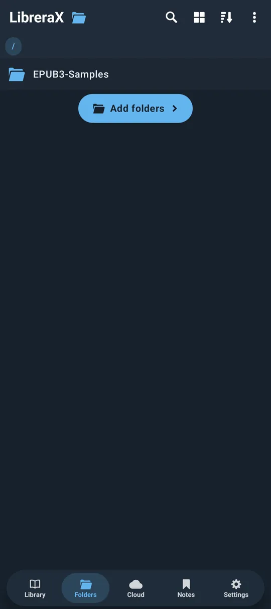<figcaption>The Folders tab with the added folder</figcaption></figure>
<figure style="width:12.3%">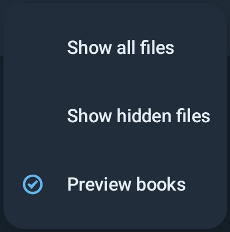<figcaption>The Folders view menu</figcaption></figure>
<figure style="width:28.8%">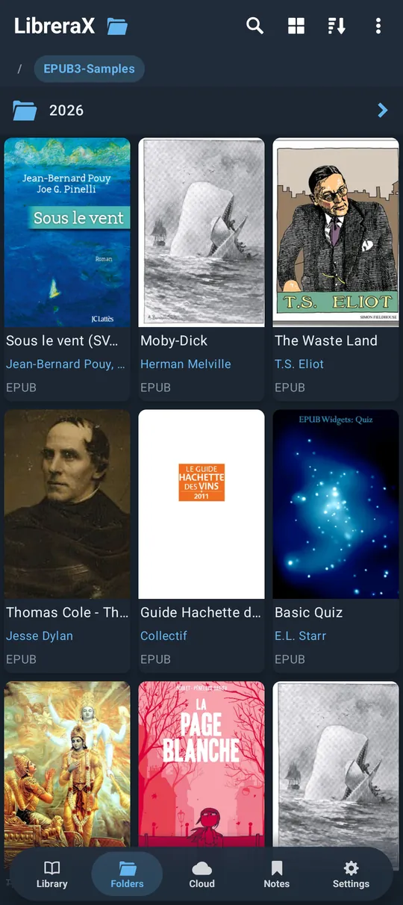<figcaption>Inside the folder: sub-folders first, then its books</figcaption></figure>
</div>

- The root "/" lists the folders you added (Android). Tap a folder to enter it; levels are pages you can
  swipe; a **breadcrumb** strip ("/ › Folder › Sub") lets you jump to any level; Back goes up one level.
- The current path, the scroll position and unfolded folders are remembered across launches. If the top folder is no
  longer added, the tab returns to "/".
- Settings → "Folders to Scan": tapping a folder row jumps to it in the Folders tab.
- On iOS the tab is hidden by default and has nothing to list, so it shows just the "Add folders" button.

### 1.12.1 Top bar
- Search: filters names in the current level.
- Display picker: "List", "Two columns", "Grid", "Covers" (its own setting; default = the Library's display if you ever
  set it, otherwise Two columns).
- Sort: "Filename", "File modified date", "File Size" (default **File modified date, descending**; remembered).
  Folders are always listed before files, each sorted the same way.
- **⋮ view menu** (check items):

| Item | Default | Effect |
|---|---|---|
| "Show all files" | off | Shows non-book files and folders without books. Unsupported files open with another app |
| "Show hidden files" | off | Shows names beginning with "." |
| "Preview books" | on | A folder that holds books and no sub-folders gets a chevron; tap to unfold its books in place (up to 200 unfolded folders are remembered) |

- Without "Show all files", folders with no books (looked up to 6 levels deep) are hidden.
- Excluded folders (with a `.nomedia` file) show a crossed folder icon in grey.

### 1.12.2 Selection in the Folders tab
- Long-press a **file**: the same selection actions as the Library (§1.8). Hearting or tagging here also adds the book to
  the library; "Exclude/Include in library" toggles whether it is in the library.
- Long-press a **folder**: folder ⋮ menu — "Mark as read", "Mark as unread" (every library book under it), and
  "Exclude from library" / "Include in library" (creates/deletes a `.nomedia` file in the folder, then rescans).
- Ctrl/Cmd+C with a hardware keyboard copies the names of the selected items.

## 1.13 Scanning

<div class="shots">
<figure style="width:28.8%"><figcaption>The library after the scan</figcaption></figure>
</div>

### 1.13.1 When a scan runs
- When you add a folder, remove folders, give access to a folder again, include an excluded folder, or exclude a
  folder in the Folders tab.
- When you tap "Rescan" in Settings → "Folders to Scan" (the free edition may show an ad first).
- When you open the Library and nothing has been found yet but folders exist, and once after an app update that
  changes how book details are stored.
- When you switch "Calibre metadata.opf" on or off.
- **iOS**: at every app start.
- On Android the scan keeps running if you leave the app. If you ask for a scan while one is running, another runs
  right after it.

### 1.13.2 Which files count
- **Extensions**: pdf, epub, mobi, azw, azw3, kf8, prc, fb2, fb2.zip, cbz, cbr, txt, md, html, xhtml, doc, docx, rtf,
  zip, djvu, djv.
- A `.zip` counts only when it contains a book.
- Skipped: any folder containing a **`.nomedia`** file, with everything under it (it is listed under "Excluded
  folders"); names starting with "."; folders named `android`, `.thumbnails` and `lost+found`.

### 1.13.3 What you see during and after a scan
- New books appear as they are found, first titled with the file name, so the library fills while scanning; titles,
  authors and covers fill in as each book is read.
- A book whose file changed (size or date) has its details read again.
- A file that was **moved or deleted** leaves the Library shelf but keeps its progress, heart, read mark and tags; if it
  comes back at the same place, it is restored with all of them. A moved file can also be relinked by opening it
  (§1.8.3).
- Books added by hand that can no longer be read are hidden from all shelves as missing until they become readable again.
- Gone files with nothing saved (no progress, heart, tags, bookmarks or annotations) are forgotten.
- A file that made reading its details fail before is skipped on later scans.
- Progress: a moving line under the Library top bar; in Settings the "Library  N" card shows a progress bar
  (files read / total) and a spinning refresh icon in the top bar.

### 1.13.4 Metadata sources
- Details come from the book file. DOC/DOCX/RTF: title, author and year are taken from the **file name**. Comics: the
  book's details combined with the file name.
- **"Calibre metadata.opf"** (Settings → Other settings, switch, default **off**): when a `metadata.opf` is in the
  book's folder, its fields override the book's own (the page count still comes from the book). Switching it re-reads
  the affected books.
- Fallbacks: title = file name without extension; creation date = the book's creation date, else the publication date,
  else the year.

### 1.13.5 Excluded folders
- Settings shows an "Excluded folders" card when any exist. Long-press to select, then the **+** icon in the top bar
  includes them again (deletes `.nomedia`) and rescans.

## 1.14 Duplicates and formats

### 1.14.1 "Hide duplicates" (Settings → Other settings)
- Switch, default **on**. Tap the label to choose the rule (choosing a rule also turns it on):

| Rule | Two books are duplicates when… |
|---|---|
| "By author and title" (**default**) | author + title are equal (trimmed, ignoring case); books with neither are never merged |
| "By file name" | file names are equal (ignoring case) |

- Applies to every shelf, the counts, tag counts and group counts. Books in the app's `Reflow` folder are never merged.
- Independent of this switch, copies with identical content are always one card.

### 1.14.2 Formats filter
- Settings → "Library  N" card: switches in two columns — "PDF", "EPUB", "MOBI/AZW", "DOC/DOCX/RTF" | "FB2",
  "TXT/MD/HTML", "CBZ/CBR", "DJVU". All on by default.
- **DJVU** (Android only): needs [Librera PRO](https://play.google.com/store/apps/details?id=com.foobnix.pro.pdf.reader) 9.6 or newer; otherwise it shows "with Librera PRO" (or "Update Librera
  PRO") and tapping opens a sheet "Librera PRO - DJVU" with "Install Librera PRO"/"Update Librera PRO". Hidden on iOS.
- The last remaining format group cannot be switched off. ZIP is always kept.
- The filter applies to the Library and Unread shelves and to groups — not to Recent, Reading Now, Favorites, Read,
  Excluded or tag shelves.

### 1.14.3 "Hide Cloud books in Library"
- Cloud tab setting (default **on**): books in the Cloud download folder are left out of the Library and Unread shelves
  and groups (still shown in tag shelves).

## 1.15 Appearance: themes, sizes, covers

<div class="shots">
<figure style="width:27.2%">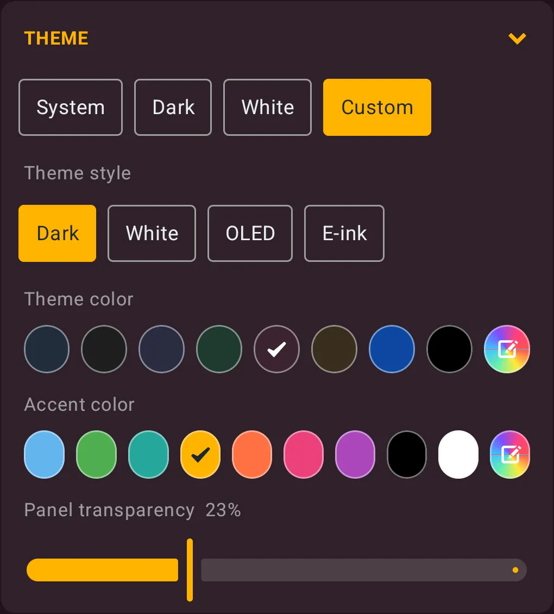<figcaption>Custom theme settings: style, theme colour, accent colour and panel transparency</figcaption></figure>
<figure style="width:28.8%"><figcaption>Custom dark theme with transparent panels: the covers show through the navigation bar</figcaption></figure>
<figure style="width:80%">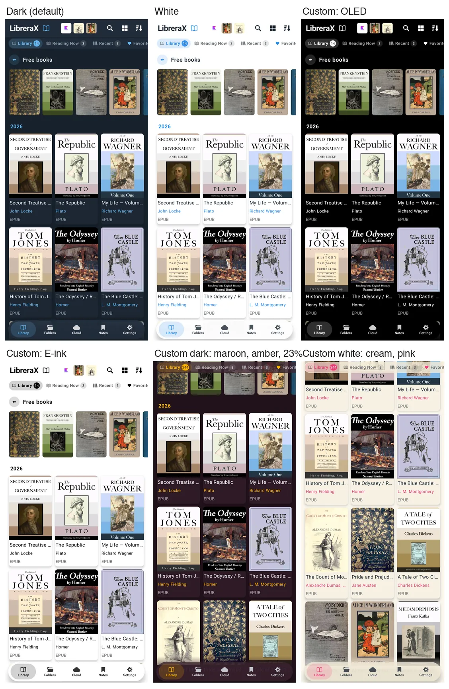<figcaption>App themes compared</figcaption></figure>
<figure style="width:80%">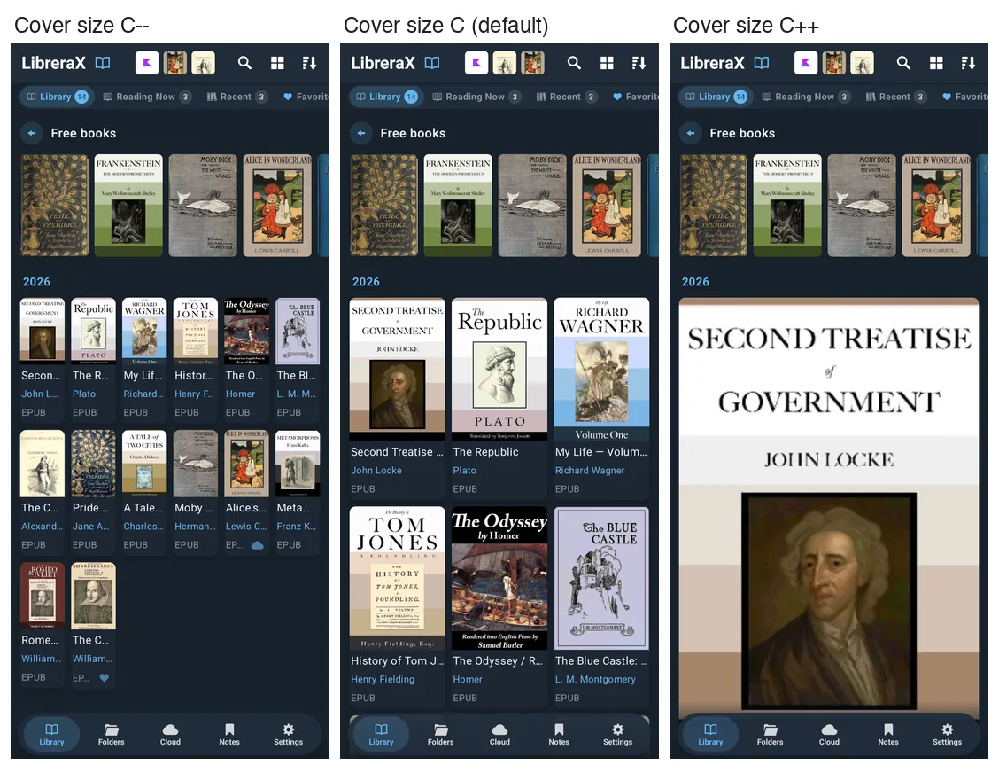<figcaption>Cover size compared: C--, C and C++</figcaption></figure>
<figure style="width:80%">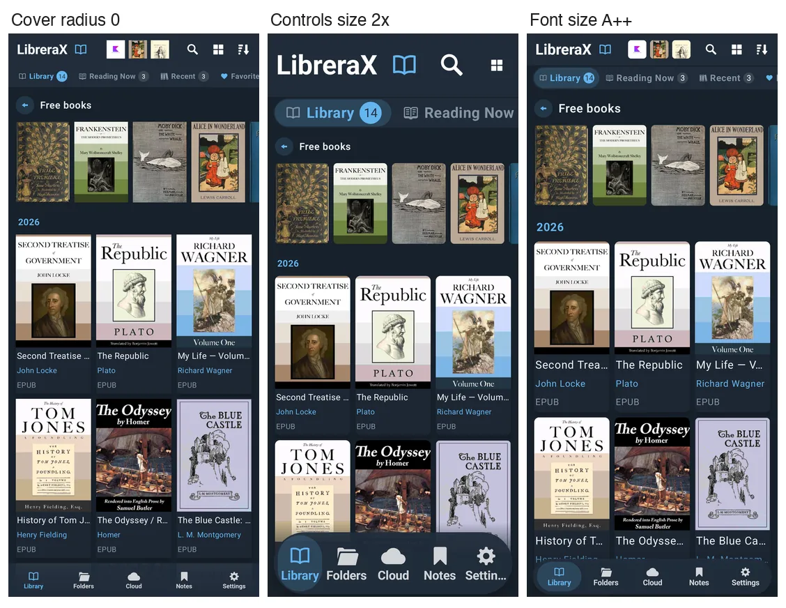<figcaption>Cover radius 0, Controls size 2x and Font size A++</figcaption></figure>
<figure style="width:80%">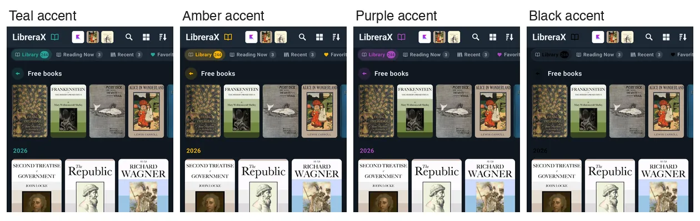<figcaption>The same library with different accent colours</figcaption></figure>
<figure style="width:27.2%">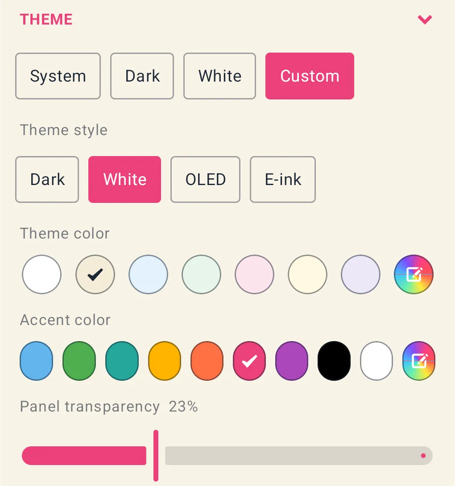<figcaption>Custom theme in the White style</figcaption></figure>
<figure style="width:28.8%">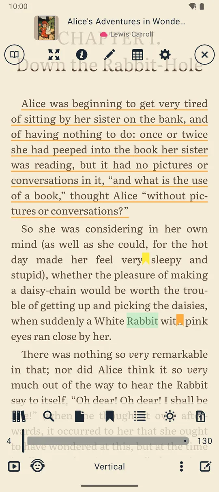<figcaption>The custom white theme in the reader</figcaption></figure>
<figure style="width:28.8%">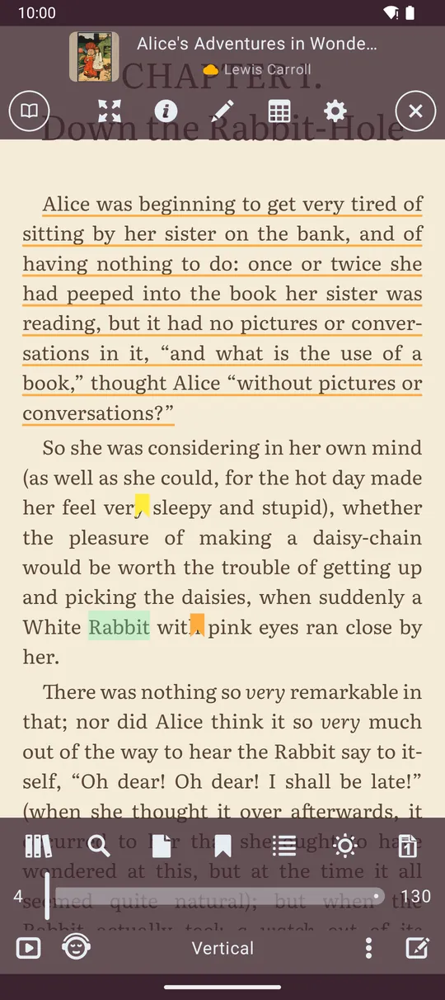<figcaption>The custom dark theme in the reader: the panels are see-through</figcaption></figure>
</div>

All under Settings, each in a folding section.

### 1.15.1 "Theme"
Chips: "System", "Dark", "White", "Custom".

| Theme | Look |
|---|---|
| "System" | follows the phone: Dark or White |
| "Dark" (**default**) | blue-grey panels, dark background, light-blue accent |
| "White" | white panels and background (light grey on iOS with System components), blue accent |
| "Custom" | your own colours (below) |

- The old stand-alone OLED theme is converted automatically into Custom → OLED style.
- The first start on an e-ink device begins in Custom → E-ink, unless a theme was chosen before.

### 1.15.2 Custom theme
- **"Theme style"** chips: "Dark", "White", "OLED", "E-ink".
  - OLED = pure black panels, white accent, no panel transparency.
  - E-ink = white panels, black accent, no transparency; **turns animations off** and sets the reader's page theme to the
    first (plain day) theme. Choosing another style turns animations back on.
- **"Theme color"**: dark styles offer blue-grey, charcoal, indigo, forest green, maroon, brown, deep blue and black;
  white styles offer white, sepia, light blue, light green, light pink, light yellow and lavender; plus a rainbow swatch for any colour.
- **"Accent color"**: light blue, green, teal, amber, orange, pink, purple, black and white, plus a rainbow swatch.
- Colour dialog: preview square, colour code field, "Hue", "Saturation", "Brightness" sliders, "Apply"/"Cancel"
  (changes preview live; Cancel restores).
- **"Panel transparency  N%"**: slider 0–70 % (panels from fully opaque to 30 % opaque). Default 8 %.
- The background follows the theme colour (darker for dark styles, lighter for white); the text colour follows the style.

### 1.15.3 Sizes

| Setting | Options | Default | Effect |
|---|---|---|---|
| "Controls size" | 1x, 1.25x, 1.5x, 1.75x, 2x | 1x on phones, 1.5x on tablets, until chosen | scales bars, buttons, chips, tab bar |
| "Cover size" | C--, C-, C, C+, C++ | C | Grid/Covers columns across a phone's portrait width: 6, 4, 3, 2, 1 (+1 on tablets; more in landscape). List cover scale 0.8, 0.9, 1.0, 1.1, 1.2 |
| "Cover radius" | 0, 1, 2, 3, 4 | 2 | corner rounding ×0, ×0.5, ×1, ×1.5, ×2. **"0" also makes the tab bar, top strip and chips square** |
| "Font size" | A--, A-, A, A+, A++ | A | app text scale 0.85, 0.92, 1.0, 1.12, 1.25 |

### 1.15.4 Other appearance switches (Settings → "Other settings")

| Label | Type | Default | Effect |
|---|---|---|---|
| "Date format" | menu | System | "System", "yyyy-MM-dd", "dd.MM.yyyy", "dd/MM/yyyy", "MM/dd/yyyy", "d MMM yyyy", "Custom…" (pattern up to 40 characters; hint "yyyy – year, MM – month, MMM – month name, dd – day"; live preview). Used on book cards and in File info |
| "Hide duplicates" | switch + rule | on, by author and title | §1.14.1 |
| "Full screen" | switch | off | §1.1.4 |
| "Enable animations" | switch | on (off for OLED/E-ink) | transitions, crossfades; with it off, presses show a brief instant highlight (for e-ink) |
| "Show book covers" | switch | on | off = placeholders only, and covers are not extracted |
| "Show file names" | switch | off | adds the file name line to List/Two columns/Grid cards |
| "System components" | switch | on | iOS 26+ only (§1.1.2) |
| "Calibre metadata.opf" | switch | off | §1.13.4 |
| "Check for updates" / "When the app starts" | switch | on | only in builds that support self-update |

### 1.15.5 Covers
- Covers are taken once from each book and kept; PDF and other page-based formats use the first page.
- "Update metadata" or saving metadata replaces the kept cover. Restoring a backup re-creates all covers.

## 1.16 Metadata editor ("Edit metadata")

<div class="shots">
<figure style="width:25.0%">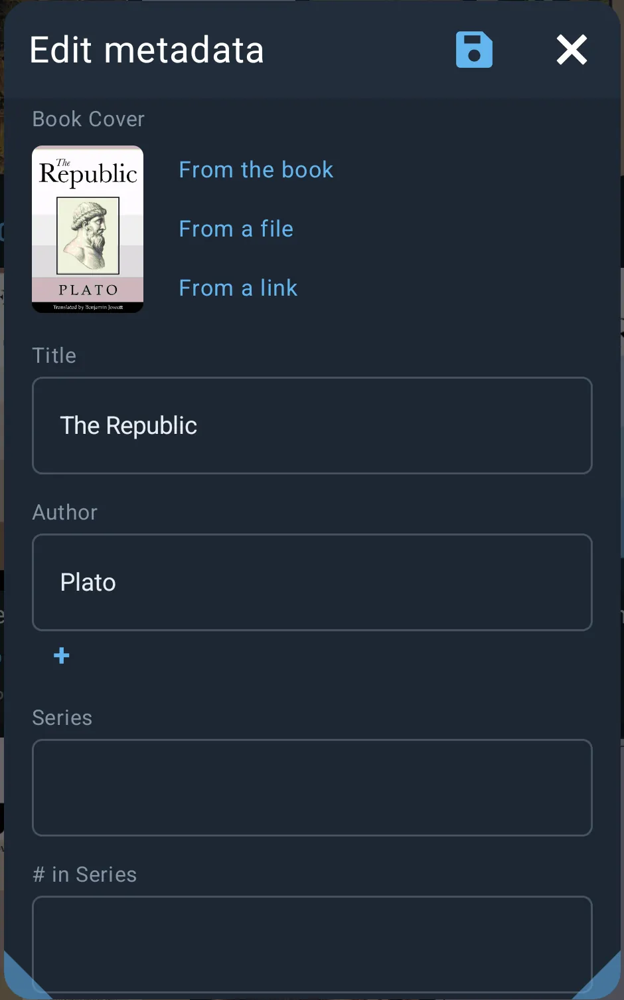<figcaption>Edit metadata</figcaption></figure>
</div>

- Available for **EPUB, FB2, FB2.ZIP, PDF**. Open from File info (pencil or ⋮ → "Edit metadata").
- Note shown: "Saving writes these fields into the book file itself."
- Save with the disk icon in the title bar or the "Save" button; "Cancel" discards. A spinner shows while writing.

| Field | Input |
|---|---|
| "Book Cover" | EPUB/FB2 only. Preview + "From the book" (grid of the images inside the book), "From a file" (image picker), "From a link" (web address + "Apply"; up to 12 MB), "Cancel" (undo the choice) |
| "Title" | text |
| "Author" | list: one field per author, "+" adds, × removes |
| "Series" | text |
| "# in Series" | text |
| "Genre" | list like Author |
| "Language" | text |
| "Publisher" | text |
| "Publication Date" | text + calendar button → wheel picker (day / month / year; years from 1000 or earlier to 10 years ahead; "OK"/"Cancel"); the date is saved as `yyyy-MM-dd` |
| "ISBN" | text |
| "Annotation" | HTML text with a toolbar: **B** bold, *I* italic, P paragraph, BR line break, H heading, T remove formatting, "Copy", "Paste", eye = rendered preview (selection works in the preview too) |

- Keywords cannot be edited here.
- After saving, the cover and book details in the library are refreshed from the file.
- **PRO gate**: in the free edition saving first plays a short rewarded video, which unlocks PRO for 3 hours ("Applying
  this plays a short video first, then everything is open for 3 hours. Subscribe for … to skip the video.").
- Errors (red): "the book file is not reachable", "the picture could not be read", "nothing could be fetched from that link",
  or the error message from writing the file.

## 1.17 Backup and restore

- Settings → **"Backup"** card: **"Export"** and **"Import"**.
- **Export**: saves the whole library, with all your settings, to a file you choose, named
  `librerax_db10_YYYY-MM-DD-HHMM.db`. Message "Export" when done. Android: save-as dialog; iOS: export picker.
- **Import**: pick a file → dialog "Import" — "Importing replaces the whole library and restarts the app." → "Import"/"Cancel".
  - The file must be a LibreraX library backup ("that file is not a library") from this version of the app or one it
    can upgrade ("that library was made by another version of the app (X against Y)").
  - Replaces the library, re-creates covers, restores the settings contained in the backup (values that belong to this
    device — subscription, trial, launch counters and install id — are kept), then restarts (Android: the app restarts;
    iOS: returns to the library).
  - Afterwards a banner: "The library is back from the backup, with your settings. Android does not hand the folder
    permissions over with it: give the app access to your book folders again below." (× dismisses), together with the
    folders-need-access list on Android.
- Backed up: books, progress, hearts, recent, read marks, tags, bookmarks, annotations, the library folders list, all
  settings. Not backed up: the book files, covers, folder permissions (Android).

## 1.18 Import from Librera (Android only)

- Started from the old **Librera** app's export to LibreraX: Librera hands its profile over, and LibreraX accepts it
  only from a Librera app. A small overlay "Export progress" with a progress bar is shown, then the library opens.
- If Librera sends a named profile, that one is used; otherwise the first one.
- What is imported, matched to books by **file name** (ignoring case):

| Data | Rule |
|---|---|
| Books Librera could open | up to 400 books that LibreraX cannot reach on its own are added to the library; books whose file was missing here are relinked |
| Library folders | Librera's search folders are added only when LibreraX may read them; then a scan runs (also when the library is empty) |
| Reading positions | applied only if newer than the position here; the book is marked read when the position is at the end |
| Tags | added; existing tags kept |
| Favourites | added unless already hearted |
| Recent | added to the recent list |
| Excluded | Librera's excluded books become Excluded here |
| Bookmarks | added once (no duplicates), with Librera's page text so the place can be found |
| Highlights / notes | PDF-type pages → annotations at the exact place; reflowable books → highlights placed by their text when the book opens; others → bookmarks |

## 1.19 Settings that belong to the library (summary)

| Settings section | Items |
|---|---|
| "Folders to Scan" + "Rescan" | folder list (tap = open in the Folders tab or give access again; long-press = select, bin icon removes; removal is refused while scanning: "Folders can be removed when the library scan finishes"), "Add folders", "Add books" |
| "Excluded folders" | list; long-press + "+" to include again |
| "Library  N" | book count, scan progress, format switches |
| "Theme", "Controls size", "Cover size", "Cover radius", "Font size" | §1.15 |
| "Navigation bar" | §1.1.1 |
| "Library tabs" | §1.3.4 |
| "Book actions" | §1.8.1 |
| "Other settings" | §1.15.4 |
| "Backup" | §1.17 |
| "Language" | "System" or an app language |

## 1.20 Android vs iOS differences

| Area | Android | iOS |
|---|---|---|
| Library folders | folders picked in the system picker; access can be lost after reinstall/restore (banner + give access again) | access to picked folders is kept; `Documents/Books` added automatically |
| "Add folders" menu | storage volumes, "Downloads", cloud providers (Google Drive accounts…) | system picker directly |
| "Add books" | files used in place | files copied into `Documents/Books` |
| Folders tab | full browser; visible by default | hidden by default; nothing to list |
| Scan | on demand; keeps running in the background | runs at every app start and on demand |
| Tab bar / controls | floating bar | iOS 26+: native Liquid Glass tab bar, segmented shelves, glass menus (switch "System components") |
| Long-press menus on shelf chips | yes | not with native segments |
| DJVU format | with [Librera PRO](https://play.google.com/store/apps/details?id=com.foobnix.pro.pdf.reader) 9.6+ | not offered |
| "Open with" | system app chooser | share sheet |
| Pin book widget from File info | when the launcher supports it | not offered |
| Import from Librera | yes | no |
| After backup import | the app restarts | returns to the library |
| Top bar collapse on scroll | yes | yes on iPhone, never on iPad |

## 1.21 Notable details and edge cases

- Your shelf, sort, sort direction, display and group mode choices are remembered.
- Opening groups from File info works from any screen: the app switches to the Library tab, selects the group mode and
  scrolls to the group.
- A book appears on Favorites/Recent/Read/tag shelves even if it lives outside your library folders, but never if it is
  excluded or its file is missing.
- Excluding a duplicate card excludes **all** of its copies; including from the Excluded shelf brings them all back.
- When a scanned file disappears it drops out of "Library" but keeps its progress, heart and tags; if it comes back
  (same place) everything is there again.
- The "Library  N" number in Settings counts with the current format filter and duplicate rule.
- Books added by hand that are no longer readable are hidden as missing until they become readable again.
- Popups (File info, tags, settings dialogs) remember their size and position; double-tap the title to
  reset/maximise.
- The "Last read" time also changes when you heart a book or change its tags.
- Removing a folder from "Folders to Scan" gives up the app's access to it on Android and rescans (its books leave the
  Library shelf).

# Part 2 — Reading

Everything on screen while a book is open. The main subject is reflowable books (EPUB, MOBI/AZW3, FB2, TXT/MD/HTML, DOC/DOCX/RTF), laid out by foliate-js in the platform WebView. The panels, tap zones, keys, status bar, themes and most dialogs are shared with PDF, DjVu and comics.

## 2.1 Which books open in the reflowable reader

| Extension(s) | How it opens |
|---|---|
| `epub` | Opened directly. Fixed-layout EPUBs are supported too: they are counted and turned by real page. |
| `mobi`, `azw`, `azw3`, `kf8`, `prc` | Opened directly. |
| `fb2`, `fb2.zip` | Opened directly. |
| `txt`, `md`, `markdown`, `html`, `xhtml` | Converted by the app and shown as a book with one section. |
| `doc`, `docx`, `rtf` | Converted by the app and shown as a book with one section. |
| `zip` holding one of the above | Opened as the book inside. |

CBZ/CBR comics, PDF and DjVu use the page reader instead, but share the screens described here.
When an HTML page is opened, anything that would run code, load another page or navigate away is removed
first (the page is read, not run).

### 2.1.1 Video, audio, formulas and vector graphics

<div class="shots">
<figure style="width:28.8%">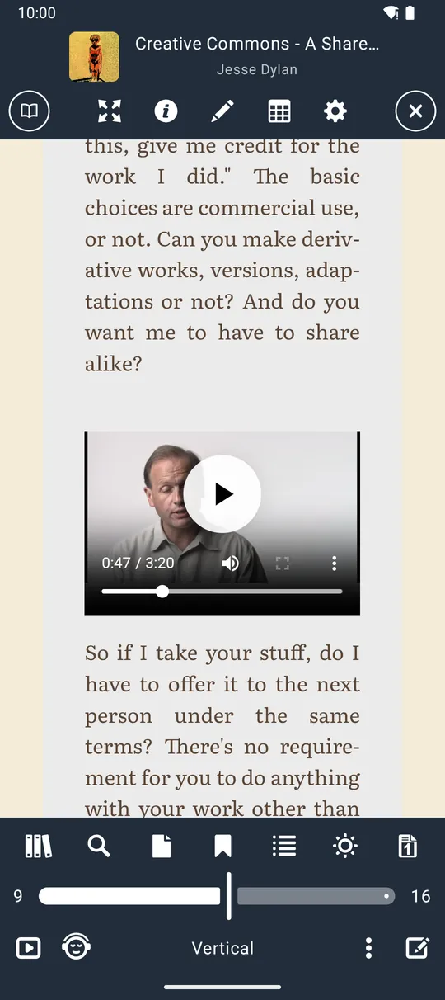<figcaption>Video inside an EPUB 3 book</figcaption></figure>
<figure style="width:28.8%">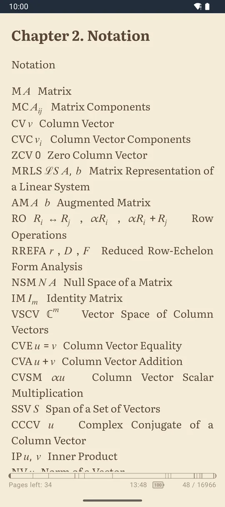<figcaption>Math formulas (MathML): notation list</figcaption></figure>
<figure style="width:28.8%"><figcaption>Math formulas (MathML): a system of equations and a matrix</figcaption></figure>
</div>

EPUB 3 books can carry more than text and pictures, and LibreraX shows them inside the page:

| Content | What you see |
|---|---|
| Video | A player in the page with play/pause, a time line, volume and full screen. |
| Audio | A player with play/pause and a time line. |
| Math formulas (MathML) | Formulas laid out as in a textbook: fractions, indices, sums, matrices and systems of equations. They keep their own size when you change the font size. |
| Vector graphics (SVG) | Drawings and diagrams stay sharp at any zoom and keep their own size. |
| Rich descriptions | The book description in File info can contain formatting such as bold, italic, headings and line breaks. |

These parts are part of the book itself, so read-aloud skips them and the theme colours apply only to the text
around them.

## 2.2 Screen layout at a glance

<div class="shots">
<figure style="width:28.8%">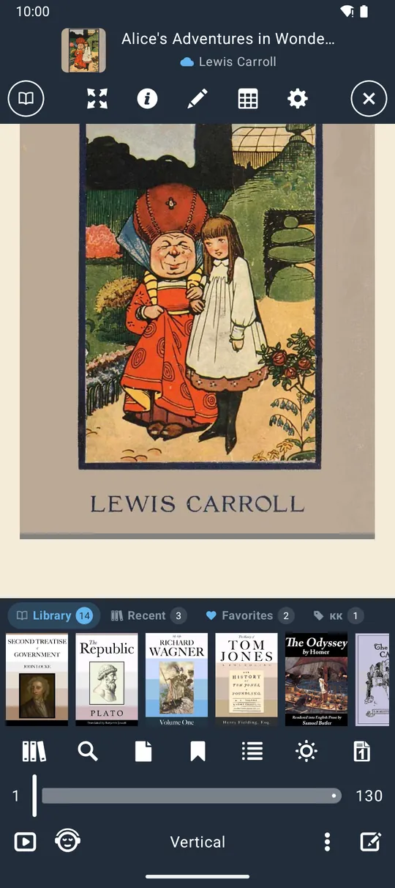<figcaption>The reading screen with panels and the book strip</figcaption></figure>
</div>

- **Page area**: the book, edge to edge, with the reader's padding and the status bar space kept clear.
- **Panels (menu)**: a top panel and a bottom panel (footer) that appear and disappear together. They are
  shown when a book opens. A tap in the "Show / hide menu" zone toggles them. Any tap while they are
  shown just hides them. Page turns, keys and settings changes also hide them.
- **Status bar / percent**: drawn over the page when the panels are hidden (the full bar is also hidden
  while the panels are shown).
- **Brightness strip**: an invisible strip along the left edge (on by default).
- **Badges**: a short dark badge in the middle of the screen after some actions (font size, theme name,
  font name, brightness %, auto-scroll speed, text selection on/off). It stays for about 1.2 seconds.
- A spinner shows until the book has opened and moved to its saved place. Errors show in red in the middle.

On iOS 26 and later, when the app's native tab bar setting is on, the panels, buttons, sliders and menus
use native "glass" components. The functions are the same.

## 2.3 Top panel

<div class="shots">
<figure style="width:28.8%">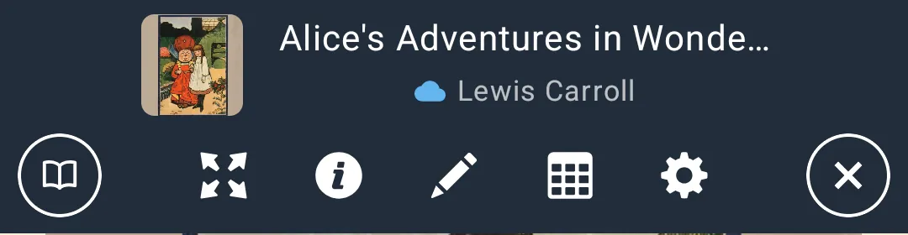<figcaption>The top panel</figcaption></figure>
</div>

**Book line** (centre):

| Element | Action |
|---|---|
| Cover thumbnail | Tap: opens the Book info dialog (metadata, edit metadata, etc.). Shows a series flag when the book is in a series. |
| Title | Tap: opens the Book info dialog. |
| Second line | The author. If there is no author, the current chapter. Before it, small marks: green check = "Read", cloud = "Cloud" (book is in the cloud), heart = "Favorites", and the text "[Reflow]" for EPUBs made by "Reflow to EPUB". |

**Icon row** (left to right):

| Icon | Action |
|---|---|
| LibreraX mark (ring) | Go to the Library. Reading continues in the background (the book is kept). |
| Fullscreen (four arrows) | Toggles full screen. |
| Info (i) | Opens the Book info dialog. |
| Pen (reflowable books) | Opens the "Replace" rules dialog (find and replace / highlight rules). |
| Crop (PDF only, instead of the pen) | Opens "Crop margins"; underlined while cropping is on. |
| Table (grid) | Opens the "Tap zones" editor. |
| Cogwheel | Opens reader "Settings". |
| X (ring) | Close the book. |

## 2.4 Bottom panel (footer)

<div class="shots">
<figure style="width:28.8%">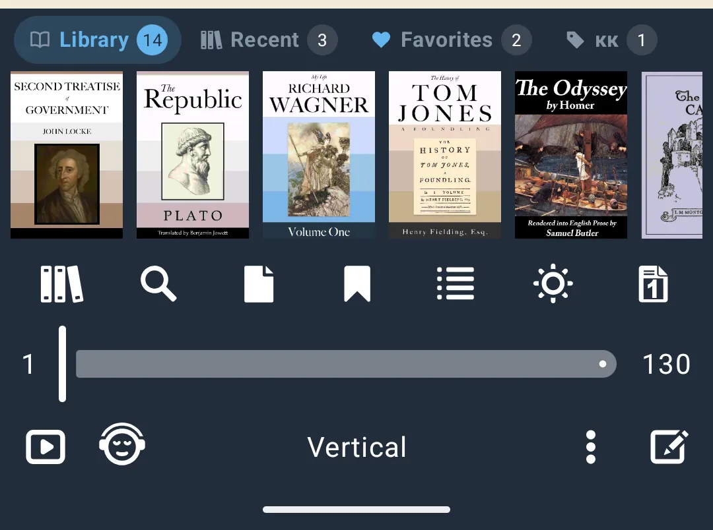<figcaption>The bottom panel with the book strip</figcaption></figure>
<figure style="width:16.5%">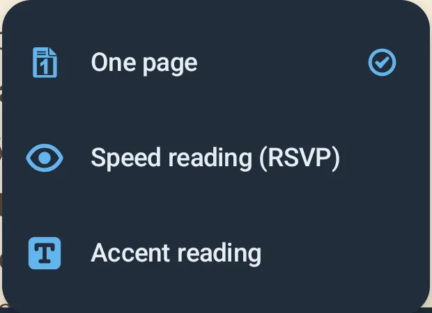<figcaption>The layout menu</figcaption></figure>
<figure style="width:14.3%">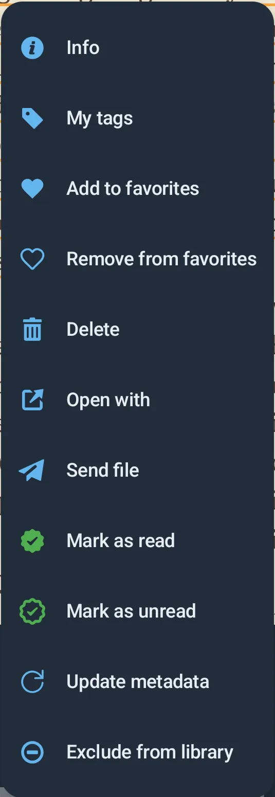<figcaption>The book menu (⋮)</figcaption></figure>
</div>

From top to bottom:

1. **TTS transport** (only while read-aloud is speaking or paused): previous / play-pause / next.
   Pressing a button hides the panels. A "PRO" tag may show next to it in the FREE edition.
2. **Book strip** (toggled by the first footer icon, remembered): a row of shelf chips and up to 40 covers.
   - Chips: "Library N", "Recent N", "Favorites N", then one chip per user tag ("tag N").
     Long-press a tag chip: "Delete tag".
   - Tap a cover: open that book. Long-press: start multi-select. In multi-select a bar shows the count and
     buttons: close (X), info (books info dialog), tag (tags popup), heart (add to favorites),
     empty heart (remove from favorites).
   - The chosen shelf/tag, chip scroll and strip scroll position are remembered.
3. **Auto-scroll row** (only while auto scroll is armed): play/pause button, speed slider 2-100, speed number.
4. **Main icon row**:

| Icon | Action |
|---|---|
| Library shelf | Show / hide the book strip. |
| Pen-draw (PDF only, when drawing is possible) | Toggle drawing/annotation tools. |
| Magnifier | "Find" (search in book). |
| File | "Go to page" (page previews grid). |
| Bookmark | "Bookmarks" (bookmarks, notes, highlights). |
| List | "Contents" (table of contents). |
| Moon / Sun | Switch between the night theme and the day theme (see 2.15). The icon shows a moon when the night theme is on. |
| Layout icon (reflowable) | Menu: "One page", "Two pages" (paged mode only); then (PRO section) "Speed reading (RSVP)", "Accent reading". The icon itself shows the current mode. |
| Layout icon (PDF) | Menu: "Half page" (when splitting is possible), "One page", "Two pages" (paged only); PRO section: "Reflow pages", "Speed reading (RSVP)", "Accent reading", "Reflow to EPUB" (PDF files only). |
| Arrow left (only after following a link) | "Back from link". Long-press: forget the whole back history. |

5. **Seek row**: current page number, a slider over all pages, total page count. Dragging jumps live
   and settles on release. Hidden until the book is positioned.
6. **Bottom row**:

| Control | Action |
|---|---|
| Play-in-circle | Toggle auto scroll (switches to scroll mode if needed). |
| Headphones | Opens the TTS (read aloud) dialog. |
| Mode label (centre) | Shows the current mode: "Paged", "Vertical" (scroll), "RSVP", "Accent" or "Reflow" (PDF). Tap: toggles Paged/Vertical; if RSVP or Accent is on, tap turns it off; for PDF, cycles through its modes. |
| More (vertical dots) | Book menu: "Info", "My tags", "Add to favorites"/"Remove from favorites", "Delete", "Open with", "Send file", "Upload to Cloud", "Mark as read"/"Mark as unread", "Update metadata", "Exclude from library"/"Include in library" (order and visibility follow the library's book-menu customisation). |
| Square-edit | Text selection on/off (dimmed when off). |

## 2.5 Tap zones

<div class="shots">
<figure style="width:24.7%">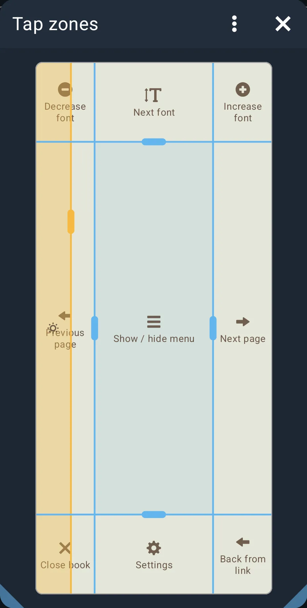<figcaption>The Tap zones editor</figcaption></figure>
<figure style="width:19.6%">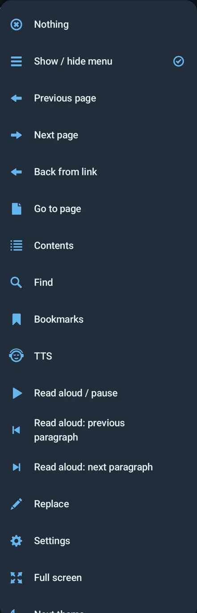<figcaption>Actions that can be given to a zone</figcaption></figure>
</div>

The screen is divided into a 3 x 3 grid. Each of the 9 zones runs one action. The grid lines can be moved.

### Default layout

| | Left | Middle | Right |
|---|---|---|---|
| **Top** | "Decrease font" | "Next font" | "Increase font" |
| **Middle** | "Previous page" | "Show / hide menu" | "Next page" |
| **Bottom** | "Close book" | "Settings" | "Back from link" |

Default boundaries: left line at 25 % of the width, right line at 75 %, top line at 15 % of the height,
bottom line at 85 %.

### All assignable actions

| Action (UI label) | What it does |
|---|---|
| "Nothing" | No action. |
| "Show / hide menu" | Toggles the panels. |
| "Previous page" | Previous page (hides panels). |
| "Next page" | Next page (hides panels). |
| "Back from link" | Returns to where you were before following a link. |
| "Go to page" | Opens Go to page. |
| "Contents" | Opens the table of contents. |
| "Find" | Opens search. |
| "Bookmarks" | Opens bookmarks. |
| "TTS" | Opens the read-aloud dialog. |
| "Read aloud / pause" | Starts or pauses read aloud. |
| "Read aloud: previous paragraph" | TTS step back. |
| "Read aloud: next paragraph" | TTS step forward. |
| "Replace" | Opens the Replace rules dialog (reflowable books only). |
| "Settings" | Opens reader settings. |
| "Full screen" | Toggles full screen. |
| "Next theme" | Cycles to the next theme that is switched on in the Themes list; badge shows its name. |
| "Next font" | Cycles to the next font in the font list; badge shows its name. |
| "Increase font" | Font size +5 (+0.5 on the displayed scale); badge shows the size. |
| "Decrease font" | Font size -5; badge shows the size. |
| "Auto scroll" | Toggles auto scroll. |
| "Library" | Goes to the Library. |
| "Close book" | Closes the book. |
| "Close app" | Closes the whole app (Android: closes the app; iOS: closes the reader). |
| "Text selection" | Toggles text selection; badge "Text selection on" / "Text selection off". |
| "Crop margins" | Opens Crop margins (PDF only). |

### Rules

- At least one zone always shows the menu: if you remove "Show / hide menu" from every zone, the
  middle zone is set back to it.
- While the panels are shown, any tap only hides them (the zone action does not run).
- A tap on a link in the text follows the link instead of running the zone action.
- A tap on a highlight or note opens that annotation instead.
- A tap while text is selected just clears the selection.
- With "Enable tap zones" off, every tap toggles the menu.
- A tap on the chapters bar of the status bar counts as a tap on the zone under it.

### The "Tap zones" editor

Opened from the table icon in the top panel. Shows a screen-shaped preview in the current theme colours.

- Tap a zone: a menu of all actions (with icons) to choose from.
- Drag any of the four lines (accent colour, with grips) to resize zones. Limits: an outer zone is at
  least 5 % of the screen; the middle zone at least 10 %.
- The brightness strip is drawn as a yellow band with a sun; drag its yellow line to change the strip
  width (2-20 % of the width).
- Menu (three dots): "Enable tap zones" (check), "Brightness strip" (check), "Reset" (default actions
  and boundaries).

| Setting | Type | Default |
|---|---|---|
| Zone actions | 9 actions | see table above |
| Left / right line | 5-90 % / 10-95 % of width | 25 % / 75 % |
| Top / bottom line | 5-90 % / 10-95 % of height | 15 % / 85 % |
| "Enable tap zones" | on/off | on |

## 2.6 Gestures in the page

| Gesture | Result |
|---|---|
| Tap | Tap-zone action (see 2.5). |
| Horizontal swipe (paged) | Turns the page. Tiny finger wobbles are ignored, so a tap is never taken for a swipe. |
| Vertical drag (scroll mode) | Scrolls. Pulling on past the end of a chapter opens the next one; past the start opens the previous one. Short chapters turn on a single swipe. |
| Long press on a word | Selects the word (if text selection is on). Keep the finger down and drag to extend. |
| Drag a selection handle | Changes the selection; dragging one end past the other flips it. |
| Long press on a picture (not on tiny ones) | Opens it full screen on black. Pinch to zoom up to 8x, drag when larger than the screen, tap to close. Not offered in fixed-layout books. |
| Vertical drag in the left brightness strip | Changes screen brightness (see 2.10). |
| Horizontal swipe in the brightness strip | Turns the page (paged mode). |
| Drag along the chapters bar | Moves through the book (see 2.11). |
| Long press + drag on the percent label | Moves the label anywhere; double-tap puts it back in the corner. |
| Tap on a link | Follows it. Internal links remember where you were ("Back from link"). Web and e-mail links open outside the app. |
| Tap on a highlight / note | Opens the annotation popup. |

While a selection is being made, page turns are blocked in paged mode so the page does not move under
your finger. In scroll mode a mostly vertical motion becomes a scroll instead.

## 2.7 Keyboard, mouse wheel and volume keys

### Keyboard (tablets with a keyboard, Mac running the iPad app)

| Keyboard key | Action |
|---|---|
| Left arrow, Page Up | Previous page |
| Right arrow, Page Down | Next page |
| Space | Next page |
| Shift + Space | Previous page |
| Up arrow | Scroll mode: scroll up by 15 % of the screen. Paged: previous page. |
| Down arrow | Scroll mode: scroll down by 15 %. Paged: next page. |

Keys with Ctrl, Cmd or Alt held are ignored. Keys are ignored while typing in a field and while a
selection is being made; otherwise a key press clears the selection and hides the panels.

### Mouse wheel / trackpad

- **Paged mode**: one page turn per wheel gesture. A short pause in the wheel starts a new gesture.
- **Scroll mode**: the wheel scrolls. Pushing on at the bottom of a chapter opens the next one (and at
  the top goes back).
- Ctrl + wheel is not taken by the reader.
- "Reverse mouse wheel" flips the direction (default off).

### Volume keys (Android only)

| Setting | Default |
|---|---|
| "Turn pages with volume keys" | on |

- Volume Down = next page, Volume Up = previous page (panels are hidden).
- While auto scroll is armed: Volume Up = speed +1, Volume Down = speed -1 (badge shows the speed).
- While read-aloud is speaking, the keys are left to the system so they change the volume.
- While text is selected, the keys do nothing.
- The system volume panel does not appear when the keys turn pages.
- The switch is not shown on iOS.

## 2.8 Paged vs scroll, columns, page-turn animation, RTL

<div class="shots">
<figure style="width:28.8%">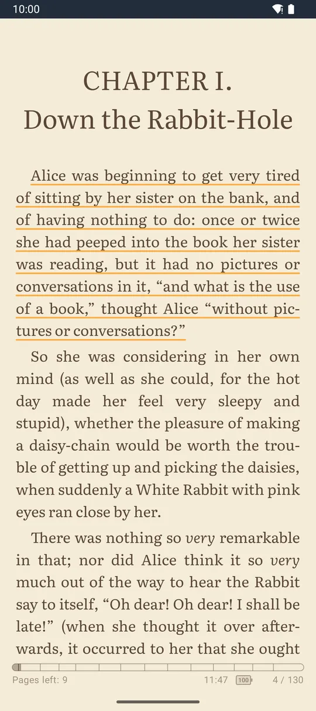<figcaption>A page with the full status bar at the bottom</figcaption></figure>
</div>

### Paged and Vertical (scroll) modes

| Setting | Values | Default |
|---|---|---|
| Reading mode | "Paged" / "Vertical" | Paged |

- Switch with the mode label in the footer. The mode is global (applies to every book).
- Scroll mode reads the whole book as one continuous scroll: chapters follow each other automatically.
- In scroll mode, a page turn by tap, key or volume key moves so that the first line not fully visible
  ends up whole at the top (or, going back, the last such line ends whole at the bottom), instead of a
  blind full screen.
- In paged mode, the space left under the last whole line is split between top and bottom, so text is
  vertically centred; the last line of a page is always filled.

### Two pages (columns)

| Setting | Values | Default |
|---|---|---|
| "One page" / "Two pages" | 1 or 2 columns | One page |

Two columns are only offered in paged mode. They split the screen into two equal columns, in portrait too.

### Page-turn animation

| Setting | Type | Default |
|---|---|---|
| "Enable animations" | on/off | on (off when the app theme is OLED) |

On: pages slide across quickly and linearly; scroll steps are smooth. Off: instant (better for e-ink).

### Reading direction ("Orientation")

| Setting | Values | Default |
|---|---|---|
| "Orientation" | "Auto", "LTR", "RTL" | Auto (the book decides) |

Sets the text direction; page turning flips with it (RTL books turn right-to-left). Note: this is the
text direction, not a screen-rotation lock. There is no screen orientation lock in the reader; the screen
follows the device rotation.

## 2.9 Full screen, keep screen on

<div class="shots">
<figure style="width:28.8%">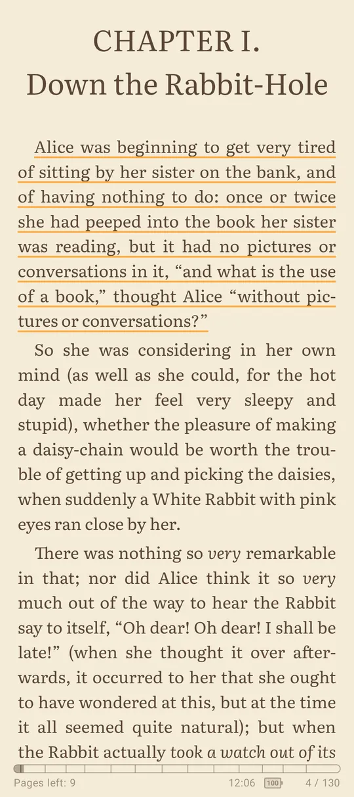<figcaption>Full screen: no system bars while reading</figcaption></figure>
</div>

| Setting | Type | Default |
|---|---|---|
| Full screen | on/off | off |
| "Keep screen on" | Off, 5 min ... 3 h | 5 min |

**Full screen**: toggle with the top-panel icon or the "Full screen" tap action.
- Android: the system bars hide whenever the panels are hidden; swipe from the edge to show them briefly.
- iOS: the status bar is hidden while the panels are hidden. On an iPhone the area under the camera
  housing is still kept clear; on an iPad the text goes to the top.

**Keep screen on**: the screen stays awake for the chosen time after your last touch, page turn or
panel change. Steps: 5 minutes up to 60 minutes, then 15 minutes, up to 180 minutes (3 h). "Off" lets
the system timeout apply. While auto scroll or RSVP is playing the screen is always kept on.

## 2.10 Brightness

| Setting | Type | Range | Default |
|---|---|---|---|
| "Brightness strip" | on/off | | on |
| Strip width | share of the width | 2-20 % | 15 % |
| Reader brightness | level | 1-100 % (or system) | system |

- Drag up or down inside the strip at the left edge. A badge with a sun shows the level in percent.
- A tap in the strip still runs the tap zone under it; a horizontal swipe still turns the page.
- The strip is not active over a full-screen picture, in RSVP/Accent modes, or while drawing in a PDF.
- Android: changes the brightness for the reader only (the system setting is untouched); it goes back to
  normal when you leave the book.
- iOS: changes the screen brightness and restores the original value when you leave the book.
- The strip width can also be dragged in the Tap zones editor.

## 2.11 Status bar and progress display

<div class="shots">
<figure style="width:28.8%"><figcaption>Status bar settings</figcaption></figure>
<figure style="width:28.8%"><figcaption>The full status bar: chapter ticks, pages left, clock, battery, page number</figcaption></figure>
</div>

Choose the mode in Settings -> "Status bar" section -> "Status bar":

| Mode (label) | What shows |
|---|---|
| "Full · Top" | Full bar at the top of the page. |
| "Full · Bottom" (default) | Full bar at the bottom of the page. |
| "Percent" | Only a small "NN%" label in the bottom-right corner. |
| "None" | Nothing. |

The text area always keeps room for the full bar, so text never runs under it.

### Full bar

Two lines:
1. **Chapters bar** ("Chapters bar"): a rounded progress bar filled to your position, with a thin tick at
   each chapter start.
2. **Facts line** (left to right): "Pages left: N" in the current chapter (or the book title when the book
   has no chapter marks), the clock (HH:MM, 24-hour, updated each minute), a battery icon with the charge
   in percent (updated every minute), and "page / total".

When placed at the top, the facts come first and the chapters bar is under them.

| Setting (label) | Type | Range / step | Default |
|---|---|---|---|
| "Chapters bar" | on/off | | on |
| "Swipe the status bar to move through the book" | on/off (shown when the chapters bar is on) | | on |
| "Pages left in chapter" | on/off | | on |
| "Time" | on/off | | on |
| "Battery" | on/off | | on |
| "Page number" | on/off | | on |
| "Chapter levels" | stepper | 1-6 | 2 |
| "Bar height" | stepper | 50-250 %, step 10 | 100 % |
| "Font size" | stepper | 50-250 %, step 10 | 100 % |

- **Chapter levels**: how many table-of-contents levels get ticks and count for "Pages left". Counting
  starts at the first level that has at least two entries.
- **Swipe**: drag a finger along the chapters bar to move through the book. The position snaps to a
  nearby chapter tick. A plain tap on the bar is a tap on the page (tap zones).
- If "Back from link" is available, a small back-arrow pill appears at the right end of the bar
  (long-press clears the history).
- On iPhones with a home indicator, the bar is lowered into the rounded corners and kept clear of them.

### Percent mode

| Setting (label) | Type | Range / step | Default |
|---|---|---|---|
| "Font size" | stepper | 50-250 %, step 10 | 100 % |
| "Background transparency" | stepper | 0-100 %, step 1 below 10, else 5 | 55 % |
| Position | drag | anywhere on screen | bottom-right corner |

Long-press the label to pick it up (haptic feedback, accent border), drag it anywhere, let go. Its place
is kept as a share of the screen, so it stays in about the same place after rotation. Double-tap to send
it back to the corner.

### 2.11.1 Configuring the status bar, step by step

<div class="shots">
<figure style="width:27.2%"><figcaption>The &quot;Status bar&quot; modes: Full · Top, Full · Bottom, Percent, None</figcaption></figure>
<figure style="width:28.8%"><figcaption>Full · Top: the bar above the text</figcaption></figure>
<figure style="width:28.8%"><figcaption>Full · Bottom with &quot;Chapters bar&quot; off: only the facts line</figcaption></figure>
<figure style="width:27.2%"><figcaption>Percent mode settings: label font size and background transparency</figcaption></figure>
<figure style="width:28.8%"><figcaption>Percent: the label in the bottom-right corner (font size 200 %)</figcaption></figure>
<figure style="width:28.8%"><figcaption>Long-press the label and drag it: a blue outline shows while it moves</figcaption></figure>
<figure style="width:28.8%"><figcaption>The label dropped at the top centre of the page</figcaption></figure>
<figure style="width:28.8%"><figcaption>None together with full screen: only the text, edge to edge</figcaption></figure>
</div>

1. Open the reader's **Settings** (cogwheel in the top panel) and unfold **"Status bar"**.
2. Tap **"Status bar"** and pick a mode: **"Full · Top"**, **"Full · Bottom"** (default), **"Percent"** or **"None"**.
3. With a full bar, turn off what you don't need: **"Chapters bar"**, **"Pages left in chapter"**, **"Time"**,
   **"Battery"**, **"Page number"**. With the chapters bar off, the facts line stays and the text gets the space back.
4. With **"Percent"**, the settings change to **"Font size"** and **"Background transparency"** of the label.
5. **Move the percent label anywhere:** close the settings, long-press the "NN%" label until it shows a blue outline,
   drag it, and let go. It stays there, also after rotating the screen. **Double-tap** the label to send it back to the
   bottom-right corner.
6. With **"None"**, the page shows only the text: no bar, no percent.

### What "pages" mean in reflowable books

The page numbers in the seek bar, status bar, Go to page and bookmarks are fixed slices of the book's text
(each chapter counts for at least one). They do not change when you change the font size, margins or
screen, so a page number always points to the same place in the book.
Fixed-layout EPUBs are counted in their real pages.

The book is marked as read automatically when you reach 99 % or the last page.

## 2.12 Table of contents ("Contents")

<div class="shots">
<figure style="width:25.0%"><figcaption>Contents</figcaption></figure>
</div>

- Opens from the footer list icon or the "Contents" tap action.
- Nested chapters are indented. Chapters with sub-chapters have a "+"/"-" button to expand or collapse.
- On opening, everything is collapsed except the branch containing the current chapter, which is
  highlighted and scrolled into view.
- Menu (shown when the contents have levels): "+  Expand all", "-  Collapse all".
- Tap an entry to jump there. (Page numbers are shown only for page-based books such as PDF.)
- Empty contents show an empty-state message.

## 2.13 Go to page and the page previews grid

<div class="shots">
<figure style="width:24.7%"><figcaption>Go to page: rendered page previews</figcaption></figure>
</div>

- Title "Go to page". A grid of page previews, 3 per row, with the page number under each. The current
  page is highlighted in blue and the grid opens around it.
- Tap a preview to go there.
- The magnifier icon in the title shows a large number field (hint "1 - N", digits only, up to 7).
  Typing highlights that page in the grid; confirm to jump.
- Reflowable books: previews are real renderings of each page with your current theme, font and layout
  (each preview has the screen's shape).
- PDF/DjVu/comics: previews are page thumbnails.

## 2.14 Search in book ("Find")

<div class="shots">
<figure style="width:24.7%"><figcaption>Find: results with the match highlighted</figcaption></figure>
<figure style="width:28.8%"><figcaption>Matches marked on the page</figcaption></figure>
</div>

- Type the text and confirm (button or keyboard Done).
- Results stream in as they are found; the title shows "Find  N..." while searching and "Find  N" when done.
  A "Cancel" link stops the search.
- Each result shows a short excerpt (up to 3 lines) with the match in bold on yellow.
- Tap a result to jump to its exact place.
- Menu: "Clear all" (clears the query and results).
- A new search cancels the previous one. The last query is kept while the book is open.

## 2.15 Reading themes

<div class="shots">
<figure style="width:28.8%"><figcaption>The Themes list</figcaption></figure>
<figure style="width:24.7%"><figcaption>Editing a theme, with its contrast ratio in the title</figcaption></figure>
<figure style="width:100%"><figcaption>The six built-in reading themes</figcaption></figure>
</div>

### Built-in themes

| Name | Page (paper) | Text (ink) | Role |
|---|---|---|---|
| Day | white | near-black | Day theme |
| Book | sepia | dark brown | (default colours on first start) |
| Grey | light grey | dark grey | |
| Dark | dark grey | light grey | |
| Dusk | very dark brown | warm beige | |
| Black | black | light grey | Night theme |

A theme counts as dark when its page colour is dark.

### Choosing a theme

- **Theme row** (top of Settings): one "Aa" swatch per visible theme. Tap to apply. Choosing a light theme
  also makes it the "Day theme"; choosing a dark one makes it the "Night theme". The current day and night
  themes have a short accent underline.
- **Moon/Sun button** in the footer: switches between the day theme and the night theme.
- **"Next theme"** tap action: cycles through visible themes.
- **"Follow the phone's day and night mode"** (Themes section, default off): the reader switches to the
  day or night theme whenever the phone's light/dark mode changes.

### Themes section (Settings -> "Themes")

- One row per theme: drag handle (reorder by dragging), colour swatch, name, and a switch to show/hide
  the theme in the theme row and in "Next theme" cycling.
- Tap the swatch or name to edit.
- "+ Add" creates a new theme.

### Theme editor ("New theme" / "Edit theme")

- Live preview card: "Chapter One" and "The quick brown fox jumps over the lazy dog." in your book font,
  size and line spacing.
- **Contrast ratio** in the title, e.g. "12.3:1"; shown in red below 4.5:1.
- "PAGE" colour and "TEXT" colour, each with: a colour code field, ready-made swatches and R/G/B sliders (0-255).
  - Page swatches: 14 ready-made papers, from white through cream and sepia to grey and black.
  - Text swatches: 13 ready-made inks, from black through browns, greens, blues and greys to white.
- "Apply" saves. A new theme is named after its page colour's hex code. Editing the theme in use applies
  it at once.
- Menu (existing themes only): "Delete".

### How themes look in the book

- Page and text colours replace the book's own. When a specific font is chosen (not "Default") on a
  dark theme, all text takes the theme text colour, coloured backgrounds in the book disappear and
  links turn light blue, so nothing disappears on the dark page.
- On dark themes images are dimmed slightly (to 80 % brightness).
- If a book has its own light and dark styles, it follows the reader theme, not the phone setting.

| Setting | Default |
|---|---|
| Page colour / text colour | sepia / dark brown (the Book theme) |
| Themes list | the 6 built-ins |
| "Follow the phone's day and night mode" | off |

## 2.16 Paper texture and illustrations

### 2.16.1 "Paper"

<div class="shots">
<figure style="width:28.8%"><figcaption>&quot;Paper&quot; on, day theme, full screen without status bar</figcaption></figure>
<figure style="width:28.8%"><figcaption>&quot;Paper&quot; on, Dark theme: the grain shows on a dark page too</figcaption></figure>
</div>

| Setting | Default |
|---|---|
| "Paper" | off |

Lays the page on an aged-paper sheet in the theme's page colour instead of a flat colour: a slightly
uneven tone, a warm age tint and fine fibre. Page turns stay fast. On dark themes the warm tint is left
out and only the grain shows. The margins are aligned with the page so the whole screen reads as one
sheet. Also applies to PDF "Reflow pages".

### 2.16.2 "Replace white in images with page color" (multiply illustrations)

<div class="shots">
<figure style="width:28.8%"><figcaption>&quot;Replace white in images with page color&quot; off: the drawing sits on a white card</figcaption></figure>
<figure style="width:28.8%"><figcaption>&quot;Replace white in images with page color&quot; on: the drawing is printed on the page</figcaption></figure>
</div>

| Setting | Type | Range | Default |
|---|---|---|---|
| "Replace white in images with page color" | on/off | | on |
| "White level" (shown when on) | stepper | 50-100 %, step 5 | 85 % |

On a tinted (not white, not dark) theme, drawings printed on white are blended into the page, so their
white background takes the page colour and they look printed on the same paper. Photos and pictures with
their own background are left alone. "White level" sets how light a pixel must be to count as the white
of the sheet; lower it for books whose scans are greyish. (The Reset button sets it to 90 %.)

## 2.17 Typography

<div class="shots">
<figure style="width:28.8%"><figcaption>Advanced settings: fonts folder, alignment, hyphens, orientation</figcaption></figure>
<figure style="width:24.7%"><figcaption>The Font picker</figcaption></figure>
<figure style="width:80%"><figcaption>The same page in different fonts</figcaption></figure>
<figure style="width:80%"><figcaption>Font size smaller and larger</figcaption></figure>
<figure style="width:80%"><figcaption>Bold text: off, then on with amount 2 and amount 5</figcaption></figure>
</div>

All of these live at the top of Settings (reflowable books only), except alignment, hyphens and CSS,
which are under "Advanced settings".

### Font family

Tap the font name row to open the "Font" picker. Each name is shown in its own font.

| Name in list | Notes |
|---|---|
| Default | The book's own fonts. Keeps the publisher's fonts and styling. |
| Lora | |
| Source Serif 4 | |
| Atkinson Hyperlegible | High-legibility sans. |
| EB Garamond | |
| Crimson Text | |
| Literata | Default font. |
| Merriweather | |
| Gentium Plus | |
| Open Sans | Sans-serif. |

Every bundled font comes in Regular, Bold, Italic and Bold Italic.

Picker menu (⋮): "Add fallback fonts", "Add fonts folder" (see 2.18), "Reader fonts  10" and "My fonts  N"
(check items to show/hide each group; at least one group stays visible).

**How a chosen font is applied ("publisher styles")**:
- "Default": the book keeps its own fonts. Your font size, line spacing, alignment and colours still apply.
- Any other font: the book's main text gets your font and your size. Everything else keeps its proportion
  to the main text (headings stay larger, small print smaller, a different face used for, e.g., headings
  stays). Very wide margins and indents set by the book (4x the text size or more) are halved for phone
  screens. Drawings and formulas keep their own sizes.

### 2.17.1 Fallback fonts

<div class="shots">
<figure style="width:28.8%"><figcaption>The Font picker menu: &quot;Add fallback fonts&quot;, &quot;Add fonts folder&quot;, Reader fonts, My fonts</figcaption></figure>
<figure style="width:28.8%"><figcaption>Source Serif 4 with two fallback fonts, EB Garamond and Crimson Text; × removes one</figcaption></figure>
</div>

A font may not have every letter a book needs: Cyrillic, Greek, accented or rarer characters. Fallback fonts fill
those gaps. LibreraX uses your main font first and, for any character it lacks, the next font in the list, in the
order you added them.

1. Pick a main font other than "Default" (fallbacks are not offered for "Default", which keeps the book's own fonts).
2. In the "Font" picker, tap **"+"** in the title, or **⋮ → "Add fallback fonts"**. The title changes to
   "Add fallback fonts".
3. Tap a font to add it. Add as many as you like; the main font itself is not offered.
4. Back in Settings, the fallbacks are listed under the main font, each in its own face, with **×** to remove it.

Choosing one of the fallbacks as the main font removes it from the fallback list. Fallback fonts are global, like the
main font.

### Size, spacing, margins

| Setting (label) | Type | Range / step | Default | Shown as |
|---|---|---|---|---|
| "Font size" | stepper | 50-250 %, step 5 | 120 % | value / 10 (e.g. "12", "12.5") |
| "Line spacing" | stepper | 1.0-2.5, step 0.1 | 1.5 | "1.5" |
| "Padding" | stepper (all sides) | 0-25, step 1 | 5 | "5%" |
| "Top" / "Bottom" / "Left" / "Right" | stepper per side | 0-25, step 1 | 5 | "5%" |

- Font size can also be stepped by the "Increase font" / "Decrease font" tap actions (by 5); a badge shows it.
- Line spacing applies to running text (paragraphs, lists, tables, captions); headings keep the book's.
- Tap "Padding" to expand the four sides. The "Padding" stepper sets all four at once; when sides differ,
  its value is shown greyed. Left/right are a percentage of the screen width; top/bottom are in steps of
  4 px.

### Alignment

| Setting | Values | Default |
|---|---|---|
| "Text alignment" | "Auto", "Justify", "Left", "Center", "Right" | Justify |

Applies to running text only. Headings keep the book's alignment, and blocks the book itself centred or
set to the far side (titles, epigraphs, verse, captions, signatures) are left as the book placed them.
"Auto" leaves the book's own alignment. Table-of-contents entries are never justified.

### Bold text

| Setting | Type | Range | Default |
|---|---|---|---|
| "Bold text" | on/off | | off |
| "Bold amount" (when on) | stepper | 1-5 | 2 |

Thickens all text; each step makes it a little bolder. Shown under Advanced settings, or in the main card
when the app uses the E-ink theme (or when it is already on).

### Hyphenation

| Setting | Values | Default |
|---|---|---|
| "Hyphens" | "OFF", "Default", "Hyphen" | Default |
| Book language chip | on/off | on |
| Extra languages | list of languages, each on/off | empty |

- **OFF**: no automatic hyphenation (hyphenation points already in the book still work).
- **Default**: the system's own hyphenation. It works only for the languages the device provides (on many
  phones mostly English).
- **Hyphen**: LibreraX hyphenates the text itself with its own bundled hyphenation patterns. Footnotes
  shown inline are hyphenated too. Switching to or from this mode reloads the book.

**Language chips** (next to the "Hyphens" title): the first chip is the book's own language (as the book
states it); tap to turn it on/off. Further chips are languages you added; tap to turn on/off, long-press to
select, then the bin icon removes them. The "+" (shown when Hyphens is not OFF) opens a filterable list
"<mode> languages" to add one.
- If you named languages, they are used; the book's language leads only if it is on. Several languages
  can be on at once: each passage is hyphenated in the language it is marked with.
- A language without a variety ("en") takes the first available variety ("en-gb"). Serbian uses
  Serbo-Croatian patterns in Latin or Cyrillic depending on the language code or the text.

**Languages available in "Hyphen" mode (76 pattern sets):**
`af, as, be, bg, bn, ca, cop, cu, cy, da, de-1901, de-1996, de-ch-1901, el-monoton, el-polyton, en-gb, en-us,
es, et, eu, fi, fi-x-school, fr, fur, ga, gl, grc, gu, hi, hr, hsb, hu, ia, is, it, ka, kmr, kn, la,
la-x-classic, la-x-liturgic, lt, ml, mn-cyrl, mn-cyrl-x-lmc, mr, mul-ethi, nb, nl, nn, no, oc, or, pa, pi,
pl, pms, pt, rm, ro, ru, sa, sh-cyrl, sh-latn, sk, sl, sq, sv, ta, te, th, tk, tr, uk, zh-latn-pinyin`
(Czech, Armenian, Indonesian, Latvian, Macedonian and Serbian-own patterns are not included for licensing reasons.)

**Languages listed in "Default" mode**: on Android, the hyphenation languages the system provides; on iOS
this list is empty.

## 2.18 User fonts

- Settings -> Advanced settings -> "Fonts folder" "+", or the "+" in the Font picker: choose a folder.
- All `.ttf` and `.otf` files in it and its sub-folders are found (hidden files and folders are skipped).
- Files are grouped into families by file name: weight words at the end (Thin 100, ExtraLight/UltraLight
  200, Light 300, Regular/Normal/Book/Roman 400, Medium 500, SemiBold/DemiBold 600, Bold 700,
  ExtraBold/UltraBold 800, Black/Heavy 900, ExtraBlack/UltraBlack 950) and Italic/Oblique/Ital are
  recognised and removed to get the family name.
  Example: `MyFont-BoldItalic.ttf` -> family "MyFont", weight 700 italic.
- Every weight found can be used by the book; a missing italic or bold is imitated.
- Families appear under "My fonts" in the picker, sorted by name, and take part in "Next font".
- Fonts named in your user CSS (`font-family: "..."`) are loaded automatically, bundled or user ones.
- On Android the fonts of a folder chosen through the system picker are copied into the app.

| Setting | Default |
|---|---|
| Fonts folder | none |
| Show "Reader fonts" | on |
| Show "My fonts" | on |

## 2.19 User CSS

<div class="shots">
<figure style="width:28.8%"><figcaption>User CSS and the other advanced switches</figcaption></figure>
</div>

Under Advanced settings, row "User CSS":

- **Switch** at the right (default on): when on, your CSS is applied to every book and made `!important`
  so it wins over the book's own rules. When off, it is applied only when a specific font is chosen, and
  without `!important`.
- **"+"** opens "Add":
  - "CSS file": load a `.css` file; its name is shown in a row with an X to remove it. The file's text is
    applied before the typed CSS.
  - "Font for text": pick a font -> adds a `p { font-family: "..."; font-weight: normal; font-style: normal; }` rule.
  - "Font for headings": pick a font -> adds an `h1, h2, h3, .title { ... font-weight: bold; }` rule.
  - "Big first letter": pick a font (or Default) -> adds a drop-cap rule (`::first-letter` of the paragraph
    after `h1`, `h2` or `.title`, 3em, floated).
  Each added rule starts with a `/* label */` comment.
- **FB2 books only**: an (i) icon "FB2 tags in CSS" opens a table of FB2 tags and the CSS selectors to use.
  Tap one to add `selector {}`. Examples:

  | FB2 tag | CSS selector |
  |---|---|
  | `epigraph` | `blockquote.epigraph` |
  | `poem` | `blockquote.poem` |
  | `stanza` | `.stanza` |
  | `text-author` | `.text-author` |
  | `empty-line` | `.empty-line` |
  | notes body | `body.notesBodyType` |
  | note links | `a[*\|type~="noteref"]` |

- **X**: clears the typed CSS.
- **Editor**: monospace text box (placeholder `p { text-align: justify; }`), changes apply as you type.
  The fullscreen icon opens a full-screen "User CSS" editor.
- **"CSS error: ..."** appears in red under the editor with the first broken part (unbalanced braces,
  invalid selector, bad declaration).

| Setting | Default |
|---|---|
| Typed CSS | empty |
| CSS file | none |
| Apply always (switch) | on |

## 2.20 Footnotes and links

| Setting | Default |
|---|---|
| "Show footnotes inline in the text" | off |

- **Off**: a note reference is an ordinary link; tapping it jumps to the note, and "Back from link" returns.
- **On**: the text of each footnote or endnote (up to 4,000 characters) appears right after its reference,
  in parentheses, slightly smaller and faded. This works for the note links EPUB and FB2 books mark as
  notes and for links that lead into a footnote section. Read aloud announces them as "Note N" ...
  "End of note".
- **Back from link**: every jump through an internal link is remembered, one after another. Use the footer
  back arrow, the back pill on the status line, or the "Back from link" tap action to go back step by step.
  Long-press the arrow to forget the history.
- Web and e-mail links open in the system browser or mail app.

## 2.21 Text selection and the selection popup

<div class="shots">
<figure style="width:24.7%"><figcaption>The selection popup</figcaption></figure>
</div>

| Setting | Default |
|---|---|
| Text selection (footer square-edit icon / tap action) | on |

Long-press a word to select it, drag to extend. The selection is a blue tint with round handles, and the
handles stay on the right text in two-column pages. The popup appears about 0.5 s after you lift your
finger. It is a movable, resizable popup that does not block the page.

**Title**: "Text" for a new selection, "Notes" for an existing annotation (with its colour dot or bookmark icon).

**Rows**:
1. The selected text (one line) and a speaker button that speaks just this text.
2. Colour swatches (the chosen colour is remembered):

| Colour |
|---|
| Yellow (default) |
| Green |
| Blue |
| Pink |
| Orange |
| Red |
| Black |

3. Mark tiles (new selection): Bookmark (adds a text bookmark and a bookmark flag), Highlight, Underline,
   Strikethrough, Note (opens a "Text bookmark" field: write a note, "Save"/"Cancel").
   For an existing note: the Note tile edits its text. Tapping a colour on an existing annotation recolours it.
   Selections inside an inline footnote cannot be marked.
4. Action tiles: Play (read aloud from the selected paragraph), Delete (existing annotation), Copy
   (copies and shows "Copy"), Translate (globe, shown when no dictionary/app tiles are shown), then one tile
   per chosen dictionary or app.
5. Reflowable books: "+ Replace" (opens the Replace dialog with a new rule for the selected text) and
   "+ Highlight" (a new highlight rule for this text in the chosen colour, applied on every page).

**Choosing tiles**: the checkbox icon in the title enters edit mode; tap tiles to show/hide them.
Menu: "Reset defaults". By default, installed apps whose names look like dictionaries are shown, plus the
web dictionaries Oxford, Cambridge, Longman and Collins.

**Translate**: Android 10+ uses the system Translate action; otherwise (and on iOS) opens Google Translate
on the web with the text.

### Built-in web dictionaries (open in the browser)

| Name | Address |
|---|---|
| Google Translate | translate.google.com (from book language to app language) |
| Deepl.com | deepl.com/translator (from -> to) |
| Wikipedia | `<lang>`.m.wikipedia.org |
| Wiktionary | `<lang>`.m.wiktionary.org |
| Wiktionary.org | `<lang>`.wiktionary.org |
| Oxford | oxfordlearnersdictionaries.com |
| Cambridge | dictionary.cambridge.org (American English) |
| Longman | ldoceonline.com |
| Macmillan | macmillandictionary.com |
| Collins | collinsdictionary.com |
| Merriam-Webster | merriam-webster.com |
| Dictionary.com | dictionary.reference.com |
| TheFreeDictionary | thefreedictionary.com |
| Vocabulary.com | vocabulary.com |
| Academic.ru | dic.academic.ru |
| Lingvo.ru | lingvo-online.ru (from -> to) |
| Ukrlit.org | ukrlit.org/slovnyk |
| Slovnyk.ua | slovnyk.ua |
| Treccani.it | treccani.it/vocabolario |
| rae.es | dle.rae.es |
| Słownik wsjp.pl | wsjp.pl |
| Perseus Greek | perseus.tufts.edu (Greek morphology) |
| 1tudien | 1tudien.com |
| Vdict | vdict.com |

"From" is the book's language (2 letters), or "auto" when it is unknown or equals the target; "to" is the
app language (or the system language).

### Installed apps (Android only)

The popup also offers installed apps: ColorDict-compatible dictionaries (shown in a bottom sheet of 3/4
screen height), "Process text" apps, search apps and share targets. Dictionary and "Process text" apps come
first, then the web dictionaries, then search and share apps.
iOS shows only the web dictionaries and Translate.

## 2.22 Highlights, underline, strikethrough, notes, bookmarks

<div class="shots">
<figure style="width:24.7%"><figcaption>The Bookmarks dialog: bookmarks, notes, highlights, underline and strikethrough</figcaption></figure>
<figure style="width:28.8%"><figcaption>Marks on the page: highlight, underline, strikethrough, bookmark and note flags</figcaption></figure>
<figure style="width:24.7%"><figcaption>Writing a note on a word</figcaption></figure>
<figure style="width:24.7%"><figcaption>Filtering the Bookmarks dialog by colour</figcaption></figure>
</div>

- Annotation types in reflowable books: highlight (tint), underline, strikethrough, bookmark and note
  (drawn as a small flag). Each stays on the exact text it was made on, even after font or layout changes.
- Tap an annotation in the text: the popup opens with recolour, Delete and, for notes, edit.
- Highlights imported from Librera are placed again by finding their words near their old position.

### "Bookmarks" dialog

- Title-bar edit icon: add a page bookmark. Type a name, or leave it empty to use the first words on the
  page (or "Page N"). Uses the chosen colour filter, else the last annotation colour.
- Colour filter (title bar, shown when more than one colour is used): an "all" ring and one swatch per
  colour in use.
- Menu: sort by "Recent" (default) or by "Page".
- Sections: "Bookmarks" (with a bookmark icon in its colour; notes have an edit icon), "Librera"
  (bookmarks passed in from Librera, if any), "Select" (highlights, underlines, strikethroughs, shown
  with their style).
- Tap: jump there. Long-press: multi-select; the title shows the count and a bin to delete them.

| Setting | Default |
|---|---|
| Last annotation colour | yellow |
| Bookmarks sorted by date | on |

## 2.23 Find and replace rules ("Replace")

<div class="shots">
<figure style="width:24.7%"><figcaption>Replace: a replace rule, a highlight rule and the preview</figcaption></figure>
<figure style="width:24.7%"><figcaption>A highlight rule: &quot;Alice&quot; in bold red, without background</figcaption></figure>
<figure style="width:28.8%"><figcaption>The rule applied: every &quot;Alice&quot; is bold and red on the page</figcaption></figure>
</div>

Opened from the pen icon in the top panel, the "Replace" tap action, or "+ Replace"/"+ Highlight" in the
selection popup. Rules change the displayed text of every book (and what read-aloud says). They are global.
There are no rules at first.

**Each rule row**:
- Mode button, tap to cycle: "=" plain text (accent) -> ".*" regular expression (green, red if invalid)
  -> off (outlined, rule dimmed). Long-press removes the rule.
- "text" field (what to find) -> arrow -> "replacement" field.
- Highlight rules show a preview of the styled text instead of the replacement field; the chevron opens:
  - line 1: **B** (bold), *I* (italic), and text-colour swatches (none + 7 mark colours);
  - line 2: highlight, underline, strikethrough buttons and the mark colour (7 colours).
  Styles can be combined.

**Behaviour**:
- Plain rules are case-sensitive; regular-expression rules use JavaScript syntax and support `$1`-style groups.
- Highlight rules match regardless of case, on every page, without changing the text.
- The replacement may contain simple HTML: `b strong i em u s del ins mark small big sub sup span code q`,
  with only a `style` attribute allowed. Anything else, or unclosed tags, shows
  "Unsupported or unclosed HTML: ..." and the rules are not applied.
- A regular expression that is not valid is skipped.

**Toolbar and buttons**:
- Edit toggle (circle icon): shows drag handles to reorder and X buttons to remove.
- Menu: "Export" -> saves the rules as `LibreraX-replace.txt` in the text format @Voice and Librera use
  (highlight rules are not exported).
- Add pills: "Replace" and "Highlight".
- Preview (when read-aloud has a current paragraph): "Original" / "Replaced" chips show that text before
  and after the rules.
- "Apply" saves the rules and reloads the book.

**Edition limits**: in the FREE edition, only 2 rules can be added, with the note "Free keeps 2 rules.
Subscribe to keep as many as a book needs." Applying rules is a paid feature: in FREE, "Apply" offers a
short reward video that unlocks PRO 3H for 3 hours.

## 2.24 Auto scroll

| Setting | Type | Range | Default |
|---|---|---|---|
| Auto-scroll speed | slider / volume keys | 2-100 | 15 |

- Start/stop with the footer play icon or the "Auto scroll" tap action. If the book is paged, it switches
  to Vertical mode first.
- While armed, a row in the footer has play/pause and the speed slider.
- The page drifts smoothly; the speed is in pixels per second. When it reaches the end of a chapter
  it waits half a screen more, then continues at the top of the next chapter; at the end of the book it stops.
- A scroll by hand is picked up from where you left it.
- Android volume keys change speed by 1 while armed.
- Works in Accent reading mode as well.
- Keeps the screen on.

## 2.25 Speed reading (RSVP)

<div class="shots">
<figure style="width:28.8%"><figcaption>Speed reading (RSVP) with its settings card</figcaption></figure>
<figure style="width:28.8%"><figcaption>RSVP running full screen, day theme</figcaption></figure>
<figure style="width:28.8%"><figcaption>RSVP running full screen, night theme</figcaption></figure>
</div>

Footer layout icon -> "Speed reading (RSVP)" (in the PRO section of the menu; in the FREE edition the
section carries a PRO badge). The mode label shows "RSVP". Turn it off with the mode label or by choosing
"One page"/"Two pages".

- Shows the text one word (or a few short words) at a time in the centre, on the theme colours, in a serif font.
- One letter of each frame (the recognition point) is shown in the focus colour, and the frame is
  positioned so this letter stays in the same place. Its position depends on the longest word: 1 letter ->
  1st, 2-5 -> 2nd, 6-9 -> 3rd, 10-13 -> 4th, longer -> 5th.
- Words shorter than "Min. letters" are grouped with following words (up to 3 words), never across a
  sentence or clause end.
- Each frame stays for the time the "Speed" gives one word, longer for frames with several or long words,
  with pauses after commas, semicolons, colons and dashes, longer ones after a sentence end and the longest
  at a paragraph end. Words hyphenated across a line break are joined.
- Controls: tap the word to play/pause; the round play button below it; arrows left/right step one frame
  (when paused). Tap zones "Next page"/"Previous page" jump to the next/previous block of text. Any other
  tap shows the panels and pauses. The panels hide while playing.
- When paused, the settings card shows (with an (i) "How speed reading works" help dialog):

| Setting (label) | Type | Range / step | Default |
|---|---|---|---|
| "Speed" | slider + -/+ | 50-1000 WPM, step 25 | 250 |
| "Font size" | slider + -/+ | 16-96, step 2 | 36 |
| "Min. letters" | slider + -/+ | 1-20, step 1 | 5 |
| Focus colour | swatches | none + 9 colours | red (focus on) |

Focus colours: red, orange, yellow, green, cyan, blue, purple, magenta and blue-grey; the first
(crossed-out) swatch turns the focus colour off.

- Reading starts at the top of the current page and moves on through the book; a page with no text
  shows "No text on this page" and moves on after 1.5 s.
- The paragraph being read is marked in the book behind it, so you return to the right place.
- RSVP mode is remembered: the next reflowable book opens in it. It is not available while a
  picture is open full screen. Keeps the screen on while playing.

## 2.26 Accent reading (accent view)

<div class="shots">
<figure style="width:28.8%"><figcaption>Accent reading, day theme, red accent, 50 %</figcaption></figure>
<figure style="width:28.8%"><figcaption>The Accent reading card: accented part and accent colour</figcaption></figure>
<figure style="width:28.8%"><figcaption>Accent reading, night theme, cyan accent, 60 %</figcaption></figure>
<figure style="width:28.8%"><figcaption>The card with cyan chosen and the accented part raised to 60 %</figcaption></figure>
</div>

Footer layout icon -> "Accent reading" (PRO section). Mode label "Accent".

- Shows the text as plain, scrollable paragraphs where the first part of every word is bold and coloured,
  so the eye catches the start of words.
- Uses your font size, line spacing and alignment, with a serif font, on the theme colours.
- Tap the side zones ("Next page"/"Previous page") to scroll by 90 % of the screen (animated if animations
  are on); at the end it moves on to the next part of the book. The middle shows the menu and the settings card.
- Text in this mode can be selected with the system selection.
- Auto scroll works here too.

| Setting (label) | Type | Range / step | Default |
|---|---|---|---|
| "Accented part, %" | slider + -/+ | 20-80 %, step 5 | 50 % |
| Accent colour | swatches | text colour (bold only) + 9 colours | red |

Every word gets at least one accented letter. Help: (i) "How accent reading works".
Accent mode is remembered. RSVP and Accent exclude each other.

## 2.27 Relayout pages (PDF only, for reference)

"Reflow pages" is a PDF/DjVu mode (not for comics) that rebuilds each page's text lines to fit the screen
width. It appears in the PDF layout menu and as a switch at the top of Settings, with its own "Font size"
stepper (10 % steps, 50-300 %; pinch to change it too). "Add Reflow to mode switch" (Advanced, PDF) adds it
to the mode-label cycle. "Reflow to EPUB" (PDF files only) converts the PDF into an EPUB in the Reflow folder
("Page N of M" progress) and opens it in the reflowable reader; such books carry the "[Reflow]" tag.
Paper texture and Bold text also apply to reflowed pages.

## 2.28 The reader Settings dialog, complete layout

<div class="shots">
<figure style="width:28.8%"><figcaption>Reader Settings: theme row, font, size, spacing, padding</figcaption></figure>
<figure style="width:28.8%"><figcaption>Reader Settings: the remaining switches</figcaption></figure>
</div>

Title "Settings". Scrollable. Changing any setting hides the panels so you see the result on the page.

**Top card**
1. Theme row ("Aa" swatches).
2. Reflowable books: Font name row; "Font size"; "Line spacing"; "Padding" (expandable: "Top", "Bottom",
   "Left", "Right").
3. PDF: "Reflow pages" (+ its "Font size"); "Zoom In/Out" (1.00x-10x, step 0.05).
4. "Bold text" / "Bold amount" here when the app uses the E-ink theme (or Bold text is on).

**"Themes"** (folding section): theme list, "+ Add", "Follow the phone's day and night mode".

**"Status bar"** (folding section): "Status bar" mode, then the settings in 2.11.

**"Advanced settings"** (folding section), reflowable part first:
- "Fonts folder" (+)
- "Text alignment" chips
- "Hyphens" title with language chips and +, then chips "OFF" / "Default" / "Hyphen"
- "Orientation" chips: "Auto" / "LTR" / "RTL"
- "User CSS" (+, FB2 info, clear, switch), CSS file row, editor, error line

then for all books:

| Switch / stepper (label) | Default | Notes |
|---|---|---|
| "Enable animations" | on (off on OLED app theme) | |
| "Turn pages with volume keys" | on | Android only |
| "Enable tap zones" | on | |
| "Brightness strip" | on | |
| "TTS buttons on the page" | on | Small TTS transport over the page while speaking and the panels are hidden. |
| "Replace white in images with page color" | on | Reflowable |
| "Show footnotes inline in the text" | off | Reflowable |
| "Crop margins" / "Gap between pages" / "Add Reflow to mode switch" / "Ask to save annotations into the PDF file" | | PDF only |
| "Reverse mouse wheel" | off | |
| "Paper" | off | |
| "Bold text" (+ "Bold amount") | off (2) | Reflowable, non-E-ink |
| "White level" | 85 % | When "Replace white in images with page color" is on |
| "Keep screen on" | 5 min | |

**"Reset"** button (bottom): restores zoom 1x, full screen off, the 6 default themes and the Book theme,
font size 120, Literata, line spacing 1.5, padding 5 on all sides, Justify, Auto direction, animations on,
volume keys on, TTS page buttons on, Hyphens Default with no extra languages (book language on), user CSS
"always" on, images on paper on, inline footnotes off, white level 90 %, full status bar at the bottom with
chapter levels 2 and all items on, reverse wheel off, paper off, keep screen on 5 min.
(It does not clear user CSS text, replace rules, tap zones or RSVP/Accent settings.)

### 2.28.1 Window size: double-tap the title

<div class="shots">
<figure style="width:28.8%"><figcaption>Settings at its normal size</figcaption></figure>
<figure style="width:28.8%"><figcaption>After a double-tap on the title: Settings fills the screen. Double-tap again to restore</figcaption></figure>
</div>

Settings, like every LibreraX window (File info, Contents, Bookmarks, the Font picker and others), opens at its
normal size over the page.

- **Double-tap the title** to make the window fill the screen, so more settings fit without scrolling.
- **Double-tap the title again** to restore the normal size and place.
- You can also drag a window by its title and resize it from the bottom corners. LibreraX remembers each window's
  size and place.

## 2.29 Global vs per-book

- **Global** (same for every book, and included in settings backup/sync): all display settings in this
  chapter: theme and theme list, font, size, spacing, padding, alignment, hyphenation, direction, user CSS,
  replace rules, paged/scroll, columns, status bar, tap zones, brightness, keep screen on, animations,
  full screen, RSVP/Accent settings and on/off state, auto-scroll speed.
- **Per book**: reading position, annotations (highlights, underlines, strikethroughs, notes, bookmark
  flags), bookmarks, read/unread, favourite, tags.
- The position is saved on every page change; when the book is closed it is saved and a cloud sync is
  started. On opening, the book goes to the saved place; a book opened from Librera goes to Librera's place
  by matching the words at the top of its page.

## 2.30 Platform differences (Android vs iOS)

| Feature | Android | iOS |
|---|---|---|
| Web engine | Android System WebView | WKWebView |
| Volume keys | Yes, with a switch | No (switch hidden) |
| Brightness | Reader only, back to normal on exit | Screen brightness, original restored on exit |
| Full screen | Hides status and navigation bars; swipe shows them briefly | Hides the status bar; iPhone keeps the notch area clear |
| Translate | System Translate action (Android 10+), else Google Translate web | Google Translate web |
| Dictionary / share apps in selection popup | Installed apps (ColorDict, Process text, Search, Share) | None (web dictionaries only) |
| "Default" hyphenation languages list | Languages the system provides | Empty |
| "Close app" action | Closes the app | Closes the reader |
| UI style | Material | Native "glass" components on iOS 26+ (when native tab bar is on) |
| Status bar position | Standard | Lowered into the rounded corners on devices with a home indicator |
| Read aloud with screen off | The book keeps going while speaking, so the next chapter can open | n/a |

## 2.31 Power-user notes

- **No text pinch-zoom in reflowable books**: there is no pinch-zoom of the text; use font size. Pinch works
  only on a full-screen picture (and in PDFs).
- **Footer back arrow and status back pill** both use the same link history.
- **Settings popups remember size and position** per dialog (drag/resize them).
- **Seeking is queued**: dragging the seek bar or chapters bar fast only performs the last requested jump,
  so you never land on an intermediate chapter.
- **A saved position that no longer fits** (book changed) falls back to the start of the text instead of failing.
- **Librera hand-off (Android)**: when Librera opens a book in LibreraX, it can pass the view mode
  (scroll/paged), full screen, its place, bookmarks and annotations; these are imported.
- **Go to page previews** never disturb the page you are reading.
- **Book fonts**: whether the book's own fonts are replaced follows the chosen font ("Default" = book's fonts).

# Part 3 — Formats, PDF and comics, notes and bookmarks

Section A lists every supported format, what LibreraX shows about it and what it can save back. Section B covers the page reader for PDF, DjVu, CBZ and CBR: zoom, fitting, cropping, layouts, recolouring, reflow, drawing and annotations. Section C covers bookmarks, highlights and notes, and how they sync.

## 3.A Formats

### 3.A.1 Master list of extensions

A library scan picks up exactly these extensions:

`pdf, epub, mobi, azw, azw3, kf8, prc, fb2, fb2.zip, cbz, cbr, txt, md, html, xhtml, doc, docx, rtf, zip, djvu, djv`

Good to know:
- A name ending in `.fb2.zip` is always treated as an FB2 book, never as a plain `.zip`.
- `.markdown` files open when you open them directly, but a library scan does not pick them up.
- Upper and lower case in extensions do not matter.

### 3.A.2 Formats at a glance

| Format | Android | iOS | Metadata shown | Can be edited | Cover |
|---|---|---|---|---|---|
| `epub` | Yes | Yes | title, author(s), series and number, genre, language, publisher, publication date, creation date, description, ISBN, estimated page count | **Yes**: title, authors, publisher, date, language, series, number in series, description, genres, ISBN, cover | the book's cover image; else an image named "cover", else the largest image |
| `mobi`, `azw`, `azw3`, `kf8`, `prc` | Yes | Yes | title, author(s), publisher, description, genre, date, language, estimated page count (no series) | No | the book's cover image; else the first picture |
| `fb2`, `fb2.zip` | Yes | Yes | title, author(s), series and number, genre(s), language, keywords, annotation, publisher, publication year, written date, ISBN, estimated page count | **Yes**: title, authors, publisher, year, language, series, number in series, annotation, genres, ISBN, cover | the book's cover page; else the first picture |
| `txt` | Yes | Yes | estimated page count only; the title is the file name | No | No |
| `md` (`markdown`) | Yes | Yes | estimated page count only; the title is the file name | No | No |
| `html`, `xhtml` | Yes | Yes | language only; the title is the file name | No | No |
| `doc` | Yes | Yes | title, author, keywords, comments (as annotation), creation date; the file name can override title and author (3.A.8) | No | first picture in the document |
| `docx` | Yes | Yes | title, author, language, keywords, description, creation date; the file name can override title and author (3.A.8) | No | first picture in the document |
| `rtf` | Yes | Yes | title, author, keywords, comments (as annotation), creation date; the file name can override title and author (3.A.8) | No | first PNG or JPEG picture |
| `pdf` | Yes (PDFium) | Yes (PDFKit) | Android: title, author, keywords, subject (as annotation), producer or creator (as publisher), creation date, page count. iOS: nothing from the file, see 3.A.5 | **Yes** (Android; see 3.A.5 for iOS): title, author, annotation, genres, publisher, series, number in series, ISBN, language (no cover) | first page |
| `djvu`, `djv` | Yes, needs [Librera PRO](https://play.google.com/store/apps/details?id=com.foobnix.pro.pdf.reader) 9.6 or newer | No (hidden) | title, author, page count | No | first page |
| `cbz` | Yes | Yes | from `ComicInfo.xml` and the file name (3.A.7), page count | No | first image in the archive |
| `cbr` | Yes | Yes | same as CBZ | No | first image in the archive |
| `zip` | Yes | Yes | the inner book's metadata | No | the inner book's cover |

A `zip` counts as a book only when it holds exactly one book of a supported format.

### 3.A.3 Which reader opens which file

- **Reflowable reader** — foliate-js inside the system WebView: EPUB, MOBI/AZW/AZW3/KF8/PRC, FB2/FB2.ZIP, TXT, MD,
  HTML/XHTML, DOC, DOCX, RTF. The last six are turned into one web page first, so all reflowable-reader features apply.
- **Page reader**: PDF (PDFium on Android, PDFKit on iOS), DjVu (Android, drawn by Librera PRO), CBZ and CBR.
- A `.zip` is unpacked first and opened by the reader for the book inside.

### 3.A.4 Format details and limits

#### EPUB
- Damaged books with small markup errors are repaired where possible and still open.
- All authors are shown, joined with ", ".
- Series come from Calibre series data or from EPUB 3 collections.
- A year of 101 or lower is shown as undefined.
- The page count is an estimate based on the size of the text.

#### MOBI / AZW / AZW3 / KF8 / PRC
- No series is shown for these formats.
- The page count is an estimate based on the length of the text.

#### FB2 / FB2.ZIP
- In a `.fb2.zip`, the first `.fb2` file inside is read.
- The annotation is shown as one paragraph.
- Only the first series of the book is shown.
- The page count is an estimate based on the size of the text.

#### TXT / MD / HTML / XHTML
- The text encoding is detected automatically, including UTF-8, UTF-16 and the older code pages windows-1251,
  windows-1252, KOI8-R and ISO-8859-1.
- TXT: paragraphs are split at blank lines; single line breaks are kept.
- Markdown: GitHub-flavoured (tables, strikethrough and so on).
- Converted text gets a simple page style: tables with borders, wrapped code blocks, pictures no wider than the page,
  a line to the left of quotations, thin rules.
- HTML: only the language is read. The page title is ignored on purpose (a saved web page names the site, not the book),
  so the title stays the file name.
- The page count is an estimate based on the file size.

#### DOC / DOCX / RTF (office formats)
- LibreraX looks at the content, not only the extension, so a `.doc` that is really a web page or plain text still opens.
- The document is shown as one reflowable page.
- Kept: paragraphs, headings (Word heading styles; the "Title" style becomes the top heading), bold, italic, underline,
  strikethrough, superscript and subscript, line breaks, bulleted and numbered lists (also nested), tables (also nested),
  links (to web addresses and to places in the document), footnotes and endnotes (collected after the text, with links back),
  and pictures. Hidden text is left out; tabs become a space.
- Pictures: PNG, JPEG, GIF, BMP and WEBP. In RTF only PNG and JPEG pictures are shown; other picture types are skipped.
- RTF documents in Western, Cyrillic, Greek, Turkish, Japanese, Korean and Chinese code pages are shown correctly.
- RTF metadata is read from the first 1 MB of the file only.
- The page count is an estimate based on the file size.
- A title or author with no letter or digit in it is ignored.

#### PDF
- Password-protected PDFs: a dialog asks for the password — "This file is protected. Enter the password to open it."; on a
  wrong one — "Wrong password. Try again.". Cancelling closes the book.
- The text layer gives selection, copy, read aloud, search and the links on the page.
- On iOS, text printed twice on top of itself is read aloud only once.
- Android: very large JPEG 2000 pictures on a page may be left out so that the page can open without running out of memory.
- Table of contents: the PDF outline, with its levels, on both platforms.
- Search ignores upper and lower case and finds at most **500** hits in total and **20** per page; each hit shows about 40
  characters before and about 60 after.
- Metadata: see 3.A.2 and 3.A.5.

#### DjVu (Android only, through Librera PRO)
- LibreraX draws DjVu pages through the separately installed app
  **[Librera PRO](https://play.google.com/store/apps/details?id=com.foobnix.pro.pdf.reader)**.
- Required version: "Librera PRO %1$s or newer is required." with %1$s = **9.6**.
- Messages:
  - not installed: "To support DJVU, please install Librera PRO. DjVu pages are drawn by Librera PRO's DjVu engine."
    with the button "Install Librera PRO";
  - installed but too old: "To support DJVU, please update Librera PRO. The installed version cannot draw DjVu pages for
    LibreraX yet." with the button "Update Librera PRO";
  - no answer within about 10 seconds: "Librera PRO is not answering. Open it once, then try again."
  The buttons open Google Play.
- DjVu supports: page display with crop, text (selection, copy, read aloud, search), table of contents, Half page,
  Bold text, Reflow pages, RSVP and Accent modes.
  DjVu does **not** support saving annotations into the file (they stay in LibreraX).
- In Library settings → "Formats" the switch "DJVU" shows the note "with Librera PRO" (or "Update Librera PRO"); turning it
  on without Librera PRO opens an info sheet instead. DjVu files are not listed when Librera PRO is not installed.
- On iOS the DJVU switch is hidden and DjVu files are not shown.

#### CBZ / CBR (comics)
- LibreraX looks at the content, not the extension, so a `.cbz` that is really a RAR archive (or the reverse) still opens.
- Pages: every `.jpg .jpeg .png .webp .gif .bmp` image whose name does not start with "."; in plain alphabetical order of
  the full path inside the archive, ignoring case ("page10" comes before "page2" unless the numbers have leading zeros).
- RAR 4 and RAR 5 archives are supported; a single image larger than 512 MB is refused.
  Jumping backwards in a very large RAR archive can be slow.
- Comics have no text: no selection, search, read aloud, Reflow pages, RSVP, Bold text and no table of contents.

#### ZIP
- A ZIP is a book only when it holds **exactly one** book of a supported format; with two or more books it is not a book.
- The book inside opens in its own reader.
- Annotations cannot be saved into a PDF that is inside a ZIP.

### 3.A.5 Platform differences (formats)

| Topic | Android | iOS |
|---|---|---|
| PDF engine | PDFium | PDFKit |
| PDF metadata shown | Yes (title, author, keywords, subject, producer/creator, creation date, pages) | **No** — the library shows the file name as the title (the cover is still shown) |
| PDF "Edit metadata" | Yes | Yes |
| DjVu | Through [Librera PRO](https://play.google.com/store/apps/details?id=com.foobnix.pro.pdf.reader) | Not available |
| CBR | Yes | Yes |
| Save annotations into PDF | Yes | Yes, except for encrypted PDFs |

### 3.A.6 Metadata writing ("Edit metadata")

- Available from the book's "File info" dialog → "Edit metadata", only when the file can be written and is `.epub`, `.fb2`,
  `.fb2.zip` or `.pdf`. The dialog notes: "Saving writes these fields into the book file itself."
- Fields: "Book Cover" (EPUB/FB2 only), "Title", "Author" (list), "Series", "# in Series", "Genre" (list),
  "Language", "Publisher", "Publication Date", "ISBN", "Annotation".
- Cover choices (EPUB/FB2): pick an image file, or "From the book" — any image already inside the book.
- Safety: LibreraX writes a new copy, checks it, and only then replaces the original. Books from cloud or other storage
  locations are written back to where they came from.
- After saving, the cover and metadata are refreshed in the library.

EPUB:
- The series is saved so that both Calibre and EPUB 3 readers recognise it.
- The ISBN is saved as the book's identifier, and the book's modification date is updated.
- A new cover is added to the book as a new image and marked as the cover.

FB2:
- The file keeps its own text encoding; a `.fb2.zip` stays zipped.
- Authors are saved split into first, middle and last name.
- Formatting in the annotation (headings, bold, italic) is kept.
- Other book information in the file (keywords, translators and so on) is kept.
- A new cover is added to the book and set as the cover page.

PDF:
- The original content of the file is kept unchanged; the new information is added to it.
- Title, author, annotation and genres are saved in the standard PDF fields that other apps show. Publisher, series,
  number in series, ISBN and language are saved too, but only LibreraX shows them.
- Encrypted PDFs cannot be edited.
- The cover of a PDF cannot be changed.

### 3.A.7 Comic metadata (ComicInfo.xml + file name)

If the archive contains a `ComicInfo.xml`, LibreraX shows its series, number, volume, issue count, title, date,
writer (or penciller, as author), publisher, genre, language, summary (as annotation) and tags (as keywords).

The title is shown as `Series Vol. N #Number (of Count) - Story` ("Vol." only for volumes below 1000).

The file name fills in whatever `ComicInfo.xml` does not give:
- In brackets `( ) [ ] { }`: a year 1900–2040, `YYYY-MM(-DD)`, `Mon YYYY`, `of N` (issue count), and the tags
  `digital` → "Digital", `webrip` → "Webrip", `c2c`, `noads` → "No ads", `adult` → "Adult" (shown as keywords).
- Web-site names (`*.com/.net/.org/.ru/.to/.me/.cc/.info`) and underscores are removed.
- Volume words: `v`, `vol`, `vol.`, `volume`, `том`, `т.`; chapter words: `c`, `ch`, `ch.`, `chapter`, `глава`, `гл.`;
  issue: `#12`, `12 of 50`, or a number at the end (up to 4 digits; a number 1900–2040 is taken as the year).
- Leading zeros of issue numbers are dropped (`007` → `7`).

### 3.A.8 Office file-name metadata

For DOC/DOCX/RTF the file name **overrides** the title and author inside the file when it looks like `Author - Title - Year`:
- separators: ` - `, ` – `, ` — `; a leading running number (`12_`, `3.`, `1-2`) and trailing "copy" markers
  (`- copy`, `- копия`, `- kopie`, `- kopia`, `- copie`, `(2)`) are removed;
- a year 1500–2099 at the end (with or without brackets) becomes the year;
- if the last part matches the author named inside the file, the order `Title - Author` is recognised;
- `Surname, Given` becomes `Given Surname`; several authors can be joined by `&` or `;`;
- when both names share a surname, the fuller author name from the file is used.

### 3.A.9 Calibre `metadata.opf`

With **Settings → "Other settings" → "Calibre metadata.opf"** on (default **off**), a `metadata.opf` in the book's folder is read and its filled-in fields take priority over the book's own
metadata (the number in series comes together with the series).

### 3.A.10 Library "Formats" switches

Library settings → "Formats", two columns of switches (all on by default; ZIP is always on):
- Column 1: "PDF", "EPUB", "MOBI/AZW" (mobi, azw, azw3, kf8, prc), "DOC/DOCX/RTF"
- Column 2: "FB2" (fb2, fb2.zip), "TXT/MD/HTML" (txt, md, html, xhtml), "CBZ/CBR", "DJVU" (Android only, needs [Librera PRO](https://play.google.com/store/apps/details?id=com.foobnix.pro.pdf.reader))
- The last group that is still on cannot be switched off.

## 3.B PDF and page-image reader (PDF, DjVu, CBZ, CBR)

### 3.B.1 Capability matrix by format

| Feature | PDF | DjVu (Android) | CBZ/CBR |
|---|---|---|---|
| Paged / Vertical scroll | Yes | Yes | Yes |
| One page / Two pages | Yes | Yes | Yes |
| Half page | Yes | Yes | **No** |
| Zoom, pinch, double-tap reset | Yes | Yes | Yes |
| Crop margins (auto/manual) | Yes | Yes | Yes |
| Night / theme recolouring, Paper texture | Yes | Yes | Yes |
| Bold text | Yes | Yes | No |
| Text selection, copy, dictionary, TTS, search | Yes | Yes | No |
| Reflow pages | Yes | Yes | No |
| RSVP / Accent reading | Yes | Yes | No |
| Reflow to EPUB | **PDF only** | No | No |
| Highlight / underline / strike / note / text bookmark | Yes | Yes | No (no text) |
| Ink drawing and shapes | Yes | Yes (kept in app) | Yes (kept in app) |
| Save annotations into the file | **PDF only** (not inside ZIP) | No | No |
| Edit existing annotations in the file | PDF only | No | No |
| Table of contents | outline | outline | none |
| Page preview grid ("Go to page") | Yes | Yes | Yes |

### 3.B.2 Reading modes and the mode button

<div class="shots">
<figure style="width:28.8%"><figcaption>A PDF in the page reader</figcaption></figure>
</div>

- The mode button in the bottom panel switches the scroll mode and shows the current mode name: "Paged", "Vertical", "Reflow",
  "RSVP", "Accent".
- "Paged" = pages turn sideways, one screen (one page, a spread, or a half) per swipe. The page turn is animated when
  "Enable animations" is on.
- "Vertical" = one continuous vertical strip of pages, each fitted to the screen width.
- Setting "Add Reflow to mode switch" (Advanced settings, default **off**): when on, the mode button cycles
  **Paged → Reflow → Vertical → Paged**; when off it toggles Paged ↔ Vertical.
- The default is "Paged"; the choice applies to all books.

### 3.B.3 Page layout menu (bottom panel layout icon)

<div class="shots">
<figure style="width:16.4%"><figcaption>The PDF layout menu</figcaption></figure>
</div>

Items (icons change with the current layout):
- "Half page" — splits each page into its left and right halves shown one after another (PDF and DjVu only). The order of the
  halves follows the reading direction: RTL shows the **right** half first. The reading direction is the
  "Auto / LTR / RTL" choice in the reflowable reader's text settings (default Auto). Default off.
- "One page" (default).
- "Two pages" — two pages side by side at the same height, fitted and zoomed as one sheet; the last page of an odd book
  stays on the left beside a blank. Not offered in Vertical mode. Spreads are always ordered left to right (no manga
  order). Default off.
- A PRO section (badge shown in the FREE edition) with: "Reflow pages", "Speed reading (RSVP)", "Accent reading"
  (not for comics) and "Reflow to EPUB" (PDF only).
- Choosing a layout turns off Reflow / RSVP / Accent; changing the layout resets zoom to 1×.

### 3.B.4 Zoom and fitting

- Fitting: Paged with one page → the whole page fits the screen; Two pages → both pages fit at equal height;
  Vertical → page width = screen width.
- Pinch to zoom: Paged 1×–**10×**, Vertical 1×–**8×**; you cannot zoom out below fit (1×). Drag with one finger to move
  around a zoomed page.
- Settings stepper "Zoom In/Out": shows e.g. "1.25x", step **0.05**, range 1×–10× (hidden while Reflow pages is on).
- Double tap while zoomed → back to fit (1×). At fit, taps go straight to the tap zones without delay.
- The zoom level (default 1×) is remembered for all books and kept when you reopen a book.
- Changing One/Two pages, or "Reset" in reader settings, sets zoom back to 1×.
- During a pinch the page may look blurred for a moment; it becomes sharp when you lift your fingers.

### 3.B.5 Crop margins

<div class="shots">
<figure style="width:24.7%"><figcaption>Crop margins, Manual</figcaption></figure>
</div>

Opened from: the crop icon in the top panel (highlighted when crop is on), Reader settings → "Advanced settings" → "Crop margins"
switch, or a tap zone set to the action "Crop margins".

Dialog "Crop margins":
- Chips: "Off", "Auto", "Manual".
- "White level" stepper (Auto only): **50–100 %**, step **5**; default **85 %** ("Reset" of reader settings
  sets 90 %). Lower = more aggressive cropping.
- Large page preview with four draggable lines (left, right, top, bottom). At least **20 %** of the page
  must stay in each direction. Areas outside are shaded; the printed area found by Auto is outlined in green.
- Arrows "<" and ">" step through pages to check the crop on other pages.
- Menu: "Reset" (area back to the full page). Button: "Apply".

Behaviour:
- Auto: finds the printed area of each page (also on coloured or gradient paper), leaves a small margin, and does not crop
  a page where it finds too little print. The manual lines are the outer limit for Auto.
- Manual: the same area is cropped on every page.
- Normal pages and Half page mode have separate manual areas.
- Crop applies to all page readers (PDF, DjVu, comics) and to all books, not per book. Crop is off by default; when you turn
  it on, "Auto" is selected.
- Reflow pages uses the cropped area.

### 3.B.6 Gap between pages

- "Gap between pages" (Advanced settings), default **on**: 4 dp between pages in Vertical mode (no gap when off).

### 3.B.7 Colours: themes, night recolouring, Paper, Bold text

<div class="shots">
<figure style="width:28.8%"><figcaption>The same PDF page in the night theme</figcaption></figure>
</div>

- Pages follow the background colour of the reader theme.
- Light themes with a non-white background: white paper takes the theme colour, black text stays black.
- Dark themes: the page is inverted — white becomes the theme background, black becomes white (pictures are inverted too).
- The sun/moon icon in the bottom panel switches between the system day and night theme.
- "Paper" (Advanced settings, default off): a paper texture is shown under the page.
- "Bold text" switch (default off) + "Bold amount" stepper **1–5**, default **2**: makes the letters thicker; each step adds
  more. Offered for PDF and DjVu (not comics).

### 3.B.8 Page previews ("Go to page")

- Opened from the page icon in the bottom panel or a tap zone "Go to page".
- A grid of **3 columns** of page thumbnails (in the current night/theme colours), page number under each;
  the current page is highlighted. Tap a thumbnail to go there.
- The search icon in the title opens a number field with hint "1 - N" (up to 7 digits); Enter jumps.
- The bottom panel also has a page slider with the current page and total.

### 3.B.9 Text selection (PDF, DjVu)

- "Text selection" must be on (default **on**, toggled by the tap action "Text selection": "Text selection on" /
  "Text selection off").
- Long press without moving selects the word; drag to extend. Two round handles at the ends can be dragged afterwards.
  A selection stays within one page.
- After a short moment the selection toolbar appears (see 3.C.4). In Draw mode with a text style active, the selection is
  marked at once instead.

### 3.B.10 Reflow pages (in-reader text reflow)

<div class="shots">
<figure style="width:28.8%"><figcaption>Before: the PDF page as printed</figcaption></figure>
<figure style="width:28.8%"><figcaption>After: the same place in Reflow pages</figcaption></figure>
<figure style="width:28.8%"><figcaption>Text can be selected in Reflow pages</figcaption></figure>
</div>

- Label "Reflow pages"; toggle in Reader settings or the layout menu; mode name "Reflow". Not for comics. PRO badge in FREE.
- Works from the page image, not the text layer: words are re-arranged into lines that fit the screen width. So it also
  works on scanned PDFs and on DjVu without text.
- Recognises columns, centred lines, headings, paragraph gaps, words hyphenated at line ends (joined again), tables
  and figures (kept as pictures) and dotted leaders.
- Pages that are mostly pictures, or have very few lines of text, are shown as the whole page.
- Continuous vertical scrolling; tapping the sides scrolls by 90 % of the screen.
- "Font size" stepper (shown only while reflow is on): **50 %–300 %**, step **10 %**, default **100 %** (body text about 19 dp).
  Pinch also changes it.
- Uses the current crop, night/theme colours and Bold text.
- Highlights, notes, selection and the read-aloud marks are shown on the reflowed words.
- Drawing is not available while Reflow, RSVP or Accent is on.
- Reflow pages is off by default.

### 3.B.11 Reflow to EPUB (PDF only)

- Menu item "Reflow to EPUB" (layout menu, PRO section). Dialog note: "Text, pictures and headings of this PDF become a
  reflowable EPUB in the Reflow folder." Progress: "Page %1$d of %2$d" with a bar; failure: "This PDF could not be
  reflowed."; button "Cancel".
- Result: `<book name>.epub` in the app's Reflow folder; if it already exists it opens at once without being rebuilt.
  The new EPUB opens automatically when done.
- What you get: the PDF's text (bold and italic kept), headings by font size, pictures cut out of the pages,
  repeated headers, footers and page numbers removed, words hyphenated at line ends joined, links kept, chapters and a table
  of contents from the PDF outline, and a cover from page 1.
- Title and author come from the library entry; the language comes from the library.
- The password already entered for the PDF is used.

### 3.B.12 Annotations on PDF / DjVu / comics — overview

Kinds of annotations:

| Kind | Created by | Shown as |
|---|---|---|
| Highlight | selection toolbar / Draw bar | semi-transparent colour box over the text |
| Underline | selection toolbar / Draw bar | coloured line under the text, in the mark line width |
| Strikethrough | selection toolbar / Draw bar | coloured line through the text |
| Text bookmark (selected text) | bookmark tile in the selection toolbar | small coloured bookmark flag left of the text |
| Note on selected text | note tile in the selection toolbar | bookmark flag; the note text can be edited |
| Page bookmark (no text) | "New bookmark" in the Bookmarks dialog | listed only |
| Freehand / shape drawing | Draw bar | stroke with round ends |

### 3.B.13 Draw mode and the Draw bar

<div class="shots">
<figure style="width:28.8%"><figcaption>Shape tool options: star or heart</figcaption></figure>
<figure style="width:28.8%"><figcaption>Rectangle tool options: rectangle, rounded rectangle, ellipse</figcaption></figure>
<figure style="width:28.8%"><figcaption>Line tool options: line, arrow, double arrow</figcaption></figure>
<figure style="width:28.8%"><figcaption>Line width</figcaption></figure>
<figure style="width:28.8%"><figcaption>A page with every figure: freehand line, star, heart, double arrow, ellipse, rectangle, rounded rectangle</figcaption></figure>
<figure style="width:28.8%"><figcaption>Tap a figure to pick it: a frame with corner handles, the bin and the check appear</figcaption></figure>
<figure style="width:28.8%"><figcaption>Tap a colour to recolour the picked figure</figcaption></figure>
<figure style="width:28.8%"><figcaption>Drag inside the frame to move it</figcaption></figure>
<figure style="width:28.8%"><figcaption>Drag a corner to resize it</figcaption></figure>
</div>

Opened with the pen icon in the bottom panel (page reader, only when Reflow/RSVP/Accent are off). The Draw bar sits above the
bottom panel; on narrow screens (below 740 dp) it uses two rows.

Draw bar contents, left to right:
1. **Line width** button — opens a list of widths.
   - Ink widths: **1.5, 3, 5, 8, 12** dp (default **3**).
   - When Underline or Strikethrough is the active style, the list shows mark line widths **1, 1.5, 2.5, 4, 6** dp
     (default **2.5**).
2. **Text styles**: Highlight, Underline, Strikethrough. Tap one, then select text → the style is applied in the current
   colour. Tapping the active style again turns it off and returns to ink.
3. **Shapes** — four groups; each group shows its last used shape; tap again (or long press) on a group with a small corner
   triangle to pick another shape:
   - Free hand
   - Line, Arrow, Double arrow
   - Rectangle, Rounded rectangle, Ellipse (circle fitted to the dragged box)
   - Star, Heart
   The last shape of each group is remembered.
4. **Delete** (bin) — shown when an annotation is picked; deletes it.
5. "PRO" badge (FREE edition only; opens the PRO offer).
6. **Colours** — 7 swatches: yellow, green, blue, pink, orange,
   red, black. Default ink colour **red**. The colour you choose also becomes the
   default annotation colour. Tapping the current colour again pauses inking (so the page can be scrolled).
7. **Done** (check mark) — shown when an annotation is picked; releases it.

Drawing behaviour:
- One finger draws; a second finger cancels the stroke (so pinch and scroll still work).
- Shapes are previewed live and replaced by the final outline when you lift your finger.
- Line width grows and shrinks with zoom.
- Picking: tap an ink stroke, a text mark, or an annotation already in the PDF file to pick it (dashed
  accent frame). While picked:
  - colour swatch → recolour; width → change width (ink and file annotations);
  - drag inside the frame → move (ink and movable file annotations);
  - drag a corner dot (ink only) → resize; rectangles stretch freely, other shapes keep their proportions; minimum 12 dp;
  - text-style tile on a picked highlight/underline/strike → change its type;
  - bin → delete; check → release.
- To delete a mark, pick it and tap the bin.

### 3.B.14 Saving annotations into the PDF file

- Switch "Ask to save annotations into the PDF file" (Advanced settings, PDF only), default **off**.
- When on and you close a book with annotations that can be saved, the dialog "Save annotations into the PDF file?" offers
  "Save" / "Don't save". On failure: "Could not save annotations into the PDF file".
- Can be saved: ink drawings, and highlights / underlines / strikethroughs placed on the page. Cannot be saved:
  bookmarks, notes, page bookmarks, and highlights imported from Librera that have not been placed on the page yet.
- They are saved as standard PDF annotations (ink, highlight, underline, strikeout, with the selected text) in the chosen
  colour and line width, so other PDF apps show them. The file is checked before it replaces the original, and books from
  cloud or other storage locations are written back to where they came from. After a successful save the marks live in
  the file and no longer as separate marks in LibreraX.
- When a changed book belongs to Google Drive, it is uploaded again on close.
- Not possible for PDFs inside a ZIP, for DjVu or for comics. iOS cannot save into encrypted PDFs; Android uses the PDF password.

### 3.B.15 Editing annotations already inside a PDF ("PDF editing")

- Annotations already in the file can be picked in the reader (tap when drawing is possible).
- Recognised types (both platforms): Text (sticky note), FreeText, Line, Square, Circle, Polygon, PolyLine, Highlight,
  Underline, Squiggly, StrikeOut, Stamp, Caret, Ink. Hidden annotations are ignored.
- Move: all except the text markups (Highlight, Underline, Squiggly, StrikeOut).
- Recolour / change width: Text, Square, Circle, Highlight, Underline, Squiggly, StrikeOut, Ink.
- Delete: any recognised type.
- Each edit is saved into the PDF at once (also written back to cloud or other storage locations). On failure:
  "Could not save annotations into the PDF file".

### 3.B.16 Comic reading options

- Comics use the same page reader: Paged / Vertical, One page / Two pages, zoom, crop (Auto crop works on scans too),
  themes/night recolouring, Paper, page preview grid, ink drawing (kept in LibreraX, never written into the archive).
- Not available for comics: Half page, Reflow pages, RSVP, Accent, Bold text, text selection, search, TTS, table of contents,
  saving annotations into the file.
- Page order is the alphabetical order of the images in the archive (3.A.4). There is **no** right-to-left/manga page order
  and no RTL spread option; Two pages always places the lower page on the left.

### 3.B.17 Other page-reader details

- Opening position: the saved page; if the number of pages changed since (e.g. the file was replaced), the position is moved
  proportionally.
- Bookmarks and annotations jump to their saved page.
- Text-to-speech on PDF/DjVu reads sentence by sentence and highlights the sentence being read on the page.
- The tap zone action list includes "Crop margins" (PDF reader only; other readers ignore it) and "Text selection".
- Top panel (page reader): fullscreen, book info, crop (instead of the text reader's edit/pen icon), tap zones,
  settings. Bottom panel: library, pen (Draw), search, go to page, bookmarks, contents, day/night, page layout, back.

## 3.C Notes and bookmarks

### 3.C.1 What kinds of marks exist

| Kind | How it is made | Shown in |
|---|---|---|
| **Bookmark** (page bookmark) | Bookmarks dialog → pencil icon ("New bookmark" field "Text bookmark"; an empty name is allowed). Remembers the position and up to 120 characters of text, in a colour | "Bookmarks" section |
| **Text bookmark** | select text → bookmark tile. Tied to the selected text (up to 120 characters shown) | "Bookmarks" section (flag icon in its colour); a flag drawn in the page margin |
| **Note** | select text → note (pencil) tile → type the note in the "Text bookmark" field → "Save". Tied to the selected text; the list shows up to 120 characters, the note keeps its full text | "Bookmarks" section with an edit (pencil) button |
| **Highlight / Underline / Strikethrough** | select text → tile, or a Draw bar text style. Keeps its colour and the selected text | second section (header "Select") |
| **Ink drawing** (page reader) | Draw bar | on the page only; not in either bookmark list |
| **Librera bookmarks** | imported from Librera | read-only in the reader's Bookmarks dialog under "Librera" |

Bookmark vs text bookmark: a plain bookmark remembers a position (page or place in the book and the words there); a text
bookmark is tied to the exact selected text and is drawn as a flag next to it.

### 3.C.2 Colours

- The same 7 swatches everywhere: yellow, green, blue, pink, orange,
  red, black.
- Default annotation colour **yellow**; the last colour picked in the selection toolbar or
  Draw bar becomes the new default.
- A new page bookmark takes the colour filter currently selected in the Bookmarks dialog, else the default colour.

### 3.C.3 How marks are drawn

- Reflowable reader (EPUB etc.): annotations are drawn in the text by type and colour (page bookmarks and imported marks
  that have not been placed in the text yet are not drawn).
- Page reader: highlight = semi-transparent colour box; underline/strike = solid line (in the mark line width);
  bookmark/note = coloured flag left of the first line; ink = stroke; the picked annotation gets an extra tint.
- In lists: highlights show the text on a light colour background; underline/strike show the text in the mark colour with
  underline / line-through.

### 3.C.4 Selection toolbar (both readers)

- Title "Text" for a new selection, "Notes" when an existing annotation was tapped; a colour dot (or the bookmark flag) leads
  the title. The header shows the selected text and a speaker button (speak it).
- Row of the 7 colour swatches (tapping recolours a selected annotation).
- Tiles for a new selection: Bookmark, Highlight, Underline, Strikethrough, Note (pencil).
- Tapping an existing note: pencil to edit its text (the matching bookmark is renamed too).
- Tapping an existing PDF highlight/underline/strike: three type tiles to change its type.
- Second row: Play (start TTS from the selection), Delete (bin, for an existing annotation), Copy, Translate (globe) when no
  apps are chosen, then your chosen dictionary/translator apps; an edit toggle chooses which apps are shown;
  menu "Reset defaults".
- Reflowable reader only: wide buttons "+ Replace" and "+ Highlight" create a text-replacement rule (the Highlight rule
  highlights every occurrence of the text in the chosen colour).

### 3.C.5 Bookmarks dialog inside the reader

- Title "Bookmarks"; opened from the bookmark icon in the bottom panel or the tap action "Bookmarks".
- Title bar: pencil icon = add a page bookmark (field "Text bookmark", empty allowed; an empty name becomes the words at the
  current place, or "Page N").
- Colour filter: when marks use more than one colour, a ring "all" plus one swatch per colour used; tapping a swatch shows
  only that colour (an underline marks the active swatch). The filter hides Librera bookmarks.
- Menu (sort): "Recent" (newest first) or "Page" (book order). Shared with the Bookmarks screen, default
  **Recent**.
- Sections:
  1. "Bookmarks" — bookmarks, text bookmarks and notes (flag icon in their colour; notes have an edit button; inline rename).
  2. "Librera" — imported Librera bookmarks (if any; jump only).
  3. "Select" — highlights / underlines / strikethroughs (and any other text mark not already listed above).
  Empty sections show "-".
- Tap a row → jump to that place.
- Long press → multi-select (count in the title) → bin deletes; deleting a bookmark also deletes its flag or note.

### 3.C.6 Bookmarks (Notes) screen — main app tab

<div class="shots">
<figure style="width:28.8%"><figcaption>The Notes tab: bookmarks and marks of a book</figcaption></figure>
<figure style="width:28.8%"><figcaption>Long-press to select marks; the bin deletes them</figcaption></figure>
<figure style="width:28.8%"><figcaption>After deleting the selected marks</figcaption></figure>
</div>

Layout:
- A tab in the home screen labelled "Notes" (bookmark icon). Empty state: "Notes"; with a search that finds nothing:
  "Nothing here".
- **One page per book** that has at least one bookmark or text mark, the book with the newest mark first (the book appears
  once, even when several copies of it exist). Swipe left/right between books.
- A strip of chips under the top bar: one chip per book (title, max 160 dp), the current one highlighted; while searching, a
  counter on each chip shows how many matches that book has. Tapping a chip jumps to that book.
- Book card at the top: compact book row (cover, title, author, etc.) — tap opens the book, long press selects the book;
  a "READ" badge/button when reading has started (opens the book); the book's tags as chips (tap → tags editor).
  Scrolling up folds the card into a small cover + title in the top bar (tap the cover to unfold, the title to open the book);
  the "Read" check and "READ" button then appear in the bar.

Top bar actions:
- Search (magnifier): opens a find row; filters across **all** books by bookmark and annotation text (upper and lower case
  ignored); books without matches are hidden; closing the search clears it.
- Menu (⋮): "Recent" / "Page" sort (same setting as the reader dialog, default Recent).
- With marks selected: count shown, close (X), bin deletes all selected marks.
- With the book card selected (long press): the standard book actions — info ("File info"), tags, favourite star on/off,
  send/share the file, delete the book, add to / remove from the library, mark read / unread, reload metadata,
  upload to Google Drive (if not in the cloud yet), open with another app.

Per-book list:
- Section "BOOKMARKS": bookmarks, text bookmarks and notes. Each row: bookmark icon in the mark's colour (default colour when
  it has no flag), the text (2 lines max), and for notes an edit (pencil) button → inline "Text bookmark" field
  ("Cancel" / "Save"; renaming updates both the bookmark and the note).
- Section "SELECT": highlights / underlines / strikethroughs (3 lines max), styled as in 3.C.3. Ink drawings are never listed.
- Empty sections show "-".
- Sort: "Recent" = newest first; "Page" = in book order.
- Tap a row → opens the book at that place.
- Long press → multi-select (accent background); the bar shows a bin to delete them.
- Each row shows only the text (with its colour and style). Dates and page numbers are not shown.

Export / share:
- There is no separate export or share of bookmarks and notes. They are included in the app backup (Settings → backup
  "Export") and in cloud sync.

### 3.C.7 Sync

- Bookmarks, notes, highlights and drawings are kept in LibreraX on the device (not in the book file, unless you save them
  into a PDF, see 3.B.14) and sync with your other devices. They follow a book that was moved, renamed or opened from
  another copy.
- Syncing uses the cloud account, together with the other book data
  ("Sync bookmarks, notes, reading progress and settings across all your devices through the cloud.").
- The same file on any device gets its marks. When the same mark was changed on two devices, the latest change wins;
  deletions sync too.
- Marks for a book that is not on this device wait and appear when the book does.
- The cloud info screen counts "Highlights". Deleting the cloud data removes "reading positions, bookmarks, notes, favourites,
  tags and read marks" from the cloud only.
- Librera import brings "%1$d bookmarks" and "%1$d highlights" (matched by file name).

# Part 4 — Reading aloud, widgets, watches, cars and integrations

Text to speech and everything that controls it from outside the app: the notification and lock screen, headset buttons, home-screen widgets, Wear OS and Apple Watch, Android Auto and CarPlay, automation, opening books from other apps, the Librera integration and e-ink devices.

## 4.1 Overview

| Area | Android | iOS |
|---|---|---|
| Speech engine | Any installed text-to-speech engine (Google, Samsung, RHVoice, eSpeak, etc.) | Apple's built-in voices only (engine shown as "Apple") |
| Reading with the screen off / in the background | Yes, with a playback notification | Yes |
| Lock screen / system media controls | Notification, lock screen, Bluetooth and headset buttons | Lock screen, Control Center, headphones |
| Home-screen widgets | Shelf widget, Book widget, Read-aloud (TTS) widget | Book widget ("LibreraX"), Shelf widget ("Shelf") |
| Watch | Wear OS companion app | Apple Watch app (watchOS 10 or later) |
| Car | Android Auto (PRO edition only) | CarPlay (not available in store builds yet, see §4.10) |
| Automation | Automation apps (Tasker, shortcuts, etc.), see §4.11 | — |

## 4.2 Where Read Aloud lives in the app

<div class="shots">
<figure style="width:28.8%"><figcaption>Read-aloud controls in the bottom panel</figcaption></figure>
</div>

Ways to start or control reading aloud:

| Entry point | What it does |
|---|---|
| Headphones icon in the reader's top panel | Opens the "TTS" dialog (§4.3). |
| Tap-zone action "TTS" (headphones icon) | Opens the "TTS" dialog. |
| Tap-zone action "Read aloud / pause" | Toggles play/pause. |
| Tap-zone action "Read aloud: previous paragraph" | Moves the voice one paragraph back on the current page. |
| Tap-zone action "Read aloud: next paragraph" | Moves the voice one paragraph forward on the current page. |
| Text selection popup → Play tile (filled play icon) | Starts reading from the paragraph and the word where the selection begins, then clears the selection. |
| Selection / dictionary popup header → speaker icon (volume icon) next to the selected text | Speaks only the selected text once (no page reading, no highlight). The TTS replacement rules are applied to it. |
| Reader top panel while reading or paused | A transport row (previous / play-pause / next) appears at the top of the panel, followed by a PRO tag (if PRO labels are shown). Pressing a button also hides the panels. |
| On-page buttons ("TTS buttons on the page") | Translucent previous / play-pause / next drawn at the bottom of the page (§4.3.8). |
| Library top bar while a book is being read in the background | Headphones icon + a play/pause button (§4.2.1). |
| Notification, lock screen, headset, watch, car, widget | See §4.5–§4.11. |

"Turn pages with volume keys" (Reader settings) is ignored while the voice is speaking, so the volume keys
change the volume during read-aloud.

### 4.2.1 Background reading (leaving the book while it is being read)

- If you close a book while it is being read aloud (or is paused in read-aloud), the book keeps reading
  in the background. Playing stays playing, paused stays paused.
- The Library's top bar then shows a **headphones icon** instead of the app logo, plus a **play/pause**
  button. The covers shown next to it (the "reading now" strip) open the book when tapped.
- Tapping the headphones icon hides this read-aloud header (it comes back the next time reading
  starts or pauses in the background).
- If you press play in the header when no book is loaded, the first "reading now" book starts reading in the
  background.
- Opening the same book again picks up seamlessly (the voice keeps going).
- Background reading ends once reading is stopped (not merely paused). If reading has not started within
  30 seconds, it gives up.
- iOS: background reading also works from the home screen while no book is open.
- Android: the TTS widget's play button, when nothing is loaded, starts reading the last book in the background
  without showing the reader (§4.7.3).

## 4.3 The "TTS" dialog

<div class="shots">
<figure style="width:24.7%"><figcaption>The TTS dialog</figcaption></figure>
</div>

Title: **"TTS"**. On Android 13 and later, the first time you open it, it asks for permission to show
notifications (needed for the playback notification). The question is asked only once.

Title-bar action: **cogwheel icon** → opens the system text-to-speech settings (same as "TTS settings").

### 4.3.1 Overflow menu

| Item | Platform | Type | Effect |
|---|---|---|---|
| "TTS settings" | both | action | Android: opens the system *Text-to-speech output* settings; if that screen is missing, opens Accessibility settings. iOS: opens LibreraX's page in the iOS Settings app. |
| "TTS buttons on the page" | both | checkbox, default **on** | Shows/hides the on-page transport buttons (§4.3.8). Same setting as the switch in Reader settings → "Advanced settings". |
| "Add widget to home screen" | Android (launchers that support it) | action | Asks the launcher to add the Read-aloud widget (§4.7.3). Hidden where the launcher does not support it, and on iOS. |
| "Refresh engines" | Android only | action | Resets **Speed and Pitch to 1.0** and reloads the list of installed engines (restarts the engine if the current one disappeared or was reinstalled). |

### 4.3.2 First card: voice

Rows have left-aligned uppercase labels.

| Row | Control | Values / range | Default | Notes |
|---|---|---|---|---|
| "Engine" | chooser (opens a picker titled "Engine") | All installed speech engines by name | The system's default engine | A real choice only on Android; iOS always shows "Apple". Choosing an engine restarts speech with it and reloads the voice list. |
| "Voice" | chooser (opens a picker titled "Voice") | Voices of the current engine | The engine's current voice | Main line = language; subtitle = voice name, plus "  ·  Not downloaded" when the voice data is not installed. |
| "Speed" | value + minus / plus buttons | **0.5 – 3.0**, step 0.1 | **1.0** | Shown with one decimal. Applied immediately. |
| "Pitch" | value + minus / plus buttons | **0.5 – 2.0**, step 0.1 | **1.0** | Shown with one decimal. Applied immediately. |

Below the rows: the big transport — **previous** / **play-pause** (larger, filled) / **next**.
Previous/next move one paragraph (sentence in PDF) within the current page (see §4.4.4).

### 4.3.3 Voice picker

- Searchable list (filter field); the last search is remembered.
- Each entry: language (title), voice name + "Not downloaded" flag (subtitle). The selected voice is marked.
- Overflow menu with two filters; only one can be on at a time, tap again to clear. The choice is remembered
  (default: all voices):
  - "Only local voices" — voices that do not need a network connection.
  - "Only network voices" — voices that need a network connection.
- iOS reports every voice as local, so "Only network voices" shows an empty list on iOS.

How Android voices are named:

| Kind of voice | Displayed name | Example |
|---|---|---|
| Microsoft-style neural voices | Just the name | "Jenny" |
| Google voices | The voice code in capitals + "  ·  Offline" / "  ·  Online" | "SFG  ·  Offline" |
| The engine's plain language voice | "Default" | |
| Anything else | The voice's name as the engine reports it | |

- The language title is the language name; when the engine has the same language for several countries
  it includes the country (e.g. "English (United Kingdom)").
- Network voices that are not installed are hidden.
- Order: voices of the language currently being spoken first, then installed before not downloaded.
- When you install, update or remove a speech engine app, the engine list refreshes by itself and the
  engine restarts if needed.

iOS voices: the title is "<Language name> (<code>)", e.g. "English (en-US)"; the subtitle is Apple's voice
name. Voices of the device's language come first, enhanced/premium quality before default quality. If no
voice was chosen, the first voice of the device language is used.

### 4.3.4 Second card: reading behaviour

| Row | Control | Values | Default | Notes |
|---|---|---|---|---|
| "Sleep timer" | chooser (picker titled "Sleep timer") | "Off", "15 min", "30 min", "45 min", "1 h", "1 h 30 min", "2 h", "2 h 30 min", "3 h" | **Off** | While running, the row shows a live countdown `m:ss`. See §4.3.5. |
| "Replace" | chooser → rules editor (§4.3.6) | List of enabled rules, comma-separated (file rules show the file name) | "-" (none) | The same for all books (not per book). |
| "Pause after" | chooser → pause dialog (§4.3.7) | Characters separated by spaces | "-" (none) | |
| "Highlight" | colour dot; tap to unfold a swatch row | 7 colours (below) | **Yellow** | Colour of the paragraph highlight that follows the voice. |

Highlight swatches: Yellow · Green · Blue · Pink ·
Orange · Red · Black. Picking one closes the row and recolours the current
highlight at once.

### 4.3.5 Sleep timer behaviour

- Not remembered: after the app restarts it is "Off" again.
- The countdown starts when reading is playing (or when chosen while playing).
- It counts real time: it keeps running while paused.
- When it reaches zero, reading **pauses** (it is not stopped, so you can resume) and the timer returns to "Off".
- Stopping read-aloud ("Close" in the notification, end of book, etc.) cancels the countdown; the chosen
  duration is kept and the next Play starts it again from the full time.
- Choosing "Off" cancels it.

### 4.3.6 Replacement rules ("Replace" editor)

The TTS editor is titled **"Replace"**. It changes what is *spoken*, not what is shown. (The book's own
display "Replace" uses the same editor but without files.)

Each rule row:

| Element | Action |
|---|---|
| Mode square (left) | Tap cycles: **"="** plain text (accent colour) → **".*"** regular expression (green; **red** if the pattern is invalid) → **off** (empty outlined square, row dimmed) → back to plain. **Long-press** deletes the rule. |
| First field, placeholder "text" | What to find. |
| Chevron › | — |
| Second field, placeholder "replacement" | What to say instead (may be empty to drop the text). |
| Error line (red) | Shown under the rule when the regular expression has an error. |

File rows (rule files, see below): a check-mark square (tap = enable/disable, long-press = remove), a file
icon, the file name and a status line: "N rules", "…" while loading, a spinner while reading, or
**"The file could not be read"** in red.

Title-bar edit toggle (circle-remove icon): turns on edit mode, which shows
- a drag handle (≡) on each row for **reordering** by dragging,
- a delete (×) button on each row,
- a **pen** button on readable file rows → opens that file's own rules in a nested editor (§4.3.6.2).

Bottom buttons:
- **"Add"** — new empty rule.
- **"Add file"** — pick any file (system file picker) to use as a rules file. LibreraX keeps access to it.

Live preview (shown when something is currently being read): a divider, two chips **"Original"** /
**"Replaced"** (default "Replaced"), and the current paragraph shown with the rules as you edit them; a small
spinner shows while it updates.

Overflow menu: **"Export"** — saves the current rules as a plain-text rules file named
**`LibreraX-tts-replace.txt`** through the system save dialog; a short "Export" message confirms.

Main button: **"Apply"** (with a reward tag in the free edition).

Free vs PRO:
- The free edition keeps at most **2 rules**. With 2 or more rows the add buttons are
  replaced by: *"Free keeps 2 rules. Subscribe to keep as many as a book needs."*
- In the free edition "Apply" offers a rewarded video; watching it unlocks PRO for **3 hours**
  and then applies the rules. Paid users apply directly.
- The nested file editor has no limit and no video.

How rules are applied:
- Top to bottom; each rule works on the result of the previous one.
- A file row applies all enabled rules of that file at its place in the list.
- Plain rules: exact text, case-sensitive, every occurrence is replaced.
- Regular-expression rules: every match is replaced; the replacement can use group references such as `$1`.
- Disabled rules and rules with an empty "text" field are skipped. Empty rules are removed on "Apply".
- Removing a file row ends LibreraX's access to that file.
- Rule files are read again every time a book is opened.

#### 4.3.6.1 Special control words in replacements

Type these words into a replacement. When the spoken text of a paragraph contains them:

| Word | Effect |
|---|---|
| `ttsPAUSE` | Inserts a short silence at that point (same length as a "Pause after" breath). |
| `ttsSTOP` | Text after it is not spoken; reading **pauses** after this paragraph. |
| `ttsSKIP` | The piece (between `ttsPAUSE`s) containing it is not spoken. Replacing a whole paragraph's trigger with `ttsSKIP` silences that paragraph. |
| `ttsNEXT` | Removed from the spoken text (no other effect in this version). |

Pieces with no letters or digits are not spoken; a paragraph with nothing speakable becomes a short silence.

#### 4.3.6.2 Rules file format (import / export / edit in place)

Plain UTF-8 text, one rule per line:

```
"find" "replace"          plain rule
"*pattern" "replace"      regular expression ( a leading * before the opening quote also works: *"pattern" "replace" )
"#find" "replace"         disabled rule (#* = disabled regex)
# comment line            ignored
""                        a doubled quote inside a field stands for one quote
```

- Empty lines and `#` comment lines are skipped; a byte-order mark at the start of the
  file is ignored; `(?#…)` comments inside a regular expression are removed; a leading `^` before the quote is
  accepted (the rule is treated as plain).
- Export writes enabled rules as `"find" "replace"`, disabled as `"#find" …`, regular expressions as
  `"*find" …`, and each file row as a `# <file name>` comment line.
- Editing a file (pen button in edit mode) opens an editor titled with the file name; its button is
  **"Save"**, which writes the rules back into the same file. If writing fails:
  *"The file could not be saved. Remove it and add it again to allow saving."*
- If a picked file cannot be read as rules: message *"The file could not be read"*.

### 4.3.7 "Pause after" dialog

- Hint: *"The voice takes a breath after each of these characters."*
- Toggle tiles: `.` `,` `!` `?` `:` `;` `…` `—` `)` `"` (filled = on).
- A text field (placeholder "Pause after") for any other characters.
- Button **"Apply"**. Default: no characters.
- Behaviour: the voice makes a short silence after every listed character. The silence gets shorter as the
  speed goes up. Punctuation that stands alone (e.g. a closing quote) stays with the text before it.

### 4.3.8 On-page TTS buttons

Shown when "TTS buttons on the page" is on (default), read-aloud is playing or paused and the panels are
hidden:
- Drawn as outlines in the status-bar text colour, at **35 % opacity**.
- On wide screens (tablets, landscape): small buttons inside the bottom status-bar row.
- On narrower screens: larger buttons in a row just above the status bar.
- Not shown over full-screen pictures or during RSVP playback.
- Reader settings → "Reset" turns this option back on.

## 4.4 How reading works (engine behaviour)

<div class="shots">
<figure style="width:28.8%"><figcaption>Reading aloud: the spoken paragraph is marked</figcaption></figure>
</div>

### 4.4.1 What is read

| Format | Unit of reading ("paragraph") | Where it starts |
|---|---|---|
| EPUB, MOBI/AZW3, FB2, TXT/MD/HTML, DOC/DOCX/RTF | Paragraphs, headings, list items, quotes, definition and table cells, preformatted blocks of the current chapter | First paragraph visible on the page, from its first visible word |
| PDF | Sentences of the page text (ending at `.` `!` `?` `…` or at blank lines) | First sentence of the page |
| Other page formats | The whole page text at once | Page start |

- From a selection: starts in the paragraph/sentence where the selection begins, at that word.
- Inline footnotes (EPUB) are read where they occur as *"Note <label>. <note text>. End of note."*
- Drop caps are joined back to their word.
- Very long paragraphs are split at sentence ends.

### 4.4.2 Highlighting and following the voice

- The paragraph being read is highlighted in the chosen "Highlight" colour (EPUB: over the paragraph text,
  not over footnote markers; PDF: boxes over the sentence).
- The page follows the voice forwards and backwards: when the voice reaches a paragraph that is not visible
  (or you scrolled away), the view moves to it; a paragraph already on screen is left still.
- Pausing removes the highlight; stepping while paused moves the highlight without speaking.

### 4.4.3 Automatic page/chapter turn

- After the last paragraph: EPUB-type books open the next chapter; PDF goes to the next page;
  others turn the page.
- Up to **5 pages/chapters in a row with nothing to read** are skipped; after that, reading stops.
- At the end of the book reading stops (the notification goes away).
- If the page text cannot be read, reading pauses.
- If the speech engine reports an error, reading pauses.

### 4.4.4 Previous / next semantics (important difference between controls)

| Control | Previous / Next does |
|---|---|
| Transport in the TTS dialog, top panel, on-page buttons, tap zones | One paragraph back/forward **within the current page**; does nothing past the first/last. While paused it only moves the highlight. |
| Android notification, lock screen, headset, Bluetooth, Android Auto, Android widgets, Wear OS, automation commands (§4.11) | One paragraph; at the edge of the page it **turns the page** and continues there. If paused, it resumes playing. |
| iOS lock screen / Control Center / headphones (next/previous track), Apple Watch | Turns the **page** back/forward and reads from there. |

### 4.4.5 Resume

Play after pause resumes at the same paragraph if you are still on the same page; otherwise reading
restarts from the top of the current page.

## 4.5 Android media session, notification and headset

<div class="shots">
<figure style="width:27.2%"><figcaption>The media player in the notification shade</figcaption></figure>
</div>

### 4.5.1 Notification

| Property | Value |
|---|---|
| Category in system settings | "TTS", low importance, no badge |
| Lock screen | Full content shown |
| Small icon | Librera mark |
| Title | Book title (or "TTS") |
| Text | Chapter name, or "page / pages" if no chapter |
| Sub-text | "page / pages" (e.g. "12 / 340") |
| Large icon | Book cover |
| Tap | Opens the book in the reader |
| Swipe away | Stops read-aloud |
| Cannot be swiped away | While speaking |
| Actions | Previous ("<"), Play/Pause, Next (">"), "Close" — the first three in the compact view |
| Style | Media player (appears in the media controls and on the lock screen) |

The notification stays while reading is playing or paused and goes away when read-aloud stops.

### 4.5.2 Media session (lock screen, quick settings media player, Bluetooth, car)

The system media player shows the book title, the chapter (as the artist), "TTS" (as the album) and the cover.

Progress bar: each page counts as **2 minutes**, so a 300-page book shows as 10 hours. Dragging the system
seek bar jumps to the matching page.

What the system controls do:

| Command | Action |
|---|---|
| Play | Resume; if no book is loaded, opens the last-read book and starts reading |
| Pause | Pause |
| Play/Pause | Toggle |
| Stop | Stop |
| Next / previous | Next / previous paragraph (crossing pages, §4.4.4) |
| Seek | Go to page (2 min per page) |
| Pick a book (e.g. in a car) | Open that book and start reading |
| Voice search (e.g. "play <book>") | Search the whole library; open the most recently read match and start reading; an empty search resumes |
| "Close" | Stop |

### 4.5.3 Headset and media keys

| Headset or media button | Action |
|---|---|
| Headset button (single button) / Play-Pause | Toggle; if nothing is loaded, open the last-read book and start reading |
| Play | Play; if nothing is loaded, open the last-read book and start reading |
| Pause | Pause |
| Stop | Stop |
| Next / Previous | Next / previous paragraph (crossing pages) |

### 4.5.4 Audio focus

- While speaking, LibreraX stays the active media app.
- Any interruption — a phone call, a navigation prompt, another player — **pauses** reading, even a short one.
  It does not resume automatically.

### 4.5.5 "Last-read book"

When a command arrives with no book loaded, LibreraX uses the book you read most recently (the first book of
the Recent shelf).

## 4.6 iOS Now Playing, lock screen and remote commands

- Reading continues with the screen locked or the app in the background.
- Now Playing shows the book title and the chapter (as the artist). There is no cover art and no
  progress bar or seeking on iOS.
- Remote commands (lock screen, Control Center, AirPods/headphones, CarPlay):

| Command | Action |
|---|---|
| Play | Play |
| Pause | Pause |
| Toggle play/pause | Toggle |
| Next track | Next **page** |
| Previous track | Previous **page** |
| Stop | Stop |

- On iOS, very high or very low speeds are limited to what Apple's voices support; pitch is 0.5–2.0.

## 4.7 Android home-screen widgets

<div class="shots">
<figure style="width:28.8%"><figcaption>The three LibreraX widgets in the Android widget picker</figcaption></figure>
<figure style="width:28.8%"><figcaption>Configuring the shelf widget: source, tag, display, cover size, number of books, background and transparency</figcaption></figure>
<figure style="width:28.8%"><figcaption>The shelf widget and the one-book widget on the home screen</figcaption></figure>
<figure style="width:6.4%"><figcaption>The one-book widget: tap to continue reading</figcaption></figure>
<figure style="width:26.1%"><figcaption>The read-aloud widget: cover, title, page and play controls</figcaption></figure>
</div>

All three widgets go on the home screen only and can be resized in both directions. They refresh every
30 minutes, when the library changes (scan, progress, tags, favourites) and whenever you leave the app.

| Widget | Picker description | Default size | Setup |
|---|---|---|---|
| Shelf | "A shelf of books: recent, favourites or a tag." | 3 × 2 cells | Required when you place it; can be changed later |
| Book | "One book, opened where reading stopped." | 1 × 1 cell | Optional; can be changed later |
| Read aloud (TTS) | "Read aloud: cover, title and play controls." | 4 × 2 cells | None |

Removing a Shelf or Book widget deletes its settings.

### 4.7.1 Shelf widget

Setup screen (popup titled **"Widget"**, cannot be closed without choosing, button **"Apply"**):

| Section / control | Type | Values | Default |
|---|---|---|---|
| Shelf chips | single choice | Shelves in your library's shelf order, with counts: "Library (N)", "Reading Now (N)", "Recent (N)", "Favorites (N)", "Unread (N)", "Read (N)" (your own names are used if you renamed shelves) | **Recent** |
| "My tags" chips | single choice (shown if any tags exist) | "<tag> (count)" — picking one makes the widget show that tag | — |
| "Display" | chips | "Grid", "List" | **Grid** |
| "Fit covers to widget height" | checkbox (Grid only) | on/off | **off** |
| "Cover size" | stepper (Grid, when not fitting height) | **32 – 160**, step 4 (cover height = 1.5 × width) | **56** |
| "Books" | stepper | **1 – 50** | **6** |
| "Background" | 8 colour swatches | dark navy, black, dark grey, dark blue, dark green, dark purple, sepia, white | **dark navy** |
| "Background transparency" | stepper | **0 – 100 %**, step 5 | **10 %** |

Display:
- Rounded background; the text turns dark on light backgrounds automatically.
- Grid: as many columns of covers as fit; with "Fit covers to widget height" the covers fill the widget
  height (one row).
- List: small cover + title (up to 2 lines).
- Books without a cover: dark tile with the first two letters of the title.
- Order: "Reading Now" and "Recent" by last-read time (newest first); other shelves and tags by the
  library's current sort order and direction.
- Empty shelf: shows "Librera X"; tapping opens the app.
- Tap a book: opens it at the last position.

### 4.7.2 Book widget

- Shows one book cover (cropped, slightly rounded corners); without a cover, a dark tile with the title
  (up to 4 lines).
- Setup popup **"Book"**: a search field (placeholder "Find") and the library list (most recently read first,
  up to 200 books) with cover, title and author; tap a book to pick it.
- Setup is optional: if skipped, the widget shows the **most recently read book** and follows it.
- Tap: opens the book where reading stopped.
- Add a widget for a specific book directly: book menu item **"Add widget to home screen"** (phone icon), also
  available as a phone icon in the book's details. The launcher's dialog shows a cover preview; the new widget
  shows that book.

### 4.7.3 Read-aloud (TTS) widget

- Layout: cover on the left, then title (bold, sized to fit), author, chapter, "page / pages", and three round
  buttons: previous, play/pause (filled blue), next.
- When the widget is resized small: no cover, the title on one centred line, and the buttons.
- Colours: translucent dark background, light-blue accent.
- Content: the book currently loaded for read-aloud, otherwise the most recently read book (its saved
  chapter and page). With no books: "Librera X".
- Tapping the title or cover opens the book.
- Buttons when a book is loaded for read-aloud: previous/next paragraph (crossing pages), play/pause.
- Buttons when nothing is loaded: **Play** starts reading the last book **without opening the reader**
  (background reading, §4.2.1); previous/next do nothing useful until a book is loaded.
- Updates live with play/pause, page and chapter changes.
- Add it from the TTS dialog menu: "Add widget to home screen".

## 4.8 iOS home-screen widgets

The widgets update whenever the library changes or a scan finishes. They do not refresh on their own.

Available shelves: "Recent" (by last read), "Favorites" (by last read), and up to **20 tags** (each sorted by
last read); up to **8 books** per shelf.

| Widget | Gallery name / description | Sizes | Configuration |
|---|---|---|---|
| Book | "LibreraX" — "One book, opened where reading stopped." | Small, Medium | None (always the most recently read book) |
| Shelf | "Shelf" — "A shelf of books: recent, favourites or a tag." | Medium, Large | Edit widget → "Shelf": Recent, Favorites, or any of the tags; default Recent |

Display:
- Book, Small: cover filling the widget with a reading-progress bar along the bottom.
- Book, Medium: cover + title (up to 3 lines), author (in accent blue), progress bar.
- Shelf: header with the shelf name in accent blue; Medium = 4 covers in one row, Large = 8 covers in two rows.
- Missing cover: coloured tile (colour depends on the title) with the title in white serif.
- Empty: "Nothing here".
- Background: dark navy; accent light blue.
- Tap (the whole Book widget, or each cover in Shelf): opens the book in LibreraX.
- There is no read-aloud widget on iOS.

## 4.9 Watch apps

### 4.9.1 Wear OS (Android)

- Companion app "Librera X" for Wear OS. It does **not work on its own** — it needs the phone app.
- One screen:
  - Time at the top; a circular **progress ring** around the edge (progress through the book).
  - Cover thumbnail, title (up to 2 lines), chapter (or pages if no chapter), and pages on a third line when
    both exist.
  - Buttons: "Previous page" (small), Play/Pause (large), "Next page" (small), and "Stop" (small; only while
    speaking or paused).
  - Before the phone has sent anything: "Open a book on your phone".
- The watch shows the book being read on the phone and updates on every change; when nothing is being read,
  it shows the most recently read book.
- The buttons control every connected phone:

| Watch button | Phone action |
|---|---|
| Play/Pause | Toggle; if no book is loaded, opens the last-read book and starts reading |
| "Previous page" / "Next page" | Previous / next **paragraph** (crossing pages) |
| "Stop" | Stop |

### 4.9.2 Apple Watch

- watchOS app "LibreraX" (watchOS 10 or later), companion of the iPhone app.
- Screen: cover, title (2 lines), chapter or pages, pages; a progress bar; buttons previous, play/pause, next,
  and stop (only while speaking or paused). VoiceOver labels: "Previous page", "Play"/"Pause", "Next page",
  "Stop".
- While waiting for the phone: a spinner (up to 3 s), then "Open a book on your phone".
- The watch updates whenever playback or the library changes on the iPhone, and asks for fresh data when it
  reconnects.
- Buttons work only while the iPhone is in reach:

| Watch button | iPhone action |
|---|---|
| Play/Pause | Toggle; if no book is loaded, opens the last-read book and starts reading |
| Previous / Next | Previous / next **page** |
| Stop | Stop |

## 4.10 Cars

### 4.10.1 Android Auto (PRO edition only)

- LibreraX appears in Android Auto as a media app only in the PRO edition. The free edition does not appear in
  Android Auto.
- Browsing:
  - Two lists: "Recent" and "Favorites".
  - "Recent": recently read books, newest first. "Favorites": favourites in the library's sort order.
  - Up to **50 books** per list, each with title, author and cover (shown as a grid).
- Selecting a book opens it on the phone and starts reading aloud.
- Voice: "play <book>" searches the library and reads the best (most recently read) match.
- Play, pause, next, previous and the progress bar work as in §4.5.2.

### 4.10.2 CarPlay (iOS)

CarPlay is not available in the App Store builds yet: Apple has not yet given LibreraX permission to appear in
CarPlay. When it becomes available, it works like this:

- One list titled "LibreraX" (tab icon: books).
- Lists the **12** most recently read books: cover, title, author, a progress bar, and a playing
  indicator on the book currently loaded.
- Tapping a book plays it (resumes if already loaded, otherwise opens it on the phone and starts reading)
  and shows the CarPlay **Now Playing** screen (controls as in §4.6).
- The list refreshes when the app becomes active.

## 4.11 Automation (Android)

Automation apps such as Tasker or Automate, and launcher shortcuts, can control read-aloud without opening the
app: start or resume reading (the current book, a chosen book, or the last book read), play/pause, pause, stop,
and move to the previous or next paragraph. Nothing appears on screen; the command just runs.

## 4.12 Opening books from other apps, "Open with" and sending

### 4.12.1 Android: LibreraX as a book viewer

LibreraX appears in the "Open with" list of other apps (file managers, browsers, mail, messengers) for these
files:

- EPUB
- PDF
- MOBI, AZW, AZW3 (also KF8 and PRC)
- FB2 (also zipped FB2)
- CBZ and CBR comics
- Plain text, Markdown, HTML and XHTML
- Word documents (DOC, DOCX) and RTF
- DjVu (read through [Librera PRO](https://play.google.com/store/apps/details?id=com.foobnix.pro.pdf.reader))

Files are also recognised by their extension, and an EPUB sent as a ZIP file still opens as a book.

If you chose LibreraX as the default "open with" app in an older version, that choice keeps working.

Behaviour:
- A book shared from another app that LibreraX cannot keep access to is copied into the app first, then opened.
- A book opened from another app returns you to that app when you close it.

### 4.12.2 iOS: document types and URL scheme

- "Open in…" / "Share to LibreraX" works for: EPUB, PDF, FB2, MOBI/PRC, AZW3/AZW/KF8, CBZ, CBR, plain text,
  Markdown, HTML, XHTML, RTF, DOC, DOCX, ZIP. LibreraX is offered as an alternative app, not as the default.
- Incoming files are copied in (not opened in place), added to the library and opened.
- The app's Documents folder is visible in the Files app and in Finder on a Mac.

### 4.12.3 "Open with" and "Send file"

| Action | Android | iOS |
|---|---|---|
| "Open with" (book menu, multi-selection with one book, Folders, Cloud, Bookmarks, OPDS) | System app chooser; the chosen app may read the file | Share sheet with the file |
| "Send file" / share (one or many books) | System share chooser with the file(s) | Share sheet with the files |
| Send selected text | System share chooser with the text; also direct targets for dictionary apps, "Process text" apps and web search | Share sheet with the text |

## 4.13 Integration with Librera (the classic app)

### 4.13.1 Librera's "LibreraX reading mode"

When you turn on "LibreraX reading mode" in Librera, books you open in Librera open in LibreraX instead, inside
Librera. LibreraX opens the book at the place where you were reading in Librera — even if the page layout is
different — and brings along Librera's bookmarks and notes/highlights for that book, Librera's scroll or page
mode and its full-screen setting.

When you close the book, you are back in Librera, and Librera continues from the place you reached in LibreraX.
If the book could not be opened, Librera keeps its old position.

### 4.13.2 Librera's "Export to LibreraX"

Choose "Export to LibreraX" in Librera to move your data over. LibreraX shows **"Export progress"** with a
progress bar while it imports reading positions, bookmarks, tags, favourites and highlights, then opens the
library. Only the official Librera apps can export to LibreraX. (The in-app "Import from Librera" folder import
is described in the library chapter.)

## 4.14 E-ink devices

On Android, LibreraX recognises e-ink readers automatically when it starts. (There is no automatic recognition
on iOS.)

Effect: on the **first start, before any theme has been chosen**, the app switches to the **E-ink** style:
custom theme, white paper, black accent, fully opaque panels, **animations off**, and the book uses the first
(plain day) page theme. A theme you chose earlier is never changed.

Manual: Settings → theme → "Theme style" chips "Dark" / "White" / "OLED" / "E-ink". Choosing "E-ink" applies the
same preset (animations off); choosing any other style turns animations back on.

## 4.15 App-wide animation speed

- All animations in the app (menus, sheets, popups) run at one speed:
  - **no animation** when "Enable animations" is off (or the E-ink style turned it off);
  - otherwise the system **Animator duration scale** (Developer options; Android 8 and later), so turning
    animations off in the system settings also turns off LibreraX animations;
  - normal speed on older Android.
- iOS: the status bar hide/show animation also follows "Enable animations".

## 4.16 Settings reference (TTS and devices)

Read-aloud settings are the same for all books. Widget settings are kept separately for each widget.

| Setting | Range / values | Default |
|---|---|---|
| "Engine" | installed engines | the system's default engine |
| "Voice" | voices of the engine | the engine's default voice |
| Voice filter | all / "Only local voices" / "Only network voices" | all |
| "Speed" | 0.5–3.0, step 0.1 | 1.0 |
| "Pitch" | 0.5–2.0, step 0.1 | 1.0 |
| "Highlight" | 7 swatches | yellow |
| "TTS buttons on the page" | on / off | on |
| "Replace" (replacement rules) | any number (free edition: 2 rules) | none |
| "Pause after" | any characters | none |
| "Sleep timer" (not remembered after restart) | "Off", 15, 30, 45 min, 1 h, 1 h 30 min, 2 h, 2 h 30 min, 3 h | "Off" |
| Shelf widget: shelf | "Library", "Reading Now", "Recent", "Favorites", "Unread", "Read", or a tag | "Recent" |
| Shelf widget: "Display" | "Grid", "List" | "Grid" |
| Shelf widget: "Books" | 1–50 | 6 |
| Shelf widget: "Cover size" | 32–160, step 4 | 56 |
| Shelf widget: "Fit covers to widget height" | on / off | off |
| Shelf widget: "Background" | 8 swatches | dark navy |
| Shelf widget: "Background transparency" | 0–100 %, step 5 | 10 % |
| Book widget: book | any book in the library | the most recently read book |

## 4.17 Platform differences at a glance

| Feature | Android | iOS |
|---|---|---|
| Engine choice | Any installed engine | Apple only |
| "Refresh engines" | Yes | Hidden |
| "TTS settings" | System text-to-speech / Accessibility settings | App's page in Settings |
| Network/local voice filter | Meaningful | All voices count as local |
| "Not downloaded" voice flag | Yes | No |
| Notification with cover and "Close" | Yes | No (system Now Playing only, no artwork) |
| Seek on lock screen | Yes (2 min per page) | No |
| Lock-screen next/previous | Paragraph (crossing pages) | Page |
| Watch next/previous | Paragraph | Page |
| Read-aloud widget | Yes | No |
| Adding a widget from inside the app | Yes ("Add widget to home screen") | No |
| Shelf widget options | Shelf/tag, grid/list, fit height, cover size, count, background, transparency | Shelf only (Recent, Favorites, tags) |
| Car | Android Auto (PRO edition) with Recent/Favorites lists and voice search | CarPlay list of 12 recent books (not available in store builds yet) |
| Automation | Automation apps (§4.11) | — |
| E-ink auto-detection | Yes | No |

# Part 5 — OPDS catalogs, cloud sync and editions

Section A covers online catalogs, section B the account, sync and Google Drive books, and section C the FREE / PRO 3H / PRO / PRO+ editions, advertising, subscriptions and licences.

## 5.A OPDS catalogs

### 5.A.1 Where OPDS lives in the app

- **OPDS tab** (bottom tab bar, globe icon). It is **hidden by default** on both platforms (on iOS the Folders tab
  is hidden too). It can be shown in the tab settings, or from the OPDS page menu item "Show OPDS tab" (see 5.A.9).
- **"OPDS" pill in the Library chip bar** (globe icon, label "OPDS"), left of the shelf chips:
  - **Tap** → opens the OPDS browser *inside the Library screen*, starting on Project Gutenberg's popular page
    (or on the page you pinned, see 5.A.12). The Library search icon then searches the catalog.
  - **Long-press** → shows the OPDS tab (turns it on if hidden) and switches to it.
  - The pill can be turned off in Library shelf settings: switch "OPDS" (default **on**). Turning it off also
    unpins the "Free books" strip and turns that strip off (see 5.A.12).
- **"Free books" strip** in the Library (see 5.A.12) — tapping it also opens the OPDS browser inside the Library.
- The globe icon in the OPDS title bar: on a catalog page it goes back to the catalog list; on the catalog list
  it goes to the Library (Home).

### 5.A.2 Built-in catalogs

| # | Name | Web address | Subtitle shown | Language |
|---|---|---|---|---|
| 1 | Project Gutenberg | `https://www.gutenberg.org/ebooks.opds/` | Free eBooks since 1971 | (any) |
| 2 | Open Library | `https://openlibrary.org/opds/?mode=open_access` | Open access books | (any) |
| 3 | Unglue.it | `https://unglue.it/api/opds/` | Free Creative Commons eBooks | en |
| 4 | Gallica | `https://gallica.bnf.fr/opds` | Bibliothèque nationale de France | fr |
| 5 | Ebooks libres et gratuits | `https://www.ebooksgratuits.com/opds/` | Livres numériques gratuits | fr |
| 6 | Bibliothèque numérique romande | `https://ebooks-bnr.com/opds/` | Ebooks gratuits | fr |
| 7 | Wolne Lektury | `https://wolnelektury.pl/opds/` | Darmowe e-booki | pl |
| 8 | textos.info | `https://www.textos.info/catalogo.atom` | Biblioteca virtual abierta y gratuita | es |
| 9 | ImWerden | `https://imwerden.de/opds/` | Электронная библиотека | ru |

**Default order:** catalogs for any language, or in the device's system language, come first (in table order);
the other-language catalogs follow. Your own catalogs come after the built-in ones. Once you reorder the list,
your order is remembered; catalogs that are not in it yet go to the end.

### 5.A.3 Catalog list screen

Each row shows:
- the catalog's own icon (filled in automatically for catalogs you add) — or a round accent badge with the first
  letter of the name;
- **name** (bold) and a second line "subtitle · host";
- a **⋮** button. Long-press on the row opens the same menu.

Row menu: **"Edit"** (catalogs you added only) and **"Remove"**.
- Removing a **built-in** catalog hides it immediately (no confirmation).
- Removing a **catalog you added** asks "Remove %1$s from the catalogs?" → "Remove" (red) / "Cancel". The saved
  login for that server is forgotten too, unless another remaining catalog uses the same server.

Bottom of the list: **"Add catalog"** button; and, only when at least one built-in catalog is hidden,
**"Restore the built-in catalogs"** (shows all built-in catalogs again; catalogs you added are untouched).

Top bar on the catalog list: **"+"** (Add catalog) and **⋮** with:
- "Reorder" (check mark while active) — shows a drag handle (≡) on every row; drag a row up/down, the list
  scrolls by itself at the edges; the order is saved when you let go. Tap "Reorder" again (or Back) to leave.
- "Proxy server" — label becomes "Proxy server · host:port" and is checked while a proxy is active (5.A.8).
- "Restore the built-in catalogs" — only when something is hidden.

### 5.A.4 Adding / editing a catalog

Popup title "Add catalog" (or "Edit catalog"). Fields, top to bottom:

| Field | Label | Notes |
|---|---|---|
| Address | "Address" | placeholder `https://`, web-address keyboard, no autocorrect |
| Verify button | "Verify" (check icon) | checks the address; shows a spinner and "Checking %1$s" with the address being tried |
| Result card | — | green "OPDS catalog found" card with the catalog's icon, title, subtitle, "%1$d entries · can be searched", and the address found; or accent card with lock icon "Found. It asks for a login: fill in Login and Password, then Verify" |
| Errors | — | "Type the catalog’s address" (empty), "No OPDS catalog found at %1$s" |
| Name | "Name" | placeholder "Taken from the catalog if left empty" |
| Description | "Description" | the subtitle shown under the name |
| Note | "A login, only if the catalog asks for one" | |
| Login | "Login" | |
| Password | "Password" | masked |
| Save | "Save" | |

If the address you type is not a catalog itself, LibreraX tries the common catalog addresses on that site.

Behaviour:
- **Save** without a successful Verify first runs Verify and saves only if a catalog is found. Editing a
  catalog without changing the address saves immediately.
- On success the address field is replaced by the address actually found; an empty Name or Description is filled
  from the catalog's own title and subtitle, and its icon is kept.
- A newly added catalog **opens immediately** after saving.
- Name, subtitle and icon of a catalog you added are also filled in automatically the first time it opens, if they
  are still blank.
- The login and password typed here are remembered for that server (5.A.7). Clearing the login field when editing
  forgets the saved login for that server.

### 5.A.5 Browsing a catalog

- **Breadcrumbs** strip under the top bar: "Catalogs" chip, then one chip per opened page (titles longer than
  32 characters are cut with "…"); the current page is highlighted. Tapping a chip goes back to that level.
- **Back** cancels a page that is still opening, else closes the search row, else goes up one page.
- A thin **progress bar** under the top bar while a page is opening or loading.
- **Navigation entries** (folders/categories): folder icon or the entry's thumbnail, bold title, up to two lines
  of description, chevron. Entries that lead nowhere are shown greyed and cannot be tapped. While a tapped
  entry is opening it is tinted and shows a small spinner.
- **Book entries** depend on the display mode (display picker in the top bar; default **List**):

| Label | Book entry looks like |
|---|---|
| "List" (default) | cover, title (2 lines), author (or description), format line |
| "Two columns" | two columns of compact rows: small cover, title (1 line), author, formats |
| "Grid" | cards: cover, title, author, formats |
| "Covers" | covers only |

  Navigation entries always span the full width. The **format line** lists the formats you can download, e.g.
  `EPUB  PDF  FB2`. When the OPDS browser is shown inside the Library it uses the Library's display mode.
- **Covers**: a small image is used in lists, the full cover in grids and the book sheet. If there is no image, or
  covers are turned off in the app, a drawn cover (format + title + author) is shown. Project Gutenberg books
  without an image get Gutenberg's own cover automatically.
- **Endless scrolling**: the next page loads automatically as you near the end of the list; a spinner row shows at
  the bottom; on failure "Could not open: %1$s" with **"Try again"**.
- **Empty page**: "Nothing here". **Failed page**: "Could not open: %1$s" + "Try again".
- **Single-book shortcut**: when a navigation entry leads to a page that holds only one book (for example a
  Gutenberg page for one book in several formats), the book sheet opens directly, with all download links together.
- **Facets** (the catalog's own filters and sort orders): a horizontally scrolling chip row below the top bar. If
  there is one group with up to 5 choices they are shown as chips (group name first); otherwise each group is one
  chip "Group: active value" that opens a menu. Choosing a facet replaces the current page (it does not add a
  breadcrumb).
- **Extra sections**: links the catalog offers for the whole page (such as popular, new, featured, recommended or
  collections) that are not already in the list are added as navigation entries at the end.

Error texts: "Could not open: %1$s", where the reason is "this address is not an OPDS catalog",
"%1$s asks for a login", "HTTP <code>", or the network error.

### 5.A.6 Search

- A **search icon** appears in the top bar when the current page, or any page above it in the breadcrumbs, can be
  searched. Tap → the search row slides down: hint "Find in %1$s" (catalog name), arrow button (appears when text
  is typed) or the keyboard's Search key, **✕** to close.
- The search uses the nearest page that offers search.
- The result opens as a new page titled **"Found: %1$s"**. Closing the search row with ✕ clears the query and
  returns to the page where the search was started.
- If the catalog's search cannot be used: "Could not open: this catalog cannot be searched".

### 5.A.7 Login / authentication

- When a catalog asks for a login, the **"Log in"** popup appears: "%1$s asks for a login" (host), the server's own
  message if any, "Login", "Password", "Save". Saving repeats what needed the login (opening a page, searching,
  downloading). Saving with an empty login forgets the saved login.
- Supported: **Basic** and **Digest** login.
- Logins are remembered **per server** on this device only; they are not synced.
- Download links that need DRM or account-based lending are hidden (see 5.A.10).

### 5.A.8 Proxy server (OPDS only)

Popup "Proxy server" (from the ⋮ menus):

| Control | Label | Values | Default |
|---|---|---|---|
| Switch | "Use a proxy server" | on/off | **off** |
| Chips | — | `HTTP`, `SOCKS` | **HTTP** |
| Field | "Server" | host (placeholder `192.168.1.1`) | empty |
| Field | "Port" | digits only, up to 5 (placeholder `8080`), valid 1–65535 | empty |
| Field | "Login" | proxy user | empty |
| Field | "Password" | masked | empty |
| Note | "Catalogs, their covers and their books go through it. The rest of the app does not." | | |
| Button | "Save" | error "Type the proxy’s server and port" if switched on with no server or a wrong port | |

- The proxy is used on Android, only when it is switched on **and** the server and port are valid. On iOS the setting is shown but catalogs connect directly. The menu items show
  "Proxy server · host:port" with a check mark while it is active. Saving takes effect immediately.

### 5.A.9 Page menu (inside a catalog)

Top bar on a catalog page: search icon (when available), display picker, ⋮ with:
- "Reload" — opens the page fresh from the catalog and tries failed covers again.
- "Proxy server" / "Proxy server · host:port".
- "Add catalog".
- "Show on library screen" (pin icon, checked when this page is the Library's "Free books" source — 5.A.12).

When the browser is shown inside the Library, the breadcrumb strip ends with a **pin icon** (toggles
"Show on library screen") and a small ⋮ that also contains **"Show OPDS tab"** (check box; shows/hides the OPDS
bottom tab).

### 5.A.10 Book details sheet

Opened by tapping a book entry. Title bar = book title. Content:

1. **Cover**. Tap → full-height cover; tap again to return.
2. **Title** (up to 5 lines), **author(s)**, and a facts line "year · LANGUAGE · publisher".
3. Section **"Download"** — one row per file offered:
   - format badge (`EPUB`, `PDF`, `MOBI`, `AZW3`, `FB2`, `FB2.ZIP`, `CBZ`, `CBR`, `TXT`, `MD`, `HTML`, `XHTML`,
     `ZIP`, `RTF`, `DOC`, `DOCX`, `ODT`, `DJVU`, `LRF`, `CHM`, or the file's extension);
   - the link's own title (e.g. "EPUB (no images)") or the format;
   - size (when the catalog gives it); while downloading, "done / total" and a progress bar (a moving bar if the
     size is unknown);
   - right side: download arrow → **✕** while downloading (tap the row to cancel) → **"OPEN"** button once the
     file is there.
   - No files: "The catalog offers no file of this book to download."
4. Info table (only filled rows): "Language", "Publisher", "Publication Date" (date only),
   "Categories" (comma-separated).
5. **"Description"** — formatted text with clickable links (accent colour); images removed.
6. **"See also"** — related catalog pages; tap opens that page.
7. **"Web page"** button (globe) — opens the book's web page in the browser.

Links to buy, borrow or subscribe, and DRM-protected files, are not shown.

### 5.A.11 Downloads

- **Where books go**: an `OPDS` folder in the app's own storage.
  - Android: `Android/data/<app>/files/OPDS` (inside the phone's storage if there is no external storage);
  - iOS: inside the app's private storage.
  You cannot choose this folder. It is **added to the library folders automatically** after the first download.
- **File name**: the book title (up to 80 characters; "book" if there is no title), with the right extension for
  the format. If the name is taken, " (1)", " (2)", … is added.
- A failed or cancelled download leaves no file behind.
- Several downloads can run at once; the same link cannot be started twice.
- After download: books in a supported format are added to the Library and their details are read;
  toast **"Downloaded: %1$s"**. Other files: toast **"Saved to %1$s"** (folder path).
- **"OPEN"**: supported formats open in the reader (closing the sheet); other files go to the system "Open with".
- LibreraX remembers which link gave which file; "OPEN" is shown as long as the file still exists.
- Failure: **"Download failed: %1$s"**; if the catalog asks for a login during a download, the login popup appears
  and the download is tried again (in the Library's "Free books" sheet a login error is shown as a toast instead).

### 5.A.12 "Free books" strip (Discover / popular books)

- Shown in the Library when the strip is **on (default on)**:
  - as a header on the **All** shelf (no tag filter) when the library has books;
  - at the top of the Library when the library is empty and not scanning.
- Header: arrow button + label — **"Free books"**, or the title of the pinned page. Below it a horizontal row of up
  to **10 covers**.
- **Source** (default): Project Gutenberg's popular books
  `https://www.gutenberg.org/ebooks/search.opds/?sort_order=downloads`. The last copy is shown immediately, then the
  fresh list replaces it.
- **Offline / first start**: a copy that comes with the app, with 10 Gutenberg books and their covers: Pride and
  Prejudice, Moby Dick; Or, The Whale, Frankenstein, Alice's Adventures in Wonderland, The Adventures of Sherlock
  Holmes, Chambers's Twentieth Century Dictionary part 1, Romeo and Juliet, The Complete Works of William
  Shakespeare, Dracula, Crime and Punishment. These covers are also used for those books when the live list is shown.
- **Tap the header** → opens the OPDS browser inside the Library with Gutenberg (its first page + the popular page,
  or the pinned catalog + pinned page). **Tap a cover** → the book sheet; if the book cannot be found, the browser
  opens at that entry.
- **Pinning**: on any catalog page, "Show on library screen" (or the pin icon) makes that page the strip's source;
  its title becomes the strip label. Turning it off on the pinned page hides the strip. Pinning the Gutenberg
  popular page itself just restores the default source.

### 5.A.13 OPDS preferences summary

| Setting | Default |
|---|---|
| Display mode in the OPDS tab | "List" |
| Catalogs you added | none |
| Hidden built-in catalogs | none |
| Catalog order | default order (5.A.2) |
| "Free books" strip | on |
| "Free books" source ("Show on library screen") | Project Gutenberg popular books |
| "OPDS" pill in the Library | on |
| "Use a proxy server" | off |
| Catalog logins | none (kept on this device only) |

## 5.B Cloud and sync

### 5.B.1 Overview

"Cloud" in LibreraX is two things:
1. **Your reading data** — positions, favourites, read marks, tags, the Recent list, bookmarks, highlights and
   notes, kept in LibreraX's cloud for your account. You sign in with Google (Android, iOS) or Apple (iOS).
2. **Google Drive** — the book files themselves, in the folder **`LibreraX/Books`** (covers in `LibreraX/Covers`).
   Access is limited: "LibreraX sees only the files it has put there itself."

Intro text when signed out: "Keeps progress, favourites, tags and notes the same on every device, and connects
Google Drive for your books".

### 5.B.2 Where the account is managed

- **Settings → "Google account" card** (always).
- **Cloud tab** when signed out shows the same section centred on the screen.

#### Signed out
- Note text (above).
- iOS only: Apple's **"Sign in with Apple"** button (black on light theme, white on dark).
- **"Sign in with Google"** button (Google "G" logo, Google's colours: white on dark theme, black on light).

#### Signed in
- Header "Google account" with a small **"Sign out"** button on the right.
- **Account row**: user icon, email (or name), status line: "Syncing…", "Sync failed: %1$s", or
  "Synced %1$s" (how long ago). A chevron (and tapping the row) opens the **data panel**:
  - **"What is synced"** button → dialog (5.B.8);
  - explanation: "Deletes everything LibreraX keeps for this account in its cloud: reading positions, bookmarks,
    notes, favourites, tags and read marks. Books on your Google Drive are not touched or deleted. The library on
    this device stays as it is, and this device stops syncing. Other devices signed in to this account keep their
    own copy." + "Your LibreraX sign-in account is deleted too. You may be asked to sign in once more to confirm
    it is you.";
  - red **"Delete account"** button (spinner while deleting).
- iOS, signed in with Apple but no Google linked: **"Continue with Google"** button + text either
  "Google Drive connects through the Google account with the same email, %1$s. No Google account for this email
  yet? Create one at accounts.google.com — any email works, not only Gmail — then tap “Continue with Google”." or,
  for Apple's hidden email, "Your Apple ID hides its email, so choose the Google account you use for Google
  Drive and on Android."
- iOS, signed in with Google but no Apple linked: an Apple "Continue" button to **link the Apple ID**.
- Errors appear in red under the section (cancelling a sign-in shows nothing). Wrong Google account picked during
  linking: "%1$s is a different email. Google Drive connects only through the Google account %2$s — choose it, or
  create a Google account for this email at accounts.google.com."

### 5.B.3 Sign-in methods and platform differences

| | Android | iOS |
|---|---|---|
| Google | "Sign in with Google" | Google sign-in; Google Drive access is asked in the same sign-in |
| Apple | not available ("Sign in with Apple is not available on this device") | Sign in with Apple (name and email) |
| Link a second sign-in | not supported | Apple ↔ Google linking; if Sign in with Apple finds a Google account with the same email, the app signs in with Google and links Apple automatically |
| Google Drive access | a Google consent sheet asks for access to Google Drive | asked during Google sign-in |
| Sign out | signs out and forgets the Google sign-in on this device | signs out of LibreraX and Google |

After a successful sign-in a first sync runs; then Google Drive access is asked for (Google accounts), or Google is
linked first (Apple-only accounts).

### 5.B.4 What is synced

- Reading position and progress in every book
- Favourites (hearts) and the Recent list
- Read and unread marks
- Tags
- Which books are in the library and which are removed from it
- Bookmarks, highlights, notes and PDF annotations, including deletions
- Which books are kept on your Google Drive

**Not synced**: the book files themselves (those go through Google Drive, 5.B.7), app settings, OPDS catalogs and
logins, and reader appearance.

A book is recognised by its content, not by its name or folder: the same file in different folders or on different
devices is the same book, and a changed file counts as a new book.

### 5.B.5 How syncing works

A sync brings in the changes made on your other devices, sends the changes made on this one, and downloads or
refreshes books from Google Drive (5.B.7). The account row then shows "Synced <time>", or "Sync failed: …".

**When two devices changed the same book:**
- Each kind of data (favourite, Recent, position, read mark, library) is handled on its own and the **newest change
  wins**. A heart set on the phone and a position reached on the tablet are both kept.
- **Tags are merged** one by one: the newer change wins.
- **Bookmarks and notes**: the newest change wins, and deleting one on a device deletes it on the others.
- All devices end up the same.

Data for a book that is not on this device yet is kept and applied as soon as the book arrives, for example after
you copy the file over or download it from Google Drive.

### 5.B.6 When syncing happens

| Trigger | Manual mode (default) | "Sync automatically" (PRO+) |
|---|---|---|
| App start (signed in) | sync runs | sync runs |
| "Sync" button (Cloud screen) | sync runs now | sync runs now |
| Closing a book (EPUB/MOBI/FB2/… and PDF) | progress saved and sync runs | same |
| You change something (heart, tag, bookmark, …) | — | a few seconds after the last change |
| Another device changes something | — | sync runs |
| Network becomes allowed (e.g. Wi-Fi back) | — | sync runs |

- **"Sync automatically"** (⋮ on the Cloud screen; default **off**) works only in **PRO+**. In any other status
  tapping it shows: "Sync automatically is available only with PRO+ (a subscription). Press Sync to sync now."
  Manual sync is available to everyone who is signed in.
- After sign-in the account is synced right away; restoring a backup starts sync again.

### 5.B.7 Google Drive — LibreraX/Books

#### Upload
- **"Upload to Cloud"** (cloud icon) in a book's menu, and an upload action in the Library and Cloud selection
  bars (hidden when every selected book is already in the Cloud).
- The file is uploaded to `My Drive/LibreraX/Books/<file name>` (folders are created when missing) and its cover
  to `LibreraX/Covers/<file name>.jpg`. Books upload one at a time.
- Uploading a book that is already in the Cloud **replaces** that Google Drive file instead of making a copy.
- A PDF changed in the reader (annotations written into the file) is **uploaded again automatically** when the book
  is closed, if it was in the Cloud.
- Toast **"Uploaded to Cloud"**, or the first error, e.g. "Sign in with Google in the Cloud tab first",
  "Use only Wi-Fi is on: connect to Wi-Fi first".

#### Download
- Tapping a book that is only in the Cloud downloads it (status "Downloading 1 of 1 · name") into the **download
  folder** and opens it.
- **Automatic downloads during every sync**: books that another device uploaded, that are missing here, and
  that are still in this account's `LibreraX/Books` are downloaded into the download folder. Files in the Google
  Drive trash and older uploads are never fetched.
- **Refresh**: during a sync, a book downloaded earlier into an app folder is replaced when the Google Drive copy
  is newer and has a different size (e.g. a PDF annotated on another device).
- When there are several copies of a book on the device, opening it picks the copy whose size matches the Google
  Drive version.
- The download folder is added to the library folders and scanned again after downloads.

#### Download folder
- ⋮ → **"Download folder: <name>"** opens a folder picker. Default **"The app's own folder"**:
  - Android: `Android/data/<app>/files/Books`;
  - iOS: `Documents/Books`.
- When you have chosen your own folder, an extra item **"The app's own folder"** resets it. If the chosen folder
  can only be read: "The download folder was attached for reading only". A chosen folder that no longer exists
  falls back to the app's own folder.

#### Hide Cloud books in Library
- ⋮ → **"Hide Cloud books in Library"** (default **on**): books inside the download folder are hidden from the
  Library shelves (they still appear in the Cloud tab, and in the Library when filtering by a tag).

#### Delete
- Delete dialog: "Delete from the device? The files cannot be brought back." with a checkbox **"Also delete from
  the Cloud (to Google Drive trash)"** for books that are in the Cloud (checked by default when deleting from the
  Cloud screen, unchecked elsewhere). It moves the book **and its cover** to the Google Drive trash; the file on
  the device is deleted (books that are only in the Cloud just lose the Google Drive copy).

### 5.B.8 "What is synced" dialog

Title **"Cloud"**:
- **Google Drive** (account email): "Books" count (from the last Cloud listing) + "The book files themselves, in
  LibreraX/Books on your Google Drive, so any of your devices can download them."
- **Google Cloud** (account email): "Books" count + long note ("One record for each book you have opened or marked
  on any of your devices: where you stopped reading, the heart, the read mark, tags and the recent list. … The book
  files are not stored here."), "Reading positions", "Bookmarks", "Highlights" counts (counted live; deleted ones
  are not counted). Spinner while counting; error "Cloud: %1$s". Button "OK".

### 5.B.9 Cloud screen layout

<div class="shots">
<figure style="width:28.8%"><figcaption>The Cloud tab</figcaption></figure>
<figure style="width:19.8%"><figcaption>The Cloud menu</figcaption></figure>
</div>

**Top bar** (cloud icon title → back to Library):
- search icon → filter row (matches title, author, file name);
- display picker: List / Two columns / Grid / Covers (default = the Library's display, or Two columns);
- sort picker with three options: **"Last read"** (default), **"File Size"**, **"File modified date"**, plus
  ascending/descending (default descending). Books without a value go last;
- ⋮ menu:
  | Item | Default |
  |---|---|
  | "Sync automatically" (checkbox, PRO+ only) | off |
  | "Use only Wi-Fi" (checkbox) | off |
  | "Hide Cloud books in Library" (checkbox) | on |
  | "Download folder: …" | "The app's own folder" |
  | "The app's own folder" (only when you have chosen your own folder) | — |

**Status line** under the bar: current work ("Uploading %1$d of %2$d · name", "Downloading %1$d of %2$d · name",
"Reading the Cloud…", "Getting covers %1$d of %2$d", "Syncing…") or "<N> books"; errors; second line
"Synced %1$s" (green with a check when everything is done); **"Sync"** button on the right; progress bar below.

**Body states:**
- signed out → the Google account section;
- Google Drive not connected → "The Cloud is LibreraX/Books on your Google Drive. LibreraX sees only the files it
  has put there itself." + **"Connect Google Drive"**;
- "Press Sync to see the books in the Cloud" (manual mode, before the first listing);
- "No books in the Cloud yet. Put one there from its menu: Upload to Cloud.";
- "Waiting for Wi-Fi" when Wi-Fi only is on and the device is on mobile data;
- "Cloud: %1$s" errors;
- otherwise the book list (same views as the Library). Books not on this device show a cloud-outline corner mark
  ("In the Cloud, not on this device") and the title/author/progress/heart/tags known from the cloud.
  A **Subscribe** button sits at the top of the list for everyone except PRO+.

**Selection mode** (long-press books): info (books on the device), tags, heart/unheart, send/share (on the device),
delete, remove from library, mark read/unread, reload metadata (on the device), upload (books not yet in the
Cloud), open with (one book on the device). For books that are only in the Cloud, heart / tags / read mark /
library changes go to the cloud; if the book is not known yet: "Sync the Cloud first to change a book that is not
on this device".

**Cloud list refresh**: the list of books in the Cloud is remembered and read again after 5 minutes or after
changes; in manual mode it is read again only when you press Sync (the first time it is always read once).

### 5.B.10 Use only Wi-Fi

- Default **off**. When on and not on Wi-Fi (Android also counts Ethernet), the Cloud list, uploads
  and downloads wait; the screen shows "Waiting for Wi-Fi"; uploads fail with "Use only Wi-Fi is on: connect to
  Wi-Fi first". When Wi-Fi returns, sync starts automatically (with "Sync automatically").

### 5.B.11 Account deletion

1. Settings → Google account → open the panel → **"Delete account"** → dialog **"Delete your account?"**: "All
   reading positions, bookmarks, notes, favourites, tags and read marks kept in the cloud for this account will be
   deleted for good. Books on Google Drive are not deleted. This can't be undone." + the note that the sign-in
   account is deleted too → **"Delete"** (red) / **"Cancel"**.
2. If you signed in more than 4 minutes ago, you are asked to confirm it is you (Google: often without a prompt,
   otherwise the account picker; **iOS with Apple: Sign in with Apple always asks**).
3. Sync stops and everything kept in the cloud for this account is deleted.
4. This device's data will be sent to the cloud again if you sign in later; the "Synced" time resets.
5. Your sign-in account is deleted and the app signs out; toast "Your account was deleted".
- Books on Google Drive and the library on the device stay.

### 5.B.12 Sign out

"Sign out" stops sync, signs out (also of Google on that device) and forgets any subscription known from other
devices (so PRO+ "from another device" ends on this device). Data on the device stays.

### 5.B.13 Cloud and sync preferences summary

| Setting | Default |
|---|---|
| "Sync automatically" (works only in PRO+) | off |
| "Use only Wi-Fi" | off |
| "Hide Cloud books in Library" | on |
| "Download folder: …" | "The app's own folder" |
| Cloud display | the Library's display, or Two columns |
| Cloud sort | "Last read", descending |

## 5.C Editions and monetisation

### 5.C.1 The four statuses

| Status | Who | Ads | Paid features (replace rules, metadata) | 3-hour video trial | Manual cloud sync | Automatic cloud sync | Subscription message | Badge |
|---|---|---|---|---|---|---|---|---|
| **FREE** | FREE app after its first 3 hours | yes | no (each use asks for a short video) | yes | yes | no | full | FREE |
| **PRO 3H** | FREE app: first 3 hours after install, or 3 hours after watching a short video | no | yes | no | yes | no | full | PRO 3H |
| **PRO** | the PRO app (Android), or **[Librera PRO](https://play.google.com/store/apps/details?id=com.foobnix.pro.pdf.reader)** installed on the device, or the app **shown in Ukrainian** | no | yes | no | yes | no | short, only when signed in | PRO |
| **PRO+** | an active store subscription (Google Play / App Store), on this device or on another device of the same account | no | yes | no | yes | yes | none | PRO+ |

Rules: the higher status wins (PRO+ > PRO > PRO 3H > FREE).
- **Ukrainian** = the app's own language setting, or the phone's language when the app setting is "System". The
  phone language alone does not count if the app is set to another language.
- [Librera PRO](https://play.google.com/store/apps/details?id=com.foobnix.pro.pdf.reader) and Ukrainian count only on the device itself, never through the account, and are never PRO+.
- **iOS**: the app is FREE; Ukrainian gives PRO; a store subscription gives PRO+.
- **Android**: there is a FREE app and a PRO app.
- If you uninstall [Librera PRO](https://play.google.com/store/apps/details?id=com.foobnix.pro.pdf.reader), the PRO status updates; it is also checked again every time you return to the
  main screen.
- Manual sync needs you to be signed in (any status).

### 5.C.2 What PRO unlocks (paid features)

In FREE, these actions first play a short video, which gives PRO 3H for 3 hours, and then the action runs:

| Feature | FREE behaviour |
|---|---|
| **Find-and-replace rules** (reader text replacements / TTS rules) | keeps **2 rules**; adding more shows "Free keeps %1$d rules. Subscribe to keep as many as a book needs."; applying asks for the video |
| **Write metadata into books** ("Update metadata" editor, Save) | video first |
| **No advertising** | ads shown |
| **Automatic cloud sync** | PRO+ only (not PRO) |

- If no video is ready (or the last video was less than 5 minutes ago), the feature opens without a video.
- Next to these actions FREE users see a green **"PRO ⓘ"** note; tapping it opens: "Applying this plays a short
  video first, then everything is open for 3 hours. Subscribe for %1$s to skip the video." (tapping the text
  starts Subscribe).
- **"PRO" labels** (green "PRO ⓘ" tag, only in FREE) also appear on: the drawing/annotation tool bar, the TTS
  panel, and the reader's page-layout menu section with "Speed reading (RSVP)", "Accent reading",
  "Reflow pages", "Reflow to EPUB". Tapping a label opens a small offer: a note, Subscribe, and (if a video is
  ready) "Try PRO for 3 hours".

### 5.C.3 Advertising (AdMob)

Ads show only while the status is FREE **and** at least **3 hours** have passed since install, so never in
PRO 3H, PRO or PRO+.

| Ad | When | Limits |
|---|---|---|
| **Full-screen ad when the app opens** | when you start the app (Android: not when the app starts by opening a book; iOS: after the consent form) | only from the **3rd start of the day**, at most **once a day** |
| **Full-screen ad between screens** | when you **close a book**, and after Settings → "Rescan" | at least **10 minutes** apart; skipped if the ad is not ready yet |
| **Ad in book lists** | one after every **32 books** (Library shelves, Cloud list, Folders screen) | a bordered "NATIVE AD" box while loading; on iOS the ad shows an "Ad" badge |
| **Short video** | "Try PRO for 3 hours" and paid features | at least **5 minutes** apart |

### 5.C.4 Consent (UMP) and tracking (ATT)

- Google's consent form appears at app start when ads can be shown, and only where the law requires it (EEA, UK
  and similar).
- **iOS**: after the consent form, if you have not yet answered, the system "Allow tracking" (App Tracking
  Transparency) prompt is shown. iOS asks for ads only when the consent allows it.
- **"Privacy options"** link in Settings → About (shown only while not bought, i.e. FREE/PRO 3H): tap → the
  privacy options form (to change your consent); **long-press → resets consent** (toast "Privacy options"); the
  form shows again at the next start.
- **"Privacy Policy"** → `https://librera.app/privacy.html`; **"Terms of Use"** → `https://librera.app/terms.html`.

### 5.C.5 Reward video trial

- **"Try PRO for 3 hours"** (green button) in the subscription message — FREE only, and only when a video is
  ready — with footnote "* One short video, and PRO is yours for 3 hours."
- Also offered from the PRO labels' offer and by the paid features (5.C.2).
- Watching moves FREE → **PRO 3H for 3 hours**. About shows **"PRO 3H ends at %1$s"** (the time).
- The first 3 hours after install are also PRO 3H (no video needed); About shows when they end.

### 5.C.6 Subscriptions

- A monthly subscription: on Android through **Google Play**, on iOS through the **App Store**.
- Button label **"Subscribe · %1$s"** with the price from the store; until the store answers it shows **$0.99**.
- Android: Google Play's payment sheet opens. iOS: Apple's subscription sheet opens, with **Restore purchases**
  and cancel buttons and links to the Privacy Policy and Terms of Service.
- A cancelled subscription keeps working until the end of the paid period.
- After a purchase the status becomes PRO+ immediately.
- **"Check subscription"** (Settings → About): toast "Asking Google Play…" then "Subscription active — everything is
  open." or "No subscription found on this Google account." It asks the store first, then your other devices
  (through the account).
- About shows "Paid through %1$s on this device." (Google Play / App Store) when the subscription belongs to this
  device.

### 5.C.7 Cross-platform subscription (through the account)

- A signed-in device with a subscription tells your account about it, and repeats this regularly.
- Your other devices on the same account check at sync start, when the app comes to the front (at most once a
  minute), and on "Check subscription". An active subscription on **another** device makes this device **PRO+** —
  Android ↔ iOS works both ways.
- This device remembers it, so PRO+ keeps working offline for up to 35 days after the subscribed device last
  reported it. When the subscription ends, the other devices lose PRO+ at their next check.
- Offer footnote: "* Already subscribed on another device (Android or iOS)? Sign in here with an account that has
  the same email, and the subscription will work here too."
- Signing out or deleting the account ends the borrowed subscription immediately.

### 5.C.8 Subscription message (offer card)

Shown at the **top of Settings** and as a **Subscribe** button at the top of the **Cloud** list (hidden in PRO+).

| Status | Form | Content |
|---|---|---|
| FREE | full | title "Read without interruption"; lines "No advertising anywhere — no banners, no full screens, nothing between you and the page.", "As many find-and-replace rules as a book needs, applied straight away instead of after a video.", "Metadata written into your books straight away instead of after a video.", "Sync bookmarks, notes, reading progress and settings across all your devices through the cloud."; "Subscribe · price"; "Try PRO for 3 hours" + footnote (if a video is ready); other-device footnote |
| PRO 3H | full | the same, without the trial button |
| PRO (signed in) | short | only the sync line, Subscribe, other-device footnote |
| PRO (signed out) | none | — |
| PRO+ | none | — |

- **✕** on the card folds it to just the Subscribe button until the app is restarted.
- Thank-you text in About when bought: PRO "Bought — everything is open and there is no advertising."; PRO+
  "Subscribed — thank you. Everything is open and the advertising is gone."
- The Settings title bar shows "LibreraX" + the status badge (green when ads are off).
- About block: "LibreraX <version>" + green check and badge when bought; "PRO 3H ends at …"; "Check subscription";
  thank-you; "Paid through …"; "In memory of my old friend"; contact `librera.reader@gmail.com`; `librera.app`;
  "Privacy Policy"; "Terms of Use"; "Privacy options" (not bought); "Licenses"; App Store and Google Play badges.

### 5.C.9 In-app update of LibreraX PRO (Android PRO app only)

- Only in the Android **PRO** app (never on iOS or in the FREE app).
- Setting **"Check for updates"** / "When the app starts" (default **on**; shown only where available). Turning it
  on checks right away.
- At start the app checks LibreraX's releases on GitHub for a newer LibreraX PRO version.
- If there is one: a card at the top of Settings **"Update available"** — "LibreraX PRO %1$s is available." — button
  **"Update"** → downloads it ("Downloading…" + progress bar) and opens Android's installer. Failure:
  "Download failed: %1$s".

### 5.C.10 App review prompts

- **Android**: Google Play asks you to rate the app when you press **Back on the Library tab to leave the app**,
  only after at least **5 starts** and at most once every **60 days**; the app then closes.
- **iOS**: the App Store rating prompt is asked for on the same Back-to-leave action (Apple decides whether it is
  shown and how often).

### 5.C.11 Licenses screen and third-party list

Settings → About → "Licenses" popup; each row shows name + licence; tapping opens its web page.

| Component | Licence / note |
|---|---|
| App Store badge | Apple trademark · App Store Marketing Guidelines |
| Google "G" logo | Google trademark · Sign in with Google branding guidelines |
| Google Play badge | Google trademark · Google Play badge guidelines |
| Android Jetpack and Jetpack Compose | Apache 2.0 · Google |
| AndroidX Room | Apache 2.0 · Google |
| AndroidX WebKit | Apache 2.0 · Google |
| Kotlin, kotlinx.coroutines, kotlinx.serialization, kotlinx-datetime | Apache 2.0 · JetBrains |
| Compose Multiplatform | Apache 2.0 · JetBrains |
| Ktor | Apache 2.0 · JetBrains |
| Koin | Apache 2.0 · Kotzilla |
| Okio and OkHttp | Apache 2.0 · Square |
| xmlutil | Apache 2.0 · Paul de Vrieze |
| ksoup | Apache 2.0 · Fleeksoft |
| SQLite | Public domain |
| jetbrains/markdown | Apache 2.0 · JetBrains |
| Coil | Apache 2.0 · Coil Contributors |
| PdfiumAndroid | Apache 2.0 · Legere / barteksc |
| PDFium | BSD 3-Clause · The Chromium Authors, Foxit Software |
| libarchive (RAR and RAR5 readers) | BSD 2-Clause; BLAKE2 under CC0 1.0 |
| foliate-js | MIT · John Factotum |
| zip.js | BSD 3-Clause · Gildas Lormeau |
| fflate | MIT · Arjun Barrett |
| hyphen | ISC · Yevhen Tiurin |
| TeX hyphenation patterns | MIT, LPPL, BSD, MPL 1.1 and other permissive licences by language; no GPL-only patterns |
| EB Garamond, Crimson Text, Literata, Merriweather, Open Sans, Lora, Source Serif 4 | SIL OFL 1.1 · Google Fonts |
| Atkinson Hyperlegible | SIL OFL 1.1 · Braille Institute of America |
| Gentium Plus | SIL OFL 1.1 · SIL International |
| Glyphicons | Licensed from GLYPHICONS · Jan Kovařík |
| Material Design Icons (SD card) | Apache 2.0 · Google |
| Project Gutenberg covers and catalogue entries (10 popular books) | Public domain · Project Gutenberg |

LibreraX is closed source; nothing licensed only under GPL, LGPL or AGPL is included. For that reason there are
no hyphenation patterns for Czech, Armenian, Indonesian, Latvian, Macedonian and Serbian Cyrillic; Serbian uses the
Serbo-Croatian (Cyrillic and Latin) patterns instead. On Android, DjVu is handled by a separate app, not built into
LibreraX. The store badges and the Google "G" are unchanged official artwork; Sign in with Apple uses Apple's own
button.

### 5.C.12 Privacy-relevant facts

- Your cloud data is kept under your own account and only you can read it.
- LibreraX can see only the Google Drive files it created itself.
- OPDS logins and proxy passwords are kept on the device only, never synced.
- Subscription state, the trial, start counters and a borrowed subscription are **kept on the device** and are not
  restored from a backup.
- Usage statistics are collected only in copies of the app set up for them; they record offer,
  subscription and trial events and which screens are opened.
- iOS asks for tracking permission (App Tracking Transparency) only after the consent form.

# Part 6 — Settings reference

The complete Settings tab in screen order: every card and option with its choices and defaults, the interface languages and what a backup contains.

Settings is one of the home tabs (tab label "Settings", cogwheel icon). It is a single vertically scrolling page made of
rounded "cards". Several cards are **folding sections**: a title row with a chevron; tapping it opens/closes the
content. All folding sections start **closed** every time you open Settings.

## 6.0 Order of the screen at a glance

<div class="shots">
<figure style="width:28.8%"><figcaption>The top of Settings</figcaption></figure>
</div>

| # | Block | Kind | Shown when |
|---|---|---|---|
| 0 | Top bar: "LibreraX" + edition badge | app bar | always |
| 1 | "Folders to Scan" | card | always |
| 2 | "Excluded folders" | card | only when at least one folder is excluded |
| 3 | "Library  N" (book count) + format switches | card | always |
| 4 | "Google account" | card | always |
| 5 | "Theme" | folding section | always |
| 6 | "Controls size" | folding section | always |
| 7 | "Cover size" | folding section | always |
| 8 | "Cover radius" | folding section | always |
| 9 | "Font size" | folding section | always |
| 10 | "Navigation bar" | folding section | always |
| 11 | "Library tabs" | folding section | always |
| 12 | "Book actions" | folding section | always |
| 13 | "Other settings" | folding section | always |
| 14 | "Backup" | card | always |
| 15 | "Language" | card (single row) | always |
| 16 | "About" | card | always |

## 6.1 Top bar

| Element | Behaviour |
|---|---|
| Title "LibreraX" | Tapping it returns to the home (Library) tab. |
| Edition badge next to the title | One of "FREE", "PRO 3H", "PRO", "PRO+". Green when paid features are active, grey otherwise. |
| Spinning refresh icon (right) | Shown while a library scan is running. |
| Selection mode (folders) | Long-press a folder in "Folders to Scan" → bar shows a close (X) icon + the number selected; right side shows a **bin** icon that removes the selected folders from the scan list (refused with "Folders can be removed when the library scan finishes" while a scan runs), then rescans. |
| Selection mode (excluded folders) | Long-press an excluded folder → bar shows a **plus** icon that puts the selected folders back into the library and rescans. |

What the statuses mean: FREE = with advertising; PRO 3H = the first 3 hours after install, or 3 hours after a reward
video; PRO = the PRO build, [Librera PRO](https://play.google.com/store/apps/details?id=com.foobnix.pro.pdf.reader)
installed on the device, or the app shown in Ukrainian; PRO+ = an active store subscription (on this device or on
another device of the account), and the only status with **automatic** cloud sync. iOS builds start as FREE.

## 6.2 "Folders to Scan"

<div class="shots">
<figure style="width:27.2%"><figcaption>Folders to Scan</figcaption></figure>
</div>

| Item | Label | Control | Behaviour |
|---|---|---|---|
| Header | "Folders to Scan" | section title | — |
| Header button | "Rescan" | small button (refresh icon) | Rescans all library folders now (may show a full-screen ad in FREE). |
| Folder rows | folder name + location subtitle | row with chevron | Tap: jumps to that folder in the Folders view. Long-press: starts multi-select (see 6.1). A folder whose access was lost is greyed and its subtitle ends with "— tap to give access again"; tapping opens the folder picker to grant access again. On Android only folders granted through the system folder picker are listed; on iOS all linked folders are listed except the app's own `Documents/Books`. |
| Button | "Add folders" | button with menu | Opens a menu of storage locations (device storage, SD card, cloud document providers) plus "Downloads"; picking one opens the system folder picker there. If no locations are reported, the picker opens directly. The folder is added and the library is rescanned. |
| Button | "Add books" | button | Opens the system file picker for book files and adds them to the library. If some were not books: "%1$d of %2$d added: the others are not books the app can open". |

## 6.3 "Excluded folders"

Shown only when at least one folder is excluded. Long-press an excluded folder to select it; the **plus** icon in the
top bar puts the selected folders back into the library (see 6.1).

## 6.4 "Library  N" and format switches

<div class="shots">
<figure style="width:27.2%"><figcaption>Library count and format switches</figcaption></figure>
</div>

Header shows "Library" followed by the number of books currently shown in the library. While scanning, a progress bar
(it fills up when the total is known).

Format switches, two columns (all **on** by default):

| Column 1 | Extensions | Column 2 | Extensions |
|---|---|---|---|
| "PDF" | pdf | "FB2" | fb2, fb2.zip |
| "EPUB" | epub | "TXT/MD/HTML" | txt, md, html, xhtml |
| "MOBI/AZW" | mobi, azw, azw3, kf8, prc | "CBZ/CBR" | cbz, cbr |
| "DOC/DOCX/RTF" | doc, docx, rtf | "DJVU" | djvu, djv — **Android only**, needs [Librera PRO](https://play.google.com/store/apps/details?id=com.foobnix.pro.pdf.reader) |

Rules:
- Switches are filters on which formats the library shows.
- The last remaining format group cannot be switched off (the tap is ignored).
- A group is disabled (greyed) if none of its extensions are supported by this build.
- **DJVU** (Android): if [Librera PRO](https://play.google.com/store/apps/details?id=com.foobnix.pro.pdf.reader) is not installed the switch shows the note "with Librera PRO"; if installed but
  too old, "Update Librera PRO". Tapping opens a bottom sheet "Librera PRO - DJVU" with "To support DJVU, please install
  Librera PRO. DjVu pages are drawn by Librera PRO's DjVu engine." (or the update variant), "Librera PRO 9.6 or newer is
  required.", and buttons "Cancel" / "Install Librera PRO" (or "Update Librera PRO") that open the store. On iOS the
  DJVU row is not shown.

The same format switches (plus "Hide duplicates") also appear in the Library screen's own settings popup
"Settings" → "Display" (chips "List", "Two columns", "Grid", "Covers") and "Formats".

## 6.5 "Google account" (cloud sync)

<div class="shots">
<figure style="width:27.2%"><figcaption>Google account</figcaption></figure>
</div>

Signed out:

| Item | Label | Control | Behaviour |
|---|---|---|---|
| Header | "Google account" | title | — |
| Note | "Keeps progress, favourites, tags and notes the same on every device, and connects Google Drive for your books" | text | — |
| Apple button | Apple's "Sign in with Apple" button | button | iOS only (where Apple sign-in is available). |
| Google button | "Sign in with Google" | button | Signs in, starts sync, then asks for Google Drive authorisation. |

Signed in:

| Item | Label | Control | Behaviour |
|---|---|---|---|
| Header button | "Sign out" | small button | Stops sync and signs out. |
| Account row | email (or name / account id) + status line | row with expand chevron | Status: "Syncing…", "Sync failed: %1$s", or "Synced %1$s" (relative time). Tapping expands the data panel. |
| Link Google | "Continue with Google" | button | iOS, signed in with Apple but not Google: links Google (needed for Drive). Explanatory note: "Google Drive connects through the Google account with the same email, %1$s. …" or "Your Apple ID hides its email, so choose the Google account you use for Google Drive and on Android." |
| Link Apple | "Sign in with Apple" (link) | button | iOS, signed in with Google but not Apple. |
| Data panel → | "What is synced" | button | Opens a dialog "Cloud": "Google Drive" (email) – "Books" count – "The book files themselves, in LibreraX/Books on your Google Drive, so any of your devices can download them."; "Google Cloud" – "Books", "Reading positions", "Bookmarks", "Highlights" counts, with the explanation of the per-book record. Button "OK". |
| Data panel text | "Deletes everything LibreraX keeps for this account in its cloud: … Other devices signed in to this account keep their own copy." + "Your LibreraX sign-in account is deleted too. You may be asked to sign in once more to confirm it is you." | text | — |
| Data panel → | "Delete account" | red button | Confirmation "Delete your account?" with the full warning, buttons "Delete" / "Cancel". On success: "Your account was deleted". |

## 6.6 "Theme"

<div class="shots">
<figure style="width:27.2%"><figcaption>Theme</figcaption></figure>
</div>

| Item | Control | Values | Default |
|---|---|---|---|
| Theme | chips | "System", "Dark", "White", "Custom" | **"Dark"**. On the very first start on an e-ink device the app starts in Custom → E-ink instead. |

- "System" follows the OS dark/light setting (Dark or White).
- The older "OLED" theme is not offered any more; if you used it, the app switches to Custom with the OLED style.

### Built-in palettes

| Theme | Background | Panel/tint | Accent | Title text |
|---|---|---|---|---|
| Dark | dark navy | blue-grey | light blue | near-white |
| White | white (light grey on iOS with system components) | same as background | blue | near-black |

### "Custom" sub-settings (shown only when "Custom" is selected)

| Item | Label | Control | Values | Default |
|---|---|---|---|---|
| Style | "Theme style" | chips | "Dark", "White", "OLED", "E-ink" | Dark |
| Tint | "Theme color" | colour swatches + custom | Dark style: blue-grey, charcoal, indigo, forest green, maroon, brown, deep blue, black. White style: white, sepia, light blue, light green, light pink, light yellow, lavender. Last swatch (rainbow) opens a colour dialog. | blue-grey |
| Accent | "Accent color" | colour swatches + custom | light blue, green, teal, amber, orange, pink, purple, black, white + custom | light blue |
| Transparency | "Panel transparency  N%" | slider | 0 %–70 % | 8 % |

- **OLED** style = black background, white accent, opaque panels. **E-ink** style = white background, black accent,
  opaque panels, animations off, and the reading page switched to the first (plain day) page theme.
- Choosing Dark/White style turns animations on.
- Colour dialog (title "Theme color" / "Accent color"): preview square, colour code field, sliders
  "Hue" (0–360), "Saturation" (0–1), "Brightness" (0–1); "Apply" / "Cancel" (Cancel restores the previous colour).
  Changes preview live.

## 6.7 "Controls size"

<div class="shots">
<figure style="width:27.2%"><figcaption>Controls size</figcaption></figure>
</div>

| Control | Values | Default |
|---|---|---|
| chips (equal width) | "1x", "1.25x", "1.5x", "1.75x", "2x" | until you pick one: **1x on phones, 1.5x on tablets** |

Scales buttons, tabs and bars.

## 6.8 "Cover size"

<div class="shots">
<figure style="width:27.2%"><figcaption>Cover size</figcaption></figure>
</div>

| Label | Grid columns (portrait phone) | List scale |
|---|---|---|
| "C--" | 6 | 0.8 |
| "C-" | 4 | 0.9 |
| **"C"** (default) | 3 | 1.0 |
| "C+" | 2 | 1.1 |
| "C++" | 1 | 1.2 |

On tablets one more column is added; landscape fits more columns of the same cell width.

## 6.9 "Cover radius"

<div class="shots">
<figure style="width:27.2%"><figcaption>Cover radius</figcaption></figure>
</div>

| Label | Corner scale |
|---|---|
| "0" | 0 (square; also makes chips and other rounded controls square) |
| "1" | 0.5 |
| **"2"** (default) | 1.0 |
| "3" | 1.5 |
| "4" | 2.0 |

## 6.10 "Font size" (app UI text)

<div class="shots">
<figure style="width:27.2%"><figcaption>Font size</figcaption></figure>
</div>

| Label | Scale |
|---|---|
| "A--" | 0.85 |
| "A-" | 0.92 |
| **"A"** (default) | 1.00 |
| "A+" | 1.12 |
| "A++" | 1.25 |

(This is the app interface font, not the book font; the book font size is set in the reader.)

## 6.11 "Navigation bar" (home tabs)

<div class="shots">
<figure style="width:27.2%"><figcaption>Navigation bar</figcaption></figure>
</div>

A reorderable list: each row has a drag handle (≡), icon, label and a switch. Drag to reorder.

| Label | Can hide? | Default visible |
|---|---|---|
| "Library" | no (fixed) | yes |
| "Folders" | yes | Android: yes · iOS: **no** |
| "Cloud" | yes | yes |
| "OPDS" | yes | **no** |
| "Notes" | yes | yes |
| "Settings" | no (fixed) | yes |

Default order is the order above. The order and the hidden tabs are remembered.

## 6.12 "Library tabs" (shelves)

<div class="shots">
<figure style="width:27.2%"><figcaption>Library tabs</figcaption></figure>
</div>

Two plain switches first, then a reorderable list of shelves with switches and a rename (edit) action:

| Item | Label | Control | Default |
|---|---|---|---|
| Add-books button on the shelf bar | "Add books" | switch | on |
| OPDS/Discover entry on the shelf bar | "OPDS" | switch | on; turning off unpins Discover |

| Default label | Renameable | Default visible |
|---|---|---|
| "Library" | yes | yes |
| "Reading Now" | yes | yes |
| "Recent" | yes | yes |
| "Favorites" | yes | yes |
| "Unread" | yes | yes |
| "Read" | yes | yes |
| "My tags" | **no** | yes |
| "Excluded" | yes | yes |

- The last visible shelf cannot be hidden.
- Rename dialog: title = default name, text field, buttons "Save", "Reset" (only when renamed), "Cancel". Saving the
  default name or empty text removes the custom name.
- The order, hidden shelves and custom names are remembered.

## 6.13 "Book actions"

<div class="shots">
<figure style="width:27.2%"><figcaption>Book actions</figcaption></figure>
</div>

Reorderable list with switches. The first **4** visible actions (that apply to the current selection) are shown as
icons on the selection bar; the rest go to the overflow menu.

| Label | Default |
|---|---|
| "Info" | visible |
| "My tags" | visible |
| "Add to favorites" | visible |
| "Remove from favorites" | visible |
| "Delete" | visible |
| "Open with" | visible |
| "Send file" | visible |
| "Upload to Cloud" | visible |
| "Mark as read" (green) | visible |
| "Mark as unread" (green) | visible |
| "Update metadata" | visible |
| "Exclude from library" | visible |

The order and the hidden actions are remembered.

## 6.14 "Other settings"

<div class="shots">
<figure style="width:27.2%"><figcaption>Other settings</figcaption></figure>
</div>

Items in order:

| # | Label (subtitle) | Control | Values | Default | What it does |
|---|---|---|---|---|---|
| 1 | "Date format" (subtitle: today's date in the current format) | menu | "System  <sample>", "yyyy-MM-dd", "dd.MM.yyyy", "dd/MM/yyyy", "MM/dd/yyyy", "d MMM yyyy" (each with a sample), "Custom…" | System | Format of dates shown in the app. "Custom…" opens a dialog with a text field (up to 40 characters), live preview, hint "yyyy – year, MM – month, MMM – month name, dd – day", "Apply" (enabled only if the pattern contains y, M or d) / "Cancel". `MMMM` or more = full month name. |
| 2 | "Hide duplicates" (subtitle: "By author and title" or "By file name") | switch + tap on text opens menu | menu: "By file name", "By author and title" | switch **on**, rule **by author and title** | Shows only one copy of duplicate books. Picking a rule also turns the switch on. |
| 3 | "Full screen" | switch | on/off | off | Hides the system bars outside the reader (library screens). |
| 4 | "Enable animations" | switch | on/off | on (off if you used the older OLED theme) | UI and page animations. |
| 5 | "Show book covers" | switch | on/off | on | Covers in library views. |
| 6 | "Show file names" | switch | on/off | off | File names instead of/with titles in library views. |
| 7 | "System components" ("Native iOS navigation bar and buttons with Liquid Glass") | switch | on/off | on | **iOS 26 and newer only** (off on Android and older iOS). Uses the native iOS tab bar and Liquid Glass buttons and menus. |
| 8 | "Calibre metadata.opf" | switch | on/off | off | When on, a `metadata.opf` file in a book's folder overrides the book's own title/author/series/genre/language/publisher/year; changing it re-reads the affected books. |
| 9 | "Check for updates" ("When the app starts") | switch | on/off | on | **Android PRO build only.** Checks GitHub releases at start; turning it on checks immediately. |

## 6.15 "Backup"

<div class="shots">
<figure style="width:27.2%"><figcaption>Backup</figcaption></figure>
</div>

| Button | Label | Behaviour |
|---|---|---|
| Export | "Export" | Opens the system save dialog (Android) or export sheet (iOS) with a suggested file name. On success shows "Export". |
| Import | "Import" | Opens a file picker, then confirms: title "Import", text "Importing replaces the whole library and restarts the app.", buttons "Import" / "Cancel". On success the app restarts. Errors are shown as messages. |

**The backup file.** One file, named `librerax_db10_<YYYY>-<MM>-<DD>-<HHmm>.db` (date and time of the export, for
example `librerax_db10_2026-11-06-1430.db`).

**What is saved.**
- The library list with each book's details (file, title, author, series, genre, language, publisher, year, pages).
- Reading state: favourites, recent books, reading time, progress and position, read marks, which books are in the
  library, and their Google Drive links.
- Your tags.
- Bookmarks and notes.
- PDF annotations.
- Changes still waiting to be synced.
- **All settings.**

**What is not saved.** The book files themselves; the cover images (they are made again); OPDS catalog logins and
passwords, the OPDS proxy settings and the list of OPDS downloads. A few device-only values such as the subscription
and trial state stay as they are.

**What happens on import.** The file must be a LibreraX library backup, otherwise you see "that file is not a library".
A backup from a much older or newer app version that cannot be brought up to date is refused with "that library was
made by another version of the app (X against 10)". Otherwise sync is paused, your current library, reading state,
tags, bookmarks, notes and settings are replaced by the ones in the file (the device-only values stay), covers are
made again, sync restarts and the app restarts.

## 6.16 "Language"

<div class="shots">
<figure style="width:27.2%"><figcaption>Language</figcaption></figure>
</div>

| Item | Label | Control | Values | Default |
|---|---|---|---|---|
| Language | "Language" (subtitle: current language name, or "System") | menu | "System" + 41 languages | "System" |

- Each language is listed by its own name, written in that language, first letter capitalised.
- Android: the current screen reloads in the new language. Arabic, Persian and Hebrew switch the layout to
  right-to-left.
- Choosing Ukrainian (or System while the phone is set to Ukrainian) makes the app status **PRO** on that device.

### Languages offered in the menu (in this order)

| Language | Language | Language |
|---|---|---|
| Arabic | Galician | Polish |
| Belarusian | Hebrew | Portuguese |
| Bulgarian | Hindi | Romanian |
| Catalan | Hungarian | Russian |
| Czech | Indonesian | Slovak |
| German | Italian | Swedish |
| Greek | Japanese | Swahili |
| English | Kazakh | Tamil |
| Spanish | Korean | Thai |
| Basque | Lithuanian | Turkish |
| Persian | Malayalam | Ukrainian |
| Finnish | Dutch | Vietnamese |
| French | Norwegian | Chinese (Simplified, China) |
| Irish | | Chinese (Traditional, Taiwan) |

## 6.17 "About"

<div class="shots">
<figure style="width:27.2%"><figcaption>About</figcaption></figure>
</div>

| Item (order) | Label / content | Control | Behaviour |
|---|---|---|---|
| Name + version | "LibreraX  <version>" (the app version, e.g. 1.2.63); if bought: green check + badge (PRO / PRO+) | text | — |
| PRO 3H end | "PRO 3H ends at HH:MM" | text | Only during PRO 3H. |
| Button | "Check subscription" | small button | Shows "Asking Google Play…", then "Subscription active — everything is open." or "No subscription found on this Google account.". |
| Thanks line | "Bought — everything is open and there is no advertising." (PRO) / "Subscribed — thank you. Everything is open and the advertising is gone." (PRO+) | text | Only if bought. |
| Store line | "Paid through %1$s on this device." | text | Only when subscribed on this device. |
| Dedication | "In memory of my old friend" | italic text | — |
| Contact | `librera.reader@gmail.com` | link | Opens an e-mail with subject "Librera Remastered". |
| Site | `librera.app` | link | Opens https://librera.app |
| Privacy | "Privacy Policy" | link | Opens https://librera.app/privacy.html |
| Terms | "Terms of Use" | link | Opens https://librera.app/terms.html |
| Privacy options | "Privacy options" | link | **Only when not bought.** Tap: shows the ad-consent privacy options form. |
| Licenses | "Licenses" | link | Opens the list of third-party licences (see §5.C.11). |
| Store badges | App Store badge, Google Play badge | images | Open https://apps.apple.com/us/app/librerax/id6815773197 and https://play.google.com/store/apps/details?id=com.librerax |

# Appendix — Glossary

| Term | Meaning in LibreraX |
|---|---|
| **Accent reading** | A reading mode in which the first part of every word is bold and coloured, so the eye catches the start of words (§2.26). |
| **E-ink style** | A Custom app-theme style with white panels, black accent and no animations. LibreraX picks it on the first start on an e-ink device. |
| **Excluded** | A book, or a folder holding a `.nomedia` file, that is kept out of the library. Excluded books have their own shelf. |
| **foliate-js** | The open-source e-book engine that lays out every reflowable book (EPUB, MOBI, FB2, TXT and others) on screen. |
| **OPDS** | The catalog format used by online libraries. LibreraX can browse such catalogs and download books from them. |
| **Page (reflowable books)** | In EPUB, MOBI, FB2 and similar books a "page" is a fixed piece of the text, not a screen. Page numbers stay the same when you change the font size or margins. |
| **PDFium / PDFKit** | The PDF engines: PDFium on Android, Apple's PDFKit on iOS. |
| **PRO 3H** | Three hours of PRO features after a short video (or right after installing the free app). |
| **PRO+** | The status an active store subscription gives. It adds automatic cloud sync. |
| **Reading Now** | Books you have opened and not finished. A book leaves this shelf when you mark it read or unread by hand, and comes back when you open it again. |
| **Reflow pages** | A PDF and DjVu mode that re-lays the lines of each page to fit the screen width. It works on scanned pages too (§3.B.10). |
| **Reflow to EPUB** | Turns a PDF into an EPUB, which is kept in the app's Reflow folder and marked "[Reflow]". |
| **RSVP** | Speed reading: words are shown one at a time at the speed you choose (§2.25). |
| **Tap zone** | One of the 9 areas of the reading screen, each linked to an action (§2.5). |
| **TTS** | Text to speech, "Read aloud". |


